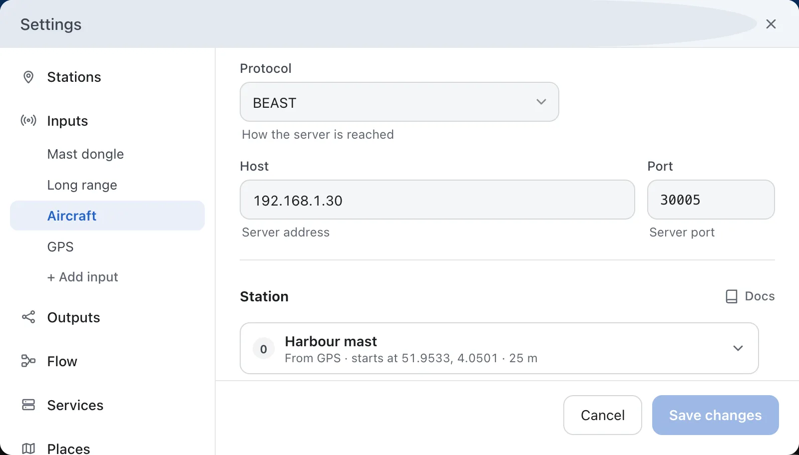

---
hide:
  - toc
---

# Show Aircraft (ADS-B) on the Map

AIS-catcher can read the aircraft that an ADS-B decoder such as dump1090 or readsb receives, and show them on its map next to the ships.

**You need:** dump1090, readsb or another ADS-B decoder, on this computer or on your network. AIS-catcher does not receive 1090 MHz itself, so the decoder needs a receiver of its own.

!!! tip "On the same computer?"
    If the ADS-B decoder runs on the same computer as AIS-catcher, use the address `127.0.0.1`.

<div class="stepper" data-eyebrow="Guide" markdown>

<div class="stepper-step" markdown>

## Find the feed

The ADS-B decoder sends what it receives on network ports. AIS-catcher reads three of its formats:

| Format | Usual port | What it sends |
|--------|------------|---------------|
| Beast | 30005 | Each message in binary, with its signal level. |
| Raw | 30002 | Each message as a line of hex, such as `*8D4840D6202CC371C32CE0576098;`. |
| BaseStation (SBS) | 30003 | Lines of text with the message decoded, the position included. |

Use Beast where you can: the aircraft's card then also shows the signal level.

If the decoder runs on another computer, its port must be open to the network.

</div>

<div class="stepper-step" markdown>

## Add a network input

=== "Managed mode"

    1. In the dashboard, open **Settings**, choose **Inputs** and press **+ Add input**.
    2. As **Device Type**, choose **Network client (RTL-TCP, TCP, MQTT)**.
    3. As **Protocol**, choose the format of the feed: **BEAST** for port 30005, **RAW1090** for 30002, **BASESTATION** for 30003.
    4. Enter the **Host** and **Port** of the ADS-B decoder. Give the input a **Name**, such as *Aircraft*.
    5. Press **Save changes**. If the receiver is stopped, press **Start** in the control bar.

    

=== "Config file"

    Add an entry to the `receiver` list, next to the receiver your ships come from:

    ```json
    {
      "config": "aiscatcher",
      "version": 1,
      "receiver": [
        { "input": "rtlsdr", "serial": "00000001", "description": "Mast dongle" },
        { "input": "rtltcp", "rtltcp": { "protocol": "beast", "host": "192.168.1.30", "port": 30005 }, "description": "Aircraft" }
      ],
      "server": [
        { "port": 8100 }
      ]
    }
    ```

    | Key | What it does |
    |-----|--------------|
    | `input` | `rtltcp`: a network client, the input that also reads RTL-TCP and NMEA over TCP. |
    | `protocol` | The format of the feed: `beast` for port 30005, `raw1090` for 30002, `basestation` for 30003. |
    | `host`, `port` | Where the ADS-B decoder sends it. |
    | `description` | The input's name in the statistics. |
    | `server` | The [web viewer](../configuration/output/web-viewer.md), whose map shows the aircraft. |

    Then restart AIS-catcher with the file:

    ```bash
    AIS-catcher -C config.json
    ```

=== "Command line"

    Add `-t` with the format, the address and the port of the feed to the command you already use:

    ```bash
    AIS-catcher -d 00000001 -t beast 192.168.1.30 30005 -N 8100
    ```

    The format is `beast` for port 30005, `raw1090` for 30002 or `basestation` for 30003. `-N 8100` starts the [web viewer](../configuration/output/web-viewer.md), whose map shows the aircraft.

    With `-t` in the command, AIS-catcher no longer picks a dongle by itself. Keep AIS coming in with `-d` and the serial number of your dongle. `AIS-catcher -l` lists the dongles that are connected, with their serial numbers.

    !!! tip "From the command line to a configuration file"
        Add `-J` to print your command line as a configuration file instead of running it: `AIS-catcher -t beast 192.168.1.30 30005 -J`.

AIS-catcher connects to the feed, and connects again by itself when the decoder restarts.

</div>

<div class="stepper-step" markdown>

## Check it works

=== "Managed mode"

    Open the map of the dashboard.

=== "Config file"

    Open the web viewer, at `http://localhost:8100`{ .address } on the computer that runs AIS-catcher.

=== "Command line"

    Open the web viewer, at `http://localhost:8100`{ .address } on the computer that runs AIS-catcher.

Within a minute, the aircraft appear on the map: orange in flight, grey on the ground. Hover over one for its callsign, altitude and speed. Press it for its card: the **Callsign** and **ICAO** address at the top, **Altitude**, **Speed** and **Heading** under **Flight**, and **Distance**, **Bearing** and **RSSI** under **ADS-B**. **RSSI** is the signal level, which only a Beast feed carries.

**Distance** and **Bearing** are measured from your station, so they need its position: see [Name and Place Your Station](../managed/station.md).

The **Aircraft** overlay is on from the start. To switch it off or on again, press the layers button on the map (**Map layers and styling**) and tick **Aircraft** under **Overlays**.

=== "Managed mode"

    !!! question "No aircraft on the map?"
        - Open **Settings → Inputs**. A mark next to the input means it needs attention: hover over it to see why. **Not connected: trying again.** means that nothing answers at that address and port.
        - Check that the **Protocol** matches the port. A Beast port read as **RAW1090** gives no aircraft.

=== "Config file"

    !!! question "No aircraft on the map?"
        - AIS-catcher's log says when it is not connected to the feed. Check the `host` and the `port`, and that the decoder runs.
        - Check that the `protocol` matches the port. A Beast port read as `raw1090` gives no aircraft.

=== "Command line"

    !!! question "No aircraft on the map?"
        - AIS-catcher's log says when it is not connected to the feed. Check the address and the port after `-t`, and that the decoder runs.
        - Check that the format after `-t` matches the port. A Beast port read as `raw1090` gives no aircraft.

</div>

</div>

## More

=== "Managed mode"

    - **Aircraft in the API:** under **Settings → Services → Main**, switch **API** on. See [Ask Your Station, the API](../managed/api.md).

=== "Config file"

    - **Aircraft in the API:** add `"api": true` to the `server` entry. See [Ask Your Station, the API](../managed/api.md).

=== "Command line"

    - **Aircraft in the API:** add `api on` after the port of `-N`. See [Ask Your Station, the API](../managed/api.md).

- **What the API gives:** `/api/v1/aircraft` lists the aircraft heard lately, newest first. `/api/v1/aircraft/` with an ICAO address, such as `/api/v1/aircraft/4840D6`, gives one. An AI assistant reads them with `list_aircraft` and `get_aircraft`: see [Let an AI Assistant Read Your Station](../managed/assistant.md).
- **How long they stay:** an aircraft leaves the map a minute after its last message, or five minutes after it when it is on the ground.
- **Colours:** **Aircraft Color**, under **Ship Outline** in the settings of the map, colours the aircraft by their altitude.
- **Several stations:** a map server that shows only some of your stations shows no aircraft, because aircraft are not kept by station.

Every setting of the network input is in the [TCP client reference](../configuration/input/tcp.md).
