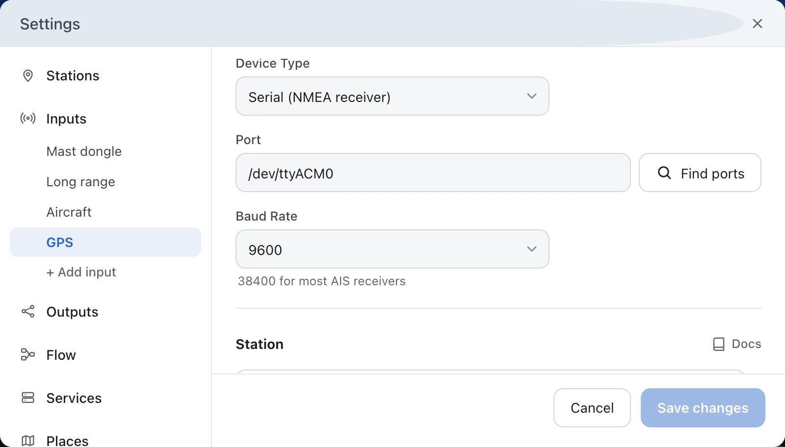
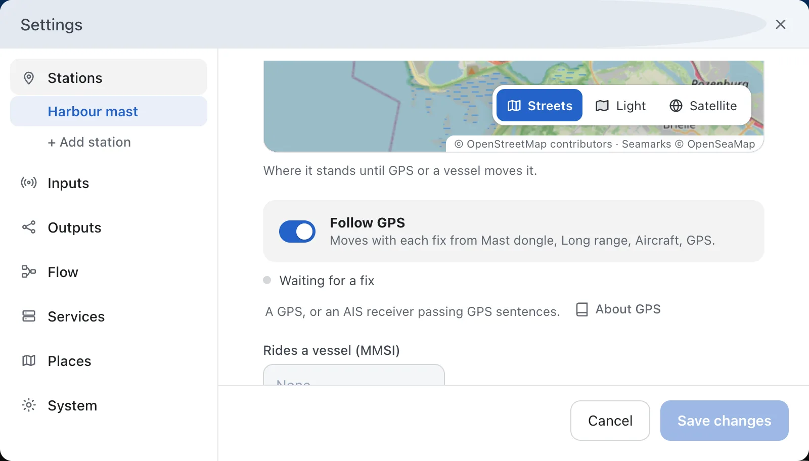

---
hide:
  - toc
---

# Location from GPS

On a boat or in a vehicle, a GPS moves the station with the antenna. Every ship's distance and bearing is then measured from where the antenna is now.

**You need:** a station set up as in [Name and Place Your Station](../managed/station.md), and a GPS: one on a USB or serial port, one that gpsd reads, or an AIS receiver that passes GPS sentences along with the AIS.

<div class="stepper" data-eyebrow="Guide" markdown>

<div class="stepper-step" markdown>

## Connect the GPS

AIS-catcher reads the position from the `GGA`, `RMC` and `GLL` sentences of any satellite system, such as `$GPRMC` or `$GNRMC`. A sentence counts only while the GPS has a fix.

With an AIS receiver that passes GPS sentences, or a boat's NMEA network that carries AIS and GPS together, the GPS needs no input of its own: its sentences come in on the input you have. Go to the next step.

=== "Managed mode"

    1. In the dashboard, open **Settings**, choose **Inputs** and press **+ Add input**.
    2. For a GPS on a USB or serial port, set **Device Type** to **Serial (NMEA receiver)**. Press **Find ports** to pick its **Port**, and set the **Baud Rate** the GPS sends at, often 9600.

        For a GPS that gpsd reads, set **Device Type** to **Network client (RTL-TCP, TCP, MQTT)**. Set **Protocol** to **GPSD**, **Host** to `localhost` and **Port** to `2947`.

    3. Give the input a **Name**, such as *GPS*. Under **Station**, choose the station the GPS is on. With one station, leave it as it is.
    4. Press **Save changes**.

    

=== "Config file"

    Add an entry for the GPS to the `receiver` list:

    ```json
    {
      "config": "aiscatcher",
      "version": 1,
      "receiver": [
        { "input": "rtlsdr", "description": "AIS dongle" },
        { "input": "serialport", "serialport": { "baudrate": 9600, "port": "/dev/ttyACM0" }, "description": "GPS" }
      ]
    }
    ```

    For a GPS that gpsd reads, the entry is:

    ```json
    { "input": "rtltcp", "rtltcp": { "protocol": "gpsd", "host": "localhost", "port": 2947 }, "description": "GPS" }
    ```

    | Key | What it does |
    |-----|--------------|
    | `serialport` | The `port` of the GPS and its `baudrate`, often 9600. |
    | `rtltcp` | With `"protocol": "gpsd"`, reads the position from gpsd at `host` and `port`. gpsd listens on port 2947. |
    | `station` | The `id` of the station the GPS is on. With one station, leave it out. |

    On Linux, the paths under `/dev/serial/by-id/` name a GPS by its make and stay the same after a reboot.

=== "Command line"

    Add the GPS as an input to the command you already use. For a GPS on a USB or serial port, `-e` takes the baud rate and the port:

    ```bash
    AIS-catcher -e 9600 /dev/ttyACM0
    ```

    For a GPS that gpsd reads:

    ```bash
    AIS-catcher -t gpsd localhost 2947
    ```

    On Linux, the paths under `/dev/serial/by-id/` name a GPS by its make and stay the same after a reboot.

!!! tip "A GPS at 4800 baud"
    The serial input runs at 9600, 19200, 38400, 57600 or 115200 baud. A GPS at 4800, the old NMEA 0183 speed, goes through gpsd: gpsd reads a GPS at any speed.

</div>

<div class="stepper-step" markdown>

## Let the station follow GPS

The station moves with each fix from the inputs that stand at it. A station that no input stands at moves with a fix from any input.

=== "Managed mode"

    1. Open **Settings**, choose **Stations** and then the station the GPS is on.
    2. Under **Position**, switch **No position** off if it is on. **Latitude** and **Longitude** are where the station stands until the first fix. They may stay empty.
    3. Switch **Follow GPS** on. Its text names the inputs that move the station.
    4. Press **Save changes**.

    

    Leave **Rides a vessel (MMSI)** empty: a station that rides a vessel moves with that ship's reports, not with GPS.

=== "Config file"

    Add `"gps": true` to the station's entry in `stations`:

    ```json
    {
      "config": "aiscatcher",
      "version": 1,
      "stations": [
        { "id": 0, "name": "Sailing yacht", "lat": 52.10, "lon": 4.27, "gps": true }
      ]
    }
    ```

    A station in `stations` stays where it is put unless `gps` is `true`. `lat` and `lon` are where it stands until the first fix: leave both out if you do not know them. Leave out `mmsi`: a station with an `mmsi` moves with that ship's reports, not with GPS.

    A file without a `stations` list follows GPS already, unless its `server` section has `"use_gps": false`.

=== "Command line"

    There is nothing to add: on the command line the station follows GPS, unless the `-N` has `use_gps off`. Its `lat` and `lon` on the `-N` are where it stands until the first fix.

    Leave out `own_mmsi`: with it, the station moves with that ship's reports, not with GPS.

</div>

<div class="stepper-step" markdown>

## Show it on the map

=== "Managed mode"

    Open **Settings → Services → Main**. Under **Shows**, check that **Station locations** is on. On a new installation it is on already.

=== "Config file"

    The station's position stays on this computer until you let it out. Add `"share_loc": true` to the station's entry:

    ```json
    { "id": 0, "name": "Sailing yacht", "lat": 52.10, "lon": 4.27, "gps": true, "share_loc": true }
    ```

=== "Command line"

    The station's position stays on this computer until you let it out. Add `share_loc on` to the `-N`:

    ```bash
    AIS-catcher -N 8100 share_loc on
    ```

</div>

<div class="stepper-step" markdown>

## Save and start

=== "Managed mode"

    Each page applies its changes when you press **Save changes**. If the receiver is stopped, press **Start** in the control bar.

=== "Config file"

    The whole file, with an RTL-SDR for the AIS, a GPS on a USB port and the web viewer:

    ```json
    {
      "config": "aiscatcher",
      "version": 1,
      "stations": [
        { "id": 0, "name": "Sailing yacht", "lat": 52.10, "lon": 4.27, "gps": true, "share_loc": true }
      ],
      "receiver": [
        { "input": "rtlsdr", "description": "AIS dongle" },
        { "input": "serialport", "serialport": { "baudrate": 9600, "port": "/dev/ttyACM0" }, "description": "GPS" }
      ],
      "server": [
        { "port": 8100 }
      ]
    }
    ```

    Restart AIS-catcher with the file:

    ```bash
    AIS-catcher -C config.json
    ```

=== "Command line"

    The whole command line, with an RTL-SDR for the AIS, a GPS on a USB port and the web viewer:

    ```bash
    AIS-catcher -d 00000001 -e 9600 /dev/ttyACM0 -N 8100 station "Sailing yacht" share_loc on
    ```

    Restart AIS-catcher with the new command line.

    !!! tip "From the command line to a configuration file"
        Add `-J` to print your command line as a configuration file instead of running it: `AIS-catcher -e 9600 /dev/ttyACM0 -N 8100 share_loc on -J`.

</div>

<div class="stepper-step" markdown>

## Check it works

=== "Managed mode"

    - Open **Settings → Stations** and the station. Under **Follow GPS**, the line shows the **Last fix** and how long ago it came. Its dot is green while that fix is less than 5 minutes old. Until the first fix, it reads **Waiting for a fix**.
    - The dashboard map shows the station where the GPS puts it.

    !!! question "Waiting for a fix?"
        - Open **Settings → Inputs**. A mark next to the GPS input means it needs attention: hover over it to see why, for example a device that is unplugged.
        - Check that the GPS input's **Station** is this station.
        - A GPS indoors may not get a fix. Put it where it sees the sky.

=== "Config file"

    The map of the [web viewer](../configuration/output/web-viewer.md) shows the station where the GPS puts it.

    !!! question "The station does not move?"
        - AIS-catcher says in its log when it cannot open the GPS's port or reach gpsd.
        - Check that the GPS input stands at this station: its `station` is the station's `id`, or it has no `station` and the station's `id` is `0`.
        - A GPS indoors may not get a fix. Put it where it sees the sky.

=== "Command line"

    The map of the [web viewer](../configuration/output/web-viewer.md) shows the station where the GPS puts it.

    !!! question "The station does not move?"
        - AIS-catcher says in its log when it cannot open the GPS's port or reach gpsd.
        - A GPS indoors may not get a fix. Put it where it sees the sky.

On the map, the station's marker has a blue edge while a GPS fix places it. Right-click the marker and choose **Follow station** to keep the map centred on it.

A GPS that also sends satellite sentences (`GSV`) fills **GNSS Sky** and **Satellite Signals** on the **Plots** tab. gpsd passes the position only.

</div>

</div>

## More

=== "Managed mode"

    - **No GPS on board:** the station can ride the boat's own AIS transponder instead. Fill in its MMSI under **Rides a vessel (MMSI)**: see [A station that moves](../managed/station.md#a-station-that-moves).
    - **GPS on the outputs:** the UDP and TCP outputs pass the GPS sentences on with the AIS, so a chart plotter fed by AIS-catcher gets the position too. The dashboard has no switch to leave them out of an output. The community map never gets them.

=== "Config file"

    - **No GPS on board:** the station can ride the boat's own AIS transponder instead. Give its entry the `mmsi` of the boat: see [A station that moves](../managed/station.md#a-station-that-moves).
    - **GPS on the outputs:** the UDP and TCP outputs pass the GPS sentences on with the AIS, so a chart plotter fed by AIS-catcher gets the position too. To leave them out of an output, add `"filter": true, "gps": false` to its entry: see [Message Filtering](../configuration/output/message-filtering.md). The community map never gets them.

=== "Command line"

    - **No GPS on board:** the station can ride the boat's own AIS transponder instead. Add `own_mmsi` with the boat's MMSI to the `-N`: see [A station that moves](../managed/station.md#a-station-that-moves).
    - **GPS on the outputs:** the UDP and TCP outputs pass the GPS sentences on with the AIS, so a chart plotter fed by AIS-catcher gets the position too. To leave them out of an output, add `filter on gps off` after it, for example `-u 192.168.1.20 10110 filter on gps off`: see [Message Filtering](../configuration/output/message-filtering.md). The community map never gets them.
