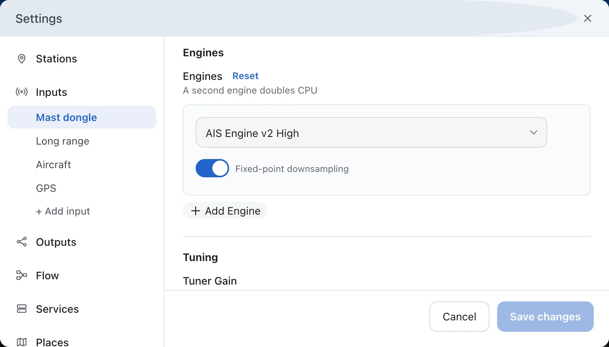
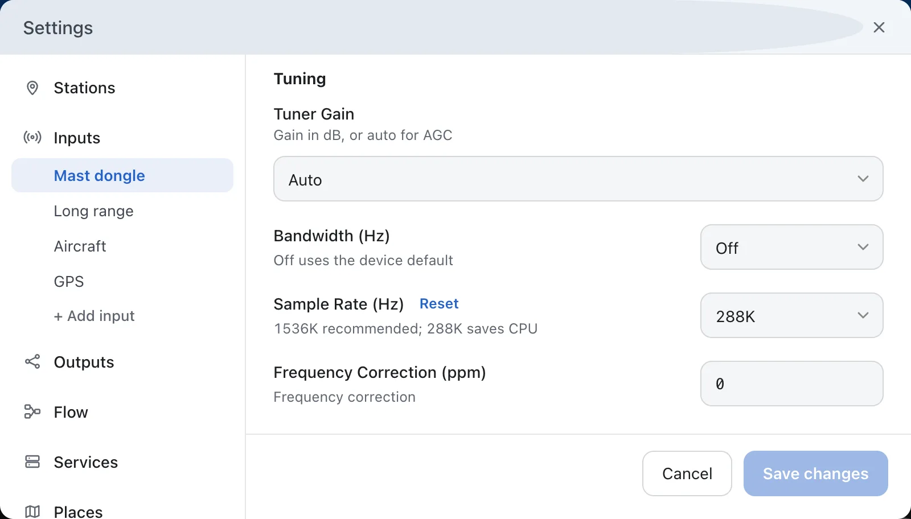

---
hide:
  - toc
---

# Small Computers

A Raspberry Pi Zero or another small computer can run AIS-catcher, but with an RTL-SDR most of its CPU goes to the radio's samples. These steps lower the load, the ones that cost the least reception first.

**You need:** AIS-catcher receiving from an RTL-SDR, on the computer whose load you want to lower.

!!! note "The first Pi Zero"
    The pre-built packages do not run on the first Raspberry Pi and the first Pi Zero. On those, install without `-p`, so that the script builds AIS-catcher from source: see [Raspberry Pi and Linux](../installation/ubuntu-debian.md).

<div class="stepper" data-eyebrow="Guide" markdown>

<div class="stepper-step" markdown>

## See what the computer runs

=== "Managed mode"

    1. In the dashboard, open **Settings**, choose **System** and then **Status**. Under **System**, **Processor** ends in *32-bit build* or *64-bit build*. Fixed-point downsampling, below, is for a 32-bit build only.
    2. Choose **Log**. `RTLSDR: buffer overrun.` means the computer does not keep up and samples are lost.

=== "Config file"

    - With the [web viewer](../configuration/output/web-viewer.md) on, open **Statistics**. Under **System**, **Processor** ends in *32-bit build* or *64-bit build*. On Linux, `getconf LONG_BIT` prints `32` or `64` as well. Fixed-point downsampling, below, is for a 32-bit build only.
    - `RTLSDR: buffer overrun.` in the log means the computer does not keep up and samples are lost. For the [service](../usage/service.md), `journalctl -u ais-catcher.service -f` follows the log.

=== "Command line"

    - With the [web viewer](../configuration/output/web-viewer.md) on, open **Statistics**. Under **System**, **Processor** ends in *32-bit build* or *64-bit build*. On Linux, `getconf LONG_BIT` prints `32` or `64` as well. Fixed-point downsampling, below, is for a 32-bit build only.
    - `RTLSDR: buffer overrun.` on the screen means the computer does not keep up and samples are lost.

`top` shows how much of the CPU AIS-catcher takes.

</div>

<div class="stepper-step" markdown>

## Keep one engine v2

Engine v2 is the default since v0.71. It decodes more messages than engine v1 and uses less CPU. A second engine on the same input doubles the CPU.

=== "Managed mode"

    Open **Settings → Inputs** and choose the RTL-SDR. Under **Advanced settings**, keep one engine in **Engines**: **Auto**, **AIS Engine v2 High** or **AIS Engine v2 Base**. Remove any other engine with the bin next to it.

=== "Config file"

    Leave `engines` out of the receiver's entry, or give it one engine of type `v2_high` or `v2_base`.

=== "Command line"

    Leave out `-m`, or use one: `-m 12` for engine v2 High, `-m 11` for engine v2 Base. `-F` selects engine v1: see the next step.

</div>

<div class="stepper-step" markdown>

## Switch on fixed-point downsampling

On a 64-bit build, skip this step: AIS-catcher already downsamples the RTL-SDR's samples at 1536K in whole numbers. On a 32-bit build, this switch does the same, at a small cost in reception. It works at 1536K, the RTL-SDR's default sample rate, and has no effect at other rates.

=== "Managed mode"

    1. Open **Settings → Inputs** and choose the RTL-SDR. Under **Advanced settings**, in **Engines**, choose **AIS Engine v2 High** in place of **Auto**: it is the engine **Auto** runs, and the switch shows for a chosen engine only.
    2. Switch on **Fixed-point downsampling**.

    

=== "Config file"

    Give the receiver's engine the setting `fp_ds`:

    ```json
    {
      "config": "aiscatcher",
      "version": 1,
      "receiver": [
        {
          "input": "rtlsdr",
          "engines": [ { "type": "v2_high", "settings": { "fp_ds": true } } ]
        }
      ]
    }
    ```

=== "Command line"

    Add `-go fp_ds on` after the RTL-SDR's input:

    ```bash
    AIS-catcher -d 00000001 -go fp_ds on
    ```

    `-F` switches fixed-point downsampling on as well, but it also selects engine v1, and it leaves the signal level and the frequency offset (ppm) out of the messages. Use `-go fp_ds on` in its place.

</div>

<div class="stepper-step" markdown>

## Lower the sample rate

If the load is still too high, run the RTL-SDR at 288K in place of 1536K. This lowers the load further, at a larger cost in reception. Fixed-point downsampling has no effect at 288K.

=== "Managed mode"

    Open **Settings → Inputs** and choose the RTL-SDR. Under **Advanced settings**, in **Tuning**, set **Sample Rate (Hz)** to **288K**.

    

=== "Config file"

    Give the receiver's `rtlsdr` section a `sample_rate`:

    ```json
    {
      "config": "aiscatcher",
      "version": 1,
      "receiver": [
        { "input": "rtlsdr", "rtlsdr": { "sample_rate": 288000 } }
      ]
    }
    ```

=== "Command line"

    Add `-s 288K` to the command you already use:

    ```bash
    AIS-catcher -d 00000001 -s 288K
    ```

    !!! tip "From the command line to a configuration file"
        Add `-J` to print your command line as a configuration file instead of running it: `AIS-catcher -d 00000001 -s 288K -J`.

</div>

<div class="stepper-step" markdown>

## Save

=== "Managed mode"

    Press **Save changes**. The receiver restarts by itself with the new settings.

=== "Config file"

    Restart AIS-catcher with the file:

    ```bash
    AIS-catcher -C config.json
    ```

=== "Command line"

    Restart AIS-catcher with the new command line.

</div>

<div class="stepper-step" markdown>

## Check it works

=== "Managed mode"

    - Open **Settings → System → Log**. No new `RTLSDR: buffer overrun.` appears.
    - In the dashboard, open **Statistics** and, under **System**, click the **Device**. **Engine** and **Sample rate** show what the receiver runs now.

=== "Config file"

    - No new `RTLSDR: buffer overrun.` appears in the log.
    - In the web viewer, open **Statistics** and, under **System**, click the **Device**. **Engine** and **Sample rate** show what the receiver runs now.

=== "Command line"

    - No new `RTLSDR: buffer overrun.` appears on the screen.
    - In the web viewer, open **Statistics** and, under **System**, click the **Device**. **Engine** and **Sample rate** show what the receiver runs now.

`top` shows the lower load.

</div>

</div>

## Why whole numbers are faster

An RTL-SDR sends 1536K samples a second, each an I and a Q of 8 bits. Before it decodes, AIS-catcher halves that rate four times, to 96K. In floating point, this takes a large part of a small computer's CPU.

Fixed-point downsampling does the same in whole numbers. In a 32-bit build it packs I and Q into one 32-bit number, so that each addition works on both at once. It drops the lowest bits after each halving: that is the small cost in reception. A 64-bit build always downsamples 1536K in whole numbers, with room to keep every bit, so the switch changes nothing there.
