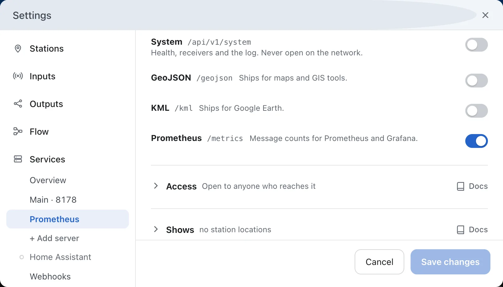

---
hide:
  - toc
---

# Graph Your Station in Grafana

AIS-catcher counts what it receives in the form Prometheus reads. Prometheus keeps the counts over time, and Grafana draws them: messages per channel and per type, the range, and the signal of each ship.

**You need:** AIS-catcher receiving ships, and a computer with [Docker](https://docs.docker.com/engine/install/) to run Prometheus and Grafana. Neither needs an account or a cloud plan.

!!! tip "Not on the station's Raspberry Pi"
    Prometheus writes a lot to disk and Grafana reads it often. Run them on another computer, so the station keeps its processor for decoding. AIS-catcher, Prometheus and Grafana on one computer works too.

<div class="stepper" data-eyebrow="Guide" markdown>

<div class="stepper-step" markdown>

## Serve the counts

Prometheus reads the counts from a server of AIS-catcher, at `/metrics`.

=== "Managed mode"

    Give Prometheus a server of its own:

    1. In the dashboard, open **Settings → Services** and press **+ Add server**.
    2. Give the server a **Name**, such as *Prometheus*, and note its **Port**. Set **Listens on** to **Network**.
    3. Under **Serves**, switch **API** off and **Prometheus** on.
    4. Under **Access**, choose **Open** to let anyone on your network read the counts. To ask for a key instead, keep **Keys** and press **New key**. Name the key, press **Make key** and copy it: it is shown once.
    5. For the longest distance, `ais_stat_distance`, also switch **Station locations** on under **Shows**.
    6. Press **Save changes**.

    

    !!! tip "Prometheus on the same computer?"
        Then Main can serve the counts. Under **Settings → Services → Main**, switch **Prometheus** on under **Serves** and press **Save changes**. Main's port is the one after the dashboard's: 8119 unless you changed it. If the dashboard is open to your network, Main's **Access** asks who may read the counts, as in step 4.

=== "Config file"

    Add `"metrics": true` to the `server` entry of the web viewer, or add an entry:

    ```json
    {
      "config": "aiscatcher",
      "version": 1,
      "server": [
        { "port": 8100, "metrics": true, "share_loc": true }
      ]
    }
    ```

    | Key | What it does |
    |-----|--------------|
    | `port` | The server's port. |
    | `metrics` | Serves the counts at `/metrics`. `prome` is its older name and still works. |
    | `share_loc` | Shows where the station is, and with it the longest distance, `ais_stat_distance`. |

    A `server` entry listens on your network, so Prometheus on another computer reaches it. Restart AIS-catcher with the file:

    ```bash
    AIS-catcher -C config.json
    ```

    !!! tip "The API on the same server?"
        A server with the API and no keys listens on this computer alone: the log says so. Give the counts a server of their own then: `{ "port": 8101, "ui": false, "metrics": true }` beside `{ "port": 8100, "api": true }`.

=== "Command line"

    Add `-N` with a port and `metrics on` to the command you already use. If it has a `-N` already, add `metrics on` after it:

    ```bash
    AIS-catcher -N 8100 metrics on share_loc on
    ```

    `prome on` is the older name of `metrics on` and still works. `share_loc on` shows where the station is, and with it the longest distance, `ais_stat_distance`.

    A `-N` listens on your network, so Prometheus on another computer reaches it.

    !!! tip "The API on the same server?"
        A server with the API and no keys listens on this computer alone: the log says so. Give the counts a server of their own then: `AIS-catcher -N 8100 api on -N 8101 ui off metrics on`.

</div>

<div class="stepper-step" markdown>

## Start Prometheus and Grafana

On the computer for Prometheus and Grafana, make a folder for them:

```bash
mkdir ~/ais-grafana
cd ~/ais-grafana
```

In it, save a file `prometheus.yml` that tells Prometheus where to read. Replace `192.168.1.10:8100` with the address of the computer that runs AIS-catcher and the port of its server:

```yaml
global:
  scrape_interval: 15s

scrape_configs:
  - job_name: ais
    static_configs:
      - targets: ['192.168.1.10:8100']
```

Prometheus reads `/metrics` unless told otherwise. If the server asks for a key, add it to the job. Prometheus sends it as `Authorization: Bearer <key>`, as AIS-catcher expects:

```yaml
scrape_configs:
  - job_name: ais
    static_configs:
      - targets: ['192.168.1.10:8110']
    authorization:
      credentials: '<key>'
```

Save a second file, `docker-compose.yml`, that runs both programs and keeps their data:

```yaml
services:
  prometheus:
    image: prom/prometheus
    restart: unless-stopped
    volumes:
      - ./prometheus.yml:/etc/prometheus/prometheus.yml:ro
      - prometheus-data:/prometheus
    ports:
      - 9090:9090

  grafana:
    image: grafana/grafana-oss
    restart: unless-stopped
    volumes:
      - grafana-data:/var/lib/grafana
    ports:
      - 3000:3000

volumes:
  prometheus-data:
  grafana-data:
```

Start them:

```bash
docker compose up -d
```

After a change to `prometheus.yml`, run `docker compose restart prometheus`.

</div>

<div class="stepper-step" markdown>

## Connect Grafana

1. Open Grafana at port 3000 of that computer, for example `http://192.168.1.20:3000`. Log in as `admin` with the password `admin`. Grafana then asks for a new password.
2. Under **Connections → Data sources**, add a data source of the type **Prometheus**. As its server URL, enter `http://prometheus:9090` and press **Save & test**.
3. Under **Dashboards**, choose **New → Import**. Enter `18417`, the Grafana dashboard for AIS-catcher on grafana.com, and press **Load**. Pick the Prometheus data source and press **Import**.

The Grafana dashboard shows the messages per channel and per type, the longest distance, and the frequency offset and signal level of the ships. Change it or add panels as you like.

</div>

<div class="stepper-step" markdown>

## Check it works

First check that AIS-catcher serves the counts:

=== "Managed mode"

    At the top of the server's page, press **Try the API**. Pick the **Endpoint** `/metrics` and press **Send**. For a server with keys, paste the key under **Key** first. The answer lists the counts, starting with `ais_stat_count`.

=== "Config file"

    On the computer that runs AIS-catcher, ask for the counts from a terminal:

    ```console
    curl http://127.0.0.1:8100/metrics
    ```

    The answer lists the counts, starting with `ais_stat_count`. For a server with keys, add `-H "Authorization: Bearer $KEY"`.

=== "Command line"

    On the computer that runs AIS-catcher, ask for the counts from a terminal:

    ```console
    curl http://127.0.0.1:8100/metrics
    ```

    The answer lists the counts, starting with `ais_stat_count`. For a server with keys, add `-H "Authorization: Bearer $KEY"`.

Then open the list of targets in Prometheus, at port 9090 of its computer: for example `http://192.168.1.20:9090/targets`. The job `ais` is **UP**. In Grafana, the graphs fill in within a few minutes.

The rows per ship, `ais_msg_ppm` and `ais_msg_level`, start after the first read: AIS-catcher keeps them only once something reads `/metrics`.

!!! question "The target is not UP?"
    - **Connection refused:** the server listens on its own computer alone, or a firewall blocks the port. Make sure the server listens on your network.
    - **401 Unauthorized:** the server asks for a key. Add `authorization` to the job in `prometheus.yml`.
    - **No distance in Grafana:** the server does not show where the station is. See step 1.

</div>

</div>

## What AIS-catcher counts

The counts start at zero when AIS-catcher starts, and when the settings of their server change. Prometheus sees the restart, so graphs of the rate carry on.

| Metric | What it counts |
|--------|----------------|
| `ais_stat_count` | Messages received. |
| `ais_stat_count_channel_A` to `ais_stat_count_channel_D` | Messages per channel. |
| `ais_stat_count_type_1` to `ais_stat_count_type_28` | Messages per message type. |
| `ais_stat_distance` | The longest distance to a ship, in nautical miles. Only on a server that shows where its stations are. |
| `ais_msg_ppm`, `ais_msg_level` | For each ship heard in the last five minutes, per channel: the frequency offset in ppm and the signal level in dB. Labelled with `mmsi`, `type`, `station_id`, `speed`, `shipclass` and `channel`. |
| `ais_stat_samples_dropped` | Messages left out of `ais_msg_ppm` and `ais_msg_level`, when more than 768 ships are heard within five minutes. |
| `ais_input_*`, `ais_output_*` | Per input and per output: messages, bytes and connections, the errors of an input and the drops of an output. |

Each input and output row is labelled with its number, its type and its name. The [web viewer reference](../configuration/output/web-viewer.md#sending-data-to-prometheus-for-use-in-grafana-dashboards) lists every one.
