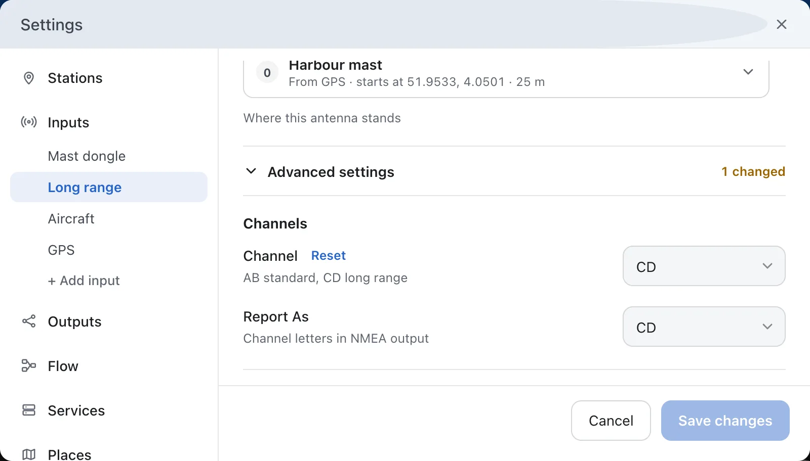

# Long Range AIS

Beside channels A and B, AIS has two channels for long-range reception, meant for satellites. AIS-catcher can listen on them with a receiver of its own.

## Type 27 messages

Far out at sea, ships send a short position report, message type 27, for satellites to pick up. It holds the ship's MMSI, its position, speed and course, and its navigational status, in less detail than a normal position report:

- the position to a tenth of a minute, about 185 m;
- the speed in whole knots and the course in whole degrees;
- no time stamp: the receiver adds the time it heard the message.

Class A ships send it, and Class B ships with the "SO" kind of transponder. Within reach of an AIS base station they normally do not.

## Channels C and D

Two channels are set aside for type 27: marine VHF channels 75 and 76, at 156.775 and 156.825 MHz. AIS-catcher calls them C and D, after A and B at 161.975 and 162.025 MHz.

A receiver listens on one pair. For A and B it tunes to 162.000 MHz, between the two; for C and D to 156.800 MHz. The decoding is the same. To hear both pairs, use two receivers.

The choice of pair is for the receivers AIS-catcher decodes itself: a radio such as an RTL-SDR, or samples over the network from RTL-TCP or SpyServer. A receiver that decodes on its own board, such as a dAISy-catcher, sends NMEA with the channel it heard, and the choice changes nothing.

## Listen on C and D

=== "Managed mode"

    1. In the dashboard, open **Settings → Inputs** and pick the receiver.
    2. Open **Advanced settings**. Under **Channels**, set **Channel** to **CD**.
    3. Press **Save changes**. The receiver restarts on the new frequency.

    

=== "Config file"

    Add `"channel": "CD"` to the receiver. Here the first dongle listens on A and B, the second on C and D:

    ```json
    {
      "config": "aiscatcher",
      "version": 1,
      "receiver": [
        { "input": "rtlsdr", "serial": "00000001", "description": "Mast" },
        { "input": "rtlsdr", "serial": "00000002", "description": "Long range", "channel": "CD" }
      ]
    }
    ```

    `"AB"`, the default, is channels A and B.

=== "Command line"

    Add `-c CD` after the receiver it is for. Here the first dongle listens on A and B, the second on C and D:

    ```bash
    AIS-catcher -d 00000001 -d 00000002 -c CD
    ```

    `-c AB`, the default, is channels A and B.

## Channel letters in the NMEA

The NMEA lines that AIS-catcher sends on name the channel of each message: C or D for these. Some programs take only A and B. For those, report them as A and B:

=== "Managed mode"

    Under **Channels**, set **Report As** to **AB**. The list appears once **Channel** is **CD**.

=== "Config file"

    Add `"nmea_channel": "AB"` beside `"channel": "CD"`.

=== "Command line"

    Give the letters after the channels: `-c CD AB`.

The statistics then count these messages under A and B too.

## What to expect

- **Few messages.** Ships send type 27 far less often than their normal position reports, and near a coast with AIS base stations most send none.
- **Where they show:** the viewer's **Statistics** counts them under **Long range**, and per channel under **Channel C** and **Channel D**. In the dashboard, the **C** and **D** lights of the control bar flash as they arrive.
- **A rough position.** AIS-catcher moves a ship to a type 27 position only when it has had no better one for a while: ten minutes, or less for a ship under way. The viewer then writes the ship's latitude and longitude in italics, and the [API](../api/reference.md) marks the vessel `approximate`.

The idea came from a [thread on the ShipPlotter forum](https://groups.io/g/shipplotter/topic/ais_type_27_long_range/92150532).

## Ships beyond the horizon on A and B

Ships that appear from hundreds of kilometres away on channels A and B are another matter. The weather can bend VHF signals along the earth's surface, called ducting, and that needs no setting. The map's **Atmospheric Ducting** overlay shows where it is likely. See [What is AIS?](../ais-basics.md).

## One channel only

`-c X`, or `"channel": "X"` in a receiver, decodes a single channel at the centre of the input, at a sample rate of 12 to 192 kHz. It is for a stream that holds one channel already, as in [GNU Radio](GNUradio.md), not for a radio. The dashboard does not offer it.
