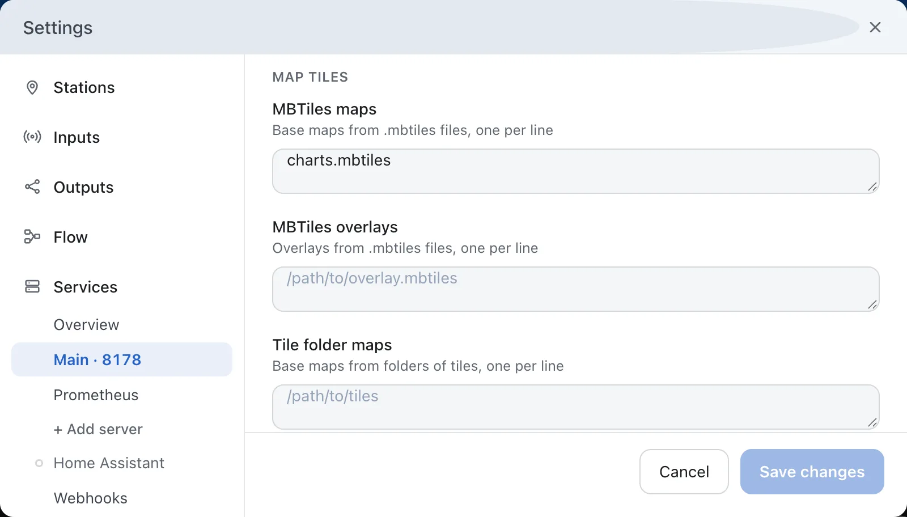

# Offline Web Viewer

The web viewer works without an internet connection, on a boat at sea or on a network of its own. Only the map underneath the ships comes from the internet, and for that AIS-catcher can serve maps from files of your own.

## What works offline

Everything the viewer is made of is built into AIS-catcher: its pages, scripts and styles, the icons and the flags. Nothing is fetched from elsewhere to draw it. The ships on the map, their cards, the ship list, the statistics and the plots all work without internet. So does the dashboard.

Older versions loaded their libraries from the internet, and had a `cdn` setting for a local copy. That setting has no effect now, and the log says it can go.

## What needs the internet

- **The maps and charts the viewer offers:** **OpenStreetMap**, the AIS-catcher and OpenFreeMap maps, **Satellite**, **OpenSeaMap** and the national charts. Without internet, the ships show on an empty background.
- **The weather overlays:** **RainViewer Radar** and **Atmospheric Ducting**.
- **Links to other sites:** a ship's page on aiscatcher.org or VesselFinder, the community map, and these docs.
- **The maps in the dashboard** where you place a station or draw a place. Maps of your own do not reach them.

## Maps of your own

AIS-catcher serves map tiles from files on its own computer, in two forms:

- **An MBTiles file:** one file that holds the tiles, as many map tools export them.
- **A folder of tiles:** one picture per tile, in folders by zoom level and column, `zoom/x/y.png`, numbered as OpenStreetMap numbers them.

Each can be a base map or an overlay on top of the base map. The tiles must be pictures, PNG or JPEG: the viewer does not draw vector tiles. MBTiles takes SQLite, which the standard builds include.

=== "Managed mode"

    1. Copy the file or the folder into the folder of the configuration file: `/etc/AIS-catcher` on a Raspberry Pi or Linux install. The dashboard takes no path outside it.
    2. In the dashboard, open **Settings → Services → Main** and open **Map page**.
    3. Under **Map tiles**, enter the full path in **MBTiles maps**, **MBTiles overlays**, **Tile folder maps** or **Tile folder overlays**, one per line.
    4. Press **Save changes**.

    

    The dashboard's map is Main's, so it shows them too. Another server that serves the map has the same settings under its own **Map page**.

=== "Config file"

    Add the files to the `server` entry of the web viewer:

    ```json
    {
      "config": "aiscatcher",
      "version": 1,
      "server": [
        { "port": 8100, "mbtiles": "/home/pi/maps/europe.mbtiles", "fsoverlay": "/home/pi/maps/seamarks" }
      ]
    }
    ```

    | Key | What it does |
    |-----|--------------|
    | `mbtiles` | MBTiles files as base maps. |
    | `mboverlay` | MBTiles files as overlays. |
    | `fstiles` | Folders of tiles as base maps. |
    | `fsoverlay` | Folders of tiles as overlays. |

    Each takes one path, a list of paths, or paths separated by commas. Restart AIS-catcher with the file:

    ```bash
    AIS-catcher -C config.json
    ```

=== "Command line"

    Add the settings after the `-N` of the web viewer:

    ```bash
    AIS-catcher -N 8100 mbtiles /home/pi/maps/europe.mbtiles mboverlay /home/pi/maps/seamarks.mbtiles
    ```

    `fstiles` and `fsoverlay` take a folder of tiles in the same way. To give several, separate them with commas.

A file or folder that does not open is named in the log, as `Failed to load MBTiles from:` or `Failed to load FileSystemTiles from:` with its path.

## Choose the map in the viewer

Open the map's settings. A map of your own is listed under the name stored in the MBTiles file, or under the name of its folder. Pick it as the **Day map** or the **Night map**. An overlay of your own appears under **Overlays**, beside the ones the viewer offers.
