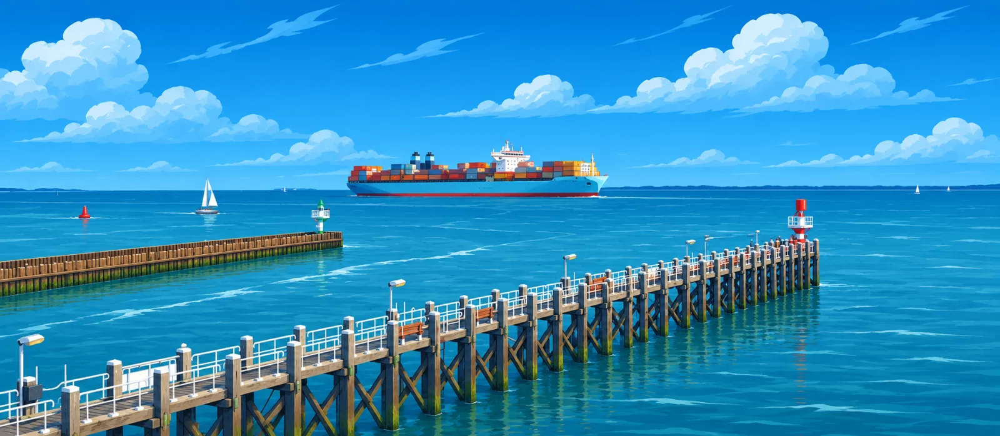
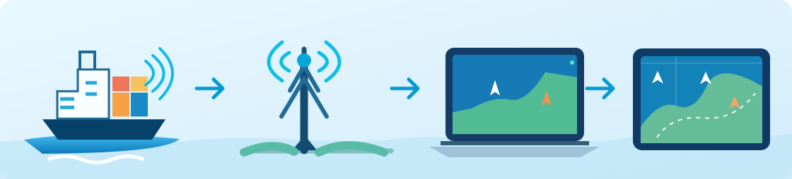

<header class="ais-hero">
  

    <h1>What is AIS?</h1>
    
Ships broadcast who they are, where they are and where they are heading. With an antenna and a receiver, AIS-catcher lets you listen in and see the traffic around you.

    

      <a class="ais-action ais-action--blue" href="../getting-started/overview/">Start receiving</a>
      <a class="ais-action ais-action--soft" href="../what-you-need/">What you need</a>
    

  

  

</header>

<section class="ais-minute" aria-label="AIS in one minute">
  
<svg aria-hidden="true"><use href="../assets/ais-home-icons.svg#signal"></use></svg><strong>AIS in one minute</strong>

  
The <strong>Automatic Identification System</strong> is the radio system ships use to say who and where they are. Every commercial vessel, and many leisure craft, carries a transponder that keeps sending short reports on the marine VHF band. Anyone nearby with a receiver can pick them up, without an internet connection.

</section>

<section class="ais-panel ais-panel--flow" aria-labelledby="how-it-works">
  

    <h2 id="how-it-works">From ship to live map.</h2>
    
AIS-catcher turns the radio messages your antenna picks up into ships on a map.

  

  
  <ol class="ais-steps">
    <li><b>1</b><strong>Ships broadcast</strong>Short reports on marine VHF, around 162 MHz</li>
    <li><b>2</b><strong>Your antenna hears</strong>Best high and outside, with a view of the water</li>
    <li><b>3</b><strong>AIS-catcher decodes</strong>From an SDR dongle or a dAISy-catcher, both channels at once</li>
    <li><b>4</b><strong>You see the ships</strong>On your own map, or passed on to a chart plotter and your own tools</li>
  </ol>
</section>

  <section class="ais-panel" aria-labelledby="what-a-ship-tells-you">
    
<h2 id="what-a-ship-tells-you">More than a position.</h2>
Every message carries the ship's MMSI, a nine-digit number. The rest comes in three kinds of report.

    <ul class="ais-rows">
      <li><svg aria-hidden="true"><use href="../assets/ais-home-icons.svg#map"></use></svg>
<strong>Where is the ship?</strong>Position, speed and course over ground, heading, rate of turn<small>Every 2 s to 3 min, by class and speed</small>
</li>
      <li><svg aria-hidden="true"><use href="../assets/ais-home-icons.svg#ship"></use></svg>
<strong>Which vessel is it?</strong>Name, call sign, ship type and dimensions<small>Every 6 min</small>
</li>
      <li><svg aria-hidden="true"><use href="../assets/ais-home-icons.svg#globe"></use></svg>
<strong>Where is it going?</strong>Destination, ETA, draught and navigational status<small>Every 6 min</small>
</li>
    </ul>
    
That is why a ship often shows on the map before its name does: the name comes in the static report, sent only every six minutes.

  </section>
  <section class="ais-panel" aria-labelledby="quick-facts">
    
<h2 id="quick-facts">Four quick facts.</h2>

    

      
<strong>162 MHz</strong>The marine VHF band

      
<strong>2 channels</strong>AIS 1 and AIS 2, shared by every ship

      
<strong>Receive-only</strong>AIS-catcher never transmits

      
<strong>Line of sight</strong>Antenna height sets the range

    

    
<strong>No internet needed to receive.</strong> AIS-catcher decodes on your own computer. The internet is only for installing it and for sharing with the community map.

  </section>

<section class="ais-deep" aria-labelledby="go-deeper">
  
<h2 id="go-deeper">Want to go deeper?</h2>
None of this is needed before you install.

  

    
<svg aria-hidden="true"><use href="../assets/ais-home-icons.svg#eye"></use></svg>How far will you receive?

    

      
VHF signals travel in essentially straight lines, so the curve of the earth sets a hard limit on range: the <strong>radio horizon</strong>. How far away it lies depends on the height of both antennas.

      <figure class="horizon-figure">
        <svg viewBox="0 0 640 200" role="img" aria-label="Diagram of the radio horizon between a shore antenna and a ship over the curved sea">
          <path d="M0,150 Q320,95 640,150 L640,200 L0,200 Z" fill="#dbe9f8"/>
          <path d="M0,150 Q320,95 640,150" fill="none" stroke="#9fb8d4" stroke-width="2"/>
          <line x1="70" y1="139" x2="70" y2="70" stroke="#42566e" stroke-width="3"/>
          <line x1="58" y1="82" x2="82" y2="82" stroke="#42566e" stroke-width="2"/>
          <line x1="61" y1="93" x2="79" y2="93" stroke="#42566e" stroke-width="2"/>
          <circle cx="70" cy="66" r="4" fill="#1976d2"/>
          <text x="90" y="105" fill="#42566e" font-size="14">h&#8321;</text>
          <path d="M545,139 L595,139 L585,128 L555,128 Z" fill="#42566e"/>
          <line x1="570" y1="128" x2="570" y2="103" stroke="#42566e" stroke-width="2.5"/>
          <circle cx="570" cy="100" r="3.5" fill="#1976d2"/>
          <text x="540" y="118" fill="#42566e" font-size="14" text-anchor="end">h&#8322;</text>
          <line x1="70" y1="66" x2="570" y2="100" stroke="#1976d2" stroke-width="2" stroke-dasharray="7 5"/>
          <text x="320" y="70" fill="#1976d2" font-size="13" text-anchor="middle">line of sight</text>
        </svg>
        <figcaption>d &#8776; 4.12 &#183; (&#8730;h&#8321; + &#8730;h&#8322;) &#8201;km, with the antenna heights h&#8321; and h&#8322; in metres</figcaption>
      </figure>
      
For a large ship with its antenna around 15 m above the water, your antenna height gives roughly this range:

      

        Window sill, 2 m<strong>22 km</strong>
        Rooftop, 5 m<strong>25 km</strong>
        Mast on the roof, 10 m<strong>29 km</strong>
        Apartment block, 20 m<strong>34 km</strong>
        Hill or tower, 50 m<strong>45 km</strong>
      

      
<strong>Height beats everything.</strong> Raising the antenna does more for your range than any amplifier or better receiver: a clear view of the water matters more than gain.

      
<strong>Ranges beyond the horizon do occur.</strong> In some weather VHF signals bend along the earth's surface (ducting), and ships hundreds of kilometres away show up for a while. See <a href="../advanced/long-range/">Long Range AIS</a>.

    

  

  

    
<svg aria-hidden="true"><use href="../assets/ais-home-icons.svg#link"></use></svg>Antenna and cable

    

      
Any antenna tuned for the marine VHF band works. A simple quarter-wave whip or a dedicated AIS antenna does better than the telescopic antenna that comes with most SDR dongles. What is often overlooked is the cable: coax loses signal quickly at 162 MHz, and every 3 dB of loss halves the power that reaches the receiver.

      <table>
        <thead><tr><th>Cable</th><th>Loss per 10 m at about 160 MHz</th></tr></thead>
        <tbody><tr><td>RG-58</td><td>2.0 dB</td></tr><tr><td>RG-8X</td><td>1.5 dB</td></tr><tr><td>RG-213</td><td>0.9 dB</td></tr><tr><td>LMR-400</td><td>0.5 dB</td></tr></tbody>
      </table>
      
A long coax run can be avoided altogether: put the receiver, for example a Raspberry Pi with the SDR dongle, next to the antenna and run a network cable to the house instead. A network cable loses no signal. See <a href="../what-you-need/">What You Need</a> for the parts.

    

  

  

    
<svg aria-hidden="true"><use href="../assets/ais-home-icons.svg#layers"></use></svg>Time slots and transponder classes

    

      
AIS is a broadcast system: there are no connections and no acknowledgements. Each vessel sends short messages in time slots on two shared channels. Every minute holds 2,250 slots per channel, and the transponders agree among themselves who uses which slot, a scheme called SOTDMA. A receiver simply listens to both channels and decodes every message it hears.

      <table>
        <thead><tr><th>Class</th><th>Carried by</th><th>Power</th><th>Position reports</th></tr></thead>
        <tbody>
          <tr><td><strong>Class A</strong></td><td>Commercial vessels, required</td><td>12.5 W</td><td>Every 2–10 s under way, every 3 min at anchor</td></tr>
          <tr><td><strong>Class B</strong></td><td>Leisure craft and small vessels, voluntary</td><td>2–5 W</td><td>Every 30 s under way, every 3 min below 2 knots</td></tr>
        </tbody>
      </table>
      
The difference in power is why large ships come in from much further away than small craft.

    

  

  

    
<svg aria-hidden="true"><use href="../assets/ais-home-icons.svg#signal"></use></svg>The radio channels

    

      
AIS sits just above the marine VHF voice channels, around 162 MHz. Each channel carries 9,600 bit/s, with GMSK modulation.

      <table>
        <thead><tr><th>Channel</th><th>Frequency</th><th>Use</th></tr></thead>
        <tbody>
          <tr><td>AIS 1 (channel A)</td><td>161.975 MHz</td><td>Position reports and data, ship to ship and ship to shore</td></tr>
          <tr><td>AIS 2 (channel B)</td><td>162.025 MHz</td><td>Position reports and data, ship to ship and ship to shore</td></tr>
          <tr><td>AIS 3 (channel C)</td><td>156.775 MHz</td><td>Long-range reports for reception by satellite</td></tr>
          <tr><td>AIS 4 (channel D)</td><td>156.825 MHz</td><td>Long-range reports for reception by satellite</td></tr>
        </tbody>
      </table>
      
Channels A and B carry nearly all traffic. They are the two AIS-catcher receives at once by default.

    

  

  

    
<svg aria-hidden="true"><use href="../assets/ais-home-icons.svg#cpu"></use></svg>Why an SDR works as an AIS receiver

    

      
A traditional AIS receiver is dedicated hardware. A software-defined radio does the same job in software: the dongle digitizes a slice of the VHF band, and AIS-catcher demodulates and decodes both AIS channels from it at once. It costs a fraction of dedicated equipment, and the same dongle can receive many other signals.

      
A dAISy-catcher does the radio work on its own board instead. See <a href="../what-you-need/#choose-a-receiver">which receiver</a> for the difference in practice, and <a href="https://wikipedia.org/wiki/Automatic_Identification_System">Wikipedia</a> for the history of AIS.

    

  

</section>

<strong>Receive-only, for hobby and research use.</strong> AIS-catcher is not approved for navigation, safety-of-life use or commercial vessel operations: those need type-approved equipment. <a href="../disclaimer/">Read the disclaimer</a>

<section class="ais-cta" aria-label="Next">
  
<h2>Ready to listen?</h2>
You need an antenna, a receiver and a computer.

  
<a class="ais-action ais-action--primary" href="../getting-started/overview/#install-ais-catcher">Install AIS-catcher</a><a href="../what-you-need/">What you need</a>

</section>

