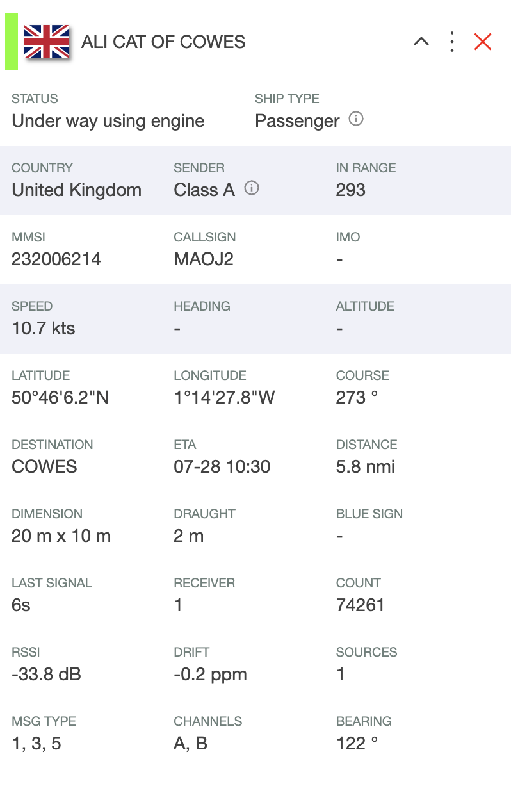

# Web Viewer

<div class="command-container">
      <div class="command-syntax">
        <span class="cmd-name">AIS-catcher</span>
        <span class="cmd-flag">-N</span>
        <span class="cmd-value">port</span> 
        [<span class="cmd-setting">setting</span> <span class="cmd-value">value</span>]
        ...
    </div>
</div>


AIS-catcher includes a simple web interface. A live demo is available for [East Boston, US](https://kx1t.com/ais/). The web interface gratefully uses the following libraries: [chart.js](https://www.chartjs.org/docs/latest/charts/line.html), chart.js [annotation plugin](https://www.chartjs.org/chartjs-plugin-annotation/latest/), [leaflet](https://leafletjs.com/), [Material Design Icons](https://m3.material.io/styles/icons/overview), tabulator, [marked](https://github.com/markedjs/marked) and [flag-icons](https://github.com/lipis/flag-icons). 

Make sure you use the latest version and start the web viewer as follows:
```bash
AIS-catcher -N 8100
```
where ``8100`` is the port number. If your machine network name is raspberrypi, e.g.,  then enter `raspberrypi:8100`{ .address } in your browser.  On the web page, you will find several sections with information related to the station and received messages.

For users wishing to include a station name and a link to an external website in the Statistics section:
```bash
AIS-catcher -N 8100 station Southwood station_link http://example.com
```
This could be a useful option if you want to offer the interface externally. To display the reception range and distances from your station, provide the program with the station coordinates and permission to share the location with the web viewer:
```bash
AIS-catcher -N 8100 lat 50 lon 3.141592 share_loc on
```
The last option `share_loc` (default is off) will allow the web viewer to access and display the location.

 The user can make a page in [markdown format](https://www.markdownguide.org/basic-syntax/). The content will be shown in the About tab of the web viewer:
```bash
AIS-catcher -N 8100 about about.md
```
All these options can be captured in the configuration file (in a section with name ``server``), see below. 

## Menu structure

The main menu behind the hamburger icon in the top left corner navigates between different functional areas. Context-sensitive menus, accessible through right-click, long press on iOS, or the vertical dot icon on the map, offer more functionalities. Here you can set options like activating the "dark mode" theme, displaying the station range on the map, locking/unlocking the map center, toggling text-only ship labels, decluttering ship labels, and viewing details of the last message received from a vessel, amongst others.

## Visualization

When AIS-catcher receives data containing a vessel's dimensions but can not determine the direction it is pointing (heading), it will display a circle that accommodates the ship's dimensions regardless of heading. Missing heading information is common for Class B ships. If there's a decent approximation available for the heading, such as course-over-ground above certain speeds, it will be used. Shapes plotted using this approximation will have a dashed border, indicating incomplete information. An example is the USS Constitution docked in Boston.

<p align="center">
  
</p>

In the map section, clicking on a vessel will open a  **ship card** with details of the vessel. For smaller screens it can be minimized in the top bar (via the `^` symbol or by clicking on the header bar). The ship card will open minimized on mobile devices. In its maximized form, users can choose which rows will be visible in the minimized state. Additional options, such as looking up the vessel on aggregator sites, are available by clicking the three-dot icon on the ship card header.

### Ship card fields

<p align="center">
  
</p>

Most fields on the ship card are self-explanatory and come directly from the vessel's AIS messages. The less obvious ones:

| Field | Meaning |
|---|---|
| **In Range** | Number of other AIS stations the vessel's *own* transponder reports it is currently receiving (from the SOTDMA communication state, ITU-R M.1371). It describes the radio situation around the ship, not how well your station receives it. Only present in some transmissions, so it can be empty or update irregularly. |
| **RSSI** | Signal strength (in dB) of the vessel's last message as measured by your receiver. |
| **Drift** | Estimated frequency offset (ppm) of the last message, useful for calibrating an RTL-SDR dongle. |
| **Distance** / **Bearing** | Position of the vessel relative to your station location. |
| **Receiver** / **Sources** | The receiver (group) that delivered the most recent message, and all receivers that have contributed messages for this vessel — relevant when running multiple receivers or network inputs. |
| **Count** / **last signal** | Number of messages received from this vessel and the time since the most recent one. |
| **Sender** | Type of transmitter (Class A/B vessel, base station, aid-to-navigation, SAR aircraft, etc.), derived from the MMSI and message types. |
| **Destination** / **ETA** | Voyage data as entered by the crew; the ETA is specified in UTC by the AIS standard. |
| **Blue Sign** | Blue sign status for inland (river) vessels. |

Clicking a row on the maximized ship card selects it as the row that remains visible when the card is minimized/collapsed, so you can pick the information that matters most to you for the compact view.

## Validation
The web-interface shows a "validation" indication at the left border of the ship card header.
<p align="center">
  
</p>

AIS-catcher analyzes an enormous stream of bits per day for both AIS channels (2 to the power 33 to be precise). To avoid erroneous messages, the AIS system employs a 16-bit CRC and matching of other bit patterns. Unfortunately, purely statistically this cannot prevent that there will be an occasional technically correct but nonsense message. These are typically easy to recognize (e.g. looking at the signal level, and location on the map) and aggregator sites like MarineTraffic will filter these out. 

To reliably measure the reception range for the station in the web interface, AIS-catcher has implemented a "validation function" that checks the location of the vessel for consistency between messages and flags if there is an inconsistency. Practically speaking, if we receive a position from an MMSI that is relatively close to the last received position, the "validation" indicator will be green and the distance to the station will be included to determine the station range. Please note that messages within 50 NMi from the receiving station will always be included for range setting. The validation indicator will be grey if validation for the location cannot be performed and red if it is not successful. 

## Plots
The Plot section contains several visualizations to assess the performance of the receiver:

<p align="center">
  
</p>
 Restarting AIS-catcher typically erases history in the graphs. To retain plot "state" and backup the information to a file use the following:

```bash
AIS-catcher -N 8100 file stat.bin backup 10
```
This will back up the plots when the program closes and every 10 minutes in a file `stat.bin`. The minimum backup interval is 5 minutes.

## Custom plugins and styles...

To give the user the option to tweak the look-and-feel and functionality of the web viewer and/or modify for example the color scheme or regional preferences, the program provides the option to inject custom plugins (JavaScript) and CSS into the website, with a command like:
```bash
AIS-catcher -N 8100 plugin plugin1.js plugin plugin2.js style mystyle.css
```
You can also include all plugin files from a specific directory using the command:
```bash
AIS-catcher -N 8100 plugin_dir /usr/share/aiscatcher/plugins
```
Files need to have the extension ``.pjs`` and ``.pss`` for respectively JavaScript and CSS style plugins. The repository includes a few example plugins that demonstrate how to add additional maps or cater to regional preferences. Examples of plugins can be found in [another](https://github.com/jvde-github/AIS-Catcher-PLUGINS) GitHub repository.

A plugin runs in the browser of everyone who opens the map: install only plugins you trust.

## Offline web viewer
The web viewer runs without an internet connection out of the box: all web libraries are now bundled into AIS-catcher, so no online content is fetched to render the interface. This facilitates using the web interface whilst traveling.

Offline *maps* can be included in `mbtiles` format:
```bash
AIS-catcher  -N 8100 mbtiles filename
```
or as an overlay
```bash
AIS-catcher  -N 8100 mboverlay filename
```

## Sending data to Prometheus for use in Grafana dashboards

You can add the option `PROME on` to the web configuration command to start rendering Prometheus-compatible statistics at `/metrics`. For example:

```bash
AIS-catcher -N 8100 prome on
```

Next to the station's figures (`ais_stat_*`, `ais_msg_*`), `/metrics` has a row per input and per output, labelled with `input` or `output` (its number), `type` and `description` (the `description` set on it, or a name such as `UDP #1`):

| Metric | Type | Meaning |
|--------|------|---------|
| `ais_input_count` | counter | Messages decoded from the input |
| `ais_input_bytes_in` | counter | Raw bytes received |
| `ais_input_up` | gauge | 1 while the input streams, else 0 |
| `ais_input_last_message_timestamp_seconds` | gauge | Unix time of the last message decoded, 0 before the first |
| `ais_input_errors` | counter | Messages with errors, by `error`: `checksum`, `undersized`, `oversized` |
| `ais_input_connect_ok`, `ais_input_connect_fail`, `ais_input_reconnects` | counter | Connections made, failed and made again, for an input that dials a server (`-t` rtl_tcp or a TCP feed, `-y` SpyServer) |
| `ais_input_connected` | gauge | 1 while such an input is connected |
| `ais_output_count` | counter | Messages passed to the output after its filter |
| `ais_output_bytes_out`, `ais_output_bytes_in` | counter | Bytes sent and received |
| `ais_output_dropped` | counter | Messages the output could not send: no connection, a full queue or a failed send |
| `ais_output_connect_ok`, `ais_output_connect_fail`, `ais_output_reconnects` | counter | Connections made, failed and made again, for an output that holds connections |
| `ais_output_connected` | gauge | Connections the output holds now |

The connection rows appear only for inputs and outputs that hold a connection.

For more information on how to configure Prometheus and Grafana to get an initial dashboard, see [README-grafana.md](../../advanced/grafana.md).

## The API on the same port

The viewer is a server on the station's ships, the same server that offers the [API](../../api/overview.md), MCP, the system service, GeoJSON and Prometheus: each is a switch on `-N`. For example, the map, the API and MCP on port 8100:

```bash
AIS-catcher -N 8100 api on mcp on
```

A second `-N` is a second server on the same ships; `ui off` leaves the map out of one. A `-N` listens on every interface, as the viewer always did, so other machines on the network reach its map. One that serves the API, MCP or the system service stays on this machine instead, and says so in the log, unless it has keys, `public on`, or an `ip_bind` of its own; see [Keys](../../api/overview.md#keys). An entry of `services` in a configuration file listens on this machine unless its `bind` says otherwise.

## The ship list for scripts (API v0)

Next to the map, a server answers the ship list and the statistics as v0.70 did: `/ships.json`, `/api/ships.json`, `/api/ships_full.json` and `/stat.json`. The map does not read them; they are there for the scripts written against them. They are on for a `-N` and a `server` section, as before, and off for an entry of `services` unless it says `"api_v0": true`. `api_v0 off` takes them away from a `-N`. `limited` does not cap them: they answer every ship in full, so on a limited server switch `api_v0` off unless those lists are meant to be read. New scripts are better served by the [API](../../api/overview.md).

## Several stations in one viewer

The receivers of one AIS-catcher stand at stations (`stations` in a configuration file, a receiver's `station`). The viewer shows every station's ships together, with the station that heard each vessel last on its card and in its hover; **Filter → Station** looks through one station alone, and `?stations=3,5` on the viewer's requests, or `/api/v1/vessels?stations=3`, asks the same of the server. Statistics and plots are kept per station: with several stations, the Statistics and Plots tabs get a row of sheets with the station whose figures show at its right end, all stations added up by default. Compare on the Plots tab sets a second station, or all of them, against the one chosen, to set one station, or one decoder, against another. A station on the map opens a card of its own, as on aiscatcher.org: its ships, rate and messages, its position, the last half hour of messages and a day of activity; while the card is open the page looks through that station, and closing it goes back to what was shown before.

A message that names a station itself, as a feed from a hub does in its tag block (`\s:s1001*hh\`), counts at that station when `stations` lists it; otherwise at the input's station. So one input from a hub can serve many stations from one ship table.

A viewer whose filter names stations with `id` is a viewer of those stations: its station list, station cards, figures and plots show them alone, and its ships are the ones its filter lets through (see [A viewer with ships of its own](#a-viewer-with-ships-of-its-own)). Several ids, separated by commas or as a list, show those together. For example, two feeders of a hub, each on a viewer of its own, from one input:

```bash
AIS-catcher -t txt 127.0.0.1 14999 -N 8100 filter on id 1001 -N 8101 filter on id 1351
```

The stations themselves, with their name and position, are described in `stations` in a configuration file; a station that `stations` does not list is shown by its number, without a position, and the log says so. On a `-N` with such a filter, `lat`, `lon`, `share_loc`, `use_gps` and `own_mmsi` are left out with a note, and `station` is the viewer's title. The same two viewers with their stations named and placed:

```json
{
  "config": "aiscatcher", "version": 1,
  "stations": [
    { "id": 1001, "name": "Southwood", "lat": 52.08, "lon": 4.33, "share_loc": true },
    { "id": 1351, "name": "Tyreso", "lat": 59.24, "lon": 18.24, "share_loc": true }
  ],
  "receiver": [ { "input": "rtltcp", "rtltcp": { "protocol": "txt", "host": "127.0.0.1", "port": 14999 } } ],
  "services": [
    { "port": 8100, "filter": "on", "id": [1001] },
    { "port": 8101, "filter": "on", "id": [1351] }
  ]
}
```

`station_id` on a server is refused: the error says to name the stations in the filter's `id`.

## A viewer with ships of its own

A viewer with a message filter switched on (`filter on` with `id`, `allow_type`, `block_mmsi`, `stations` and the other terms an output takes), or that takes only some receivers (`zone`, `groups_in`), keeps a ship table of its own behind that filter, with its own `history` and `track_time`. Its `file` is its own backup: read at start and written as often as the station's `backup` says, and on exit. The places are the station's: every ship table reads the one catalogue, which `places` names on any viewer, this one included. Without a filter, a viewer's `file`, `backup` and `history` are the station's.

## HTTPS

A server stays on plain HTTP unless it is given a certificate you already have, as PEM files without a passphrase:

```json
{ "server": { "port": 8443, "tls": { "cert": "fullchain.pem", "key": "privkey.pem" } } }
```

or on the command line:

```console
AIS-catcher -N 8443 TLS_CERT fullchain.pem TLS_KEY privkey.pem
```

Relative paths are read from the configuration's folder. A renewed certificate is taken within a minute, without a restart. A file that does not load stops the start with the reason: a server never falls back to HTTP. An expired certificate still starts, with a warning in the log.

The service's user must be able to read both files. Let's Encrypt's own folder usually is closed to it, so have a renewal hook copy the files to the configuration's folder.

## Behind a reverse proxy

A viewer treats a request from its own machine as coming from the station's owner, who may see the range figures of a station that does not share its position. A proxy on the same machine looks like that too, so it must say it is a proxy, with `proxy_set_header X-Forwarded-For $remote_addr;` in nginx or the same in another proxy. Without that header everyone who reaches the proxy counts as the owner. One address may hold 32 connections, and a proxy on another machine counts as one address.

## Cross-origin access (CORS)

The data endpoints intended for external consumers send an `Access-Control-Allow-Origin: *` header so that browser-based dashboards and other web pages can fetch them directly without a proxy. The HTML pages and other resources served by the web viewer are deliberately *not* CORS-exposed.

CORS is enabled on:

- `/api/ships.json`, `/ships.json`, `/api/ships_full.json`, `/api/ships_array.json`
- `/api/planes_array.json`
- `/api/binmsgs.json`
- `/api/history_full.json`
- `/api/stat.json`, `/stat.json`
- `/api/path.json`, `/api/allpath.json`
- `/api/message`, `/api/vessel` (per-vessel last message and details)
- `/api/decode` (when `decoder` is enabled)
- `/kml` (when `kml` is enabled)
- `/geojson` and `/allpath.geojson` (when `geojson` is enabled)
- `/metrics` (when `prome` is enabled)

The Content-Security-Policy served by the web viewer also accepts `http`/`ws` schemes in `img-src` and `connect-src` so LAN deployments work without a custom policy.

## Summary Settings

Server Options:

<div class="input-table" markdown>
| Setting (JSON key / CLI setting name) | Type | Default | Description |
|---------|------|---------|-------------|
| <span class="cmd-setting">port</span> | integer | <span class="cmd-value">-</span> | Single port for web server |
| <span class="cmd-setting">port_min</span> | integer | <span class="cmd-value">-</span> | No longer used; a warning says so |
| <span class="cmd-setting">port_max</span> | integer | <span class="cmd-value">-</span> | No longer used; a warning says so |
| <span class="cmd-setting">ip_bind</span> | string | <span class="cmd-value">0.0.0.0</span> | The address the server listens on; every interface unless given, or this machine for a server with the API, MCP or the system service and no keys |
| <span class="cmd-setting">reuse_port</span> | boolean | <span class="cmd-value">false</span> | No longer used; a warning says so |
| <span class="cmd-setting">zlib</span> | boolean | <span class="cmd-value">true</span> | No longer used; a warning says so |
| <span class="cmd-setting">server_mode</span> | boolean | <span class="cmd-value">false</span> | Enable hardened multi-station server mode |
| <span class="cmd-setting">log</span> | boolean | <span class="cmd-value">false</span> | Show the log view in the web viewer |
| <span class="cmd-setting">api_v0</span> | boolean | <span class="cmd-value">true</span> | `/ships.json`, `/stat.json`, `/api/ships.json` and `/api/ships_full.json` as v0.70 served them; off for an entry of `services` unless switched on; `limited` does not cap them; see [The ship list for scripts](#the-ship-list-for-scripts-api-v0) |
| <span class="cmd-setting">frame_ancestors</span> | string | <span class="cmd-value">-</span> | CSP `frame-ancestors` value; set to allow embedding the viewer in an `<iframe>` |
| <span class="cmd-setting">groups_in</span> | integer | <span class="cmd-value">all</span> | Bitmask of input groups feeding the viewer; set, the viewer keeps ships of its own from them |
| <span class="cmd-setting">station_id</span> | integer[] | <span class="cmd-value">-</span> | Refused on a server: the stations a viewer shows are the ones its filter names with `id`; see [Several stations in one viewer](#several-stations-in-one-viewer) |
| <span class="cmd-setting">zone</span> | string | <span class="cmd-value">-</span> | Comma-separated zone tags routed to this viewer; set, the viewer keeps ships of its own from them |
| <span class="cmd-setting">split</span> | boolean | <span class="cmd-value">true</span> | No longer used: every station is in one view, see [Several stations in one viewer](#several-stations-in-one-viewer) |
| | | | |
| Location Settings | | | |
| <span class="cmd-setting">lat</span> | float | <span class="cmd-value">-</span> | Station latitude |
| <span class="cmd-setting">lon</span> | float | <span class="cmd-value">-</span> | Station longitude |
| <span class="cmd-setting">share_loc</span> | boolean | <span class="cmd-value">false</span> | Share station location |
| <span class="cmd-setting">use_gps</span> | boolean | <span class="cmd-value">true</span> | Use GPS data for station location |
| <span class="cmd-setting">own_mmsi</span> | integer | <span class="cmd-value">-</span> | Own vessel MMSI |
| | | | |
| Data Management | | | |
| <span class="cmd-setting">history</span> | integer | <span class="cmd-value">-</span> | History retention (5-43200 sec) |
| <span class="cmd-setting">cutoff</span> | integer | <span class="cmd-value">-</span> | Max Distance threshold (0-10000) | 
| <span class="cmd-setting">backup</span> | integer | <span class="cmd-value">-1</span> | Backup interval (5-2880 min) |
| <span class="cmd-setting">file</span> | string | <span class="cmd-value">-</span> | Statistics file path |
| <span class="cmd-setting">stats_on_close</span> | boolean | <span class="cmd-value">false</span> | No longer used; a warning says so |
| <span class="cmd-setting">realtime</span> | boolean | <span class="cmd-value">false</span> | Enable real-time updates |
| <span class="cmd-setting">decoder</span> | boolean | <span class="cmd-value">false</span> | Enable online NMEA decoder |
| | | | |
| Output Formats | | | |
| <span class="cmd-setting">kml</span> | boolean | <span class="cmd-value">false</span> | Serve the ships as KML at `/kml`, for Google Earth |
| <span class="cmd-setting">geojson</span> | boolean | <span class="cmd-value">false</span> | Serve the ships as GeoJSON at `/geojson` |
| <span class="cmd-setting">prome</span> | boolean | <span class="cmd-value">false</span> | Serve message counts for Prometheus at `/metrics`; `metrics` says the same |
| | | | |
| UI Customization | | | | 
| <span class="cmd-setting">message</span> (alias <span class="cmd-setting">msg</span>) | boolean | <span class="cmd-value">false</span> | Store the latest decoded message per vessel, viewable via the **Show Last Message** item in the vessel's right-click menu |
| <span class="cmd-setting">station</span> | string | <span class="cmd-value">-</span> | Station display name |
| <span class="cmd-setting">station_link</span> | string | <span class="cmd-value">-</span> | Station info URL |
| <span class="cmd-setting">webcontrol_http</span> | string | <span class="cmd-value">-</span> | URL for external web control endpoint |
| <span class="cmd-setting">context</span> | string | <span class="cmd-value">settings</span> | Default web viewer context/tab |
| <span class="cmd-setting">mbtiles</span> | string | <span class="cmd-value">-</span> | Offline map in mbtiles format |
| <span class="cmd-setting">mboverlay</span> | string | <span class="cmd-value">-</span> | Offline overlay in mbtiles format |
| <span class="cmd-setting">fstiles</span> | string | <span class="cmd-value">-</span> | Offline map from filesystem tile directory |
| <span class="cmd-setting">fsoverlay</span> | string | <span class="cmd-value">-</span> | Offline overlay from filesystem tile directory |
| <span class="cmd-setting">plugin</span> | string | <span class="cmd-value">-</span> | JavaScript plugin path |
| <span class="cmd-setting">style</span> | string | <span class="cmd-value">-</span> | CSS style path |
| <span class="cmd-setting">plugin_dir</span> | string | <span class="cmd-value">-</span> | Plugins directory |
| <span class="cmd-setting">about</span> | string | <span class="cmd-value">-</span> | About page path. Markdown, and raw HTML in it is shown as written: use a file you trust |
</div>

In addition to the options above, the web viewer accepts the standard [message-filtering](message-filtering.md) settings (e.g. `FILTER on`, allow/block by message type or channel). These restrict which messages reach this particular viewer.
