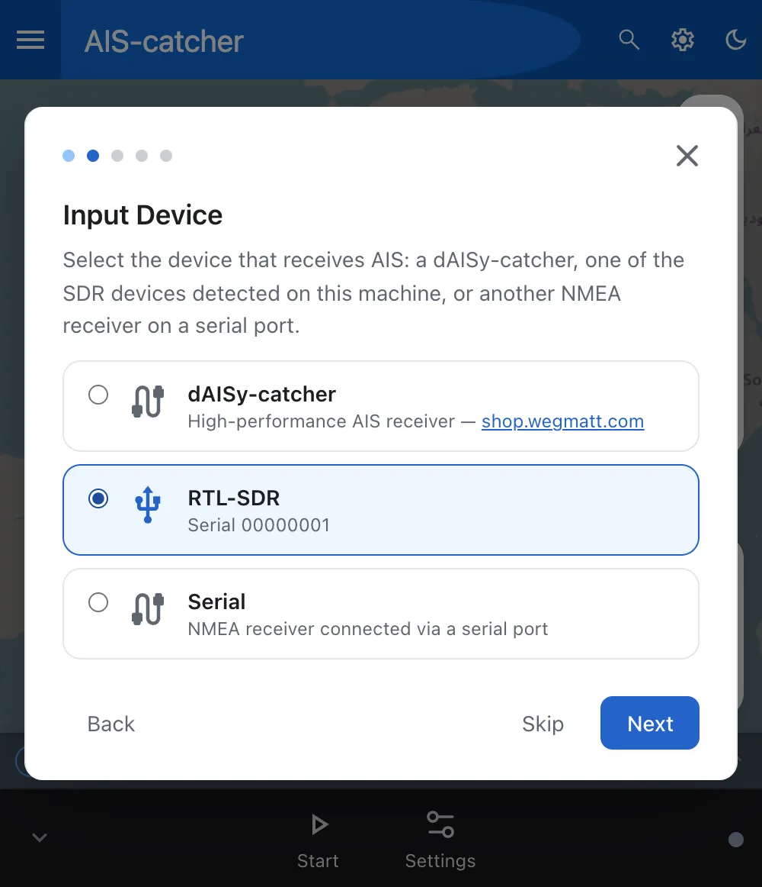
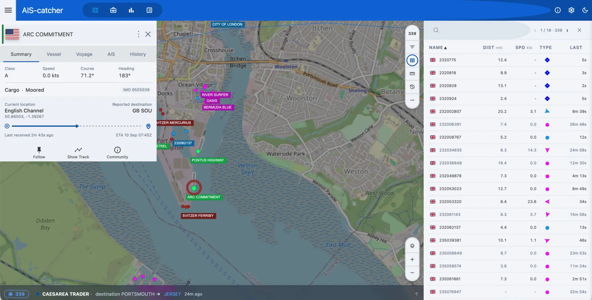

<header class="ais-qs ais-qs-hero">
  <div class="ais-qs-hero__copy">
    <h1>Get your station <span>receiving.</span></h1>
    <p>Install AIS-catcher, connect your receiver and see the first ships on your own map, in four steps.</p>
    <ol class="ais-qs-journey" aria-label="The four steps">
      <li><a href="#install-ais-catcher"><b>1</b>Install</a></li>
      <li><a href="#open-the-dashboard"><b>2</b>Open the dashboard</a></li>
      <li><a href="#run-the-setup-wizard"><b>3</b>Run the setup wizard</a></li>
      <li><a href="#see-your-ships"><b>4</b>See your ships</a></li>
    </ol>
  </div>
  
</header>

<section class="ais-qs ais-qs-kit" id="before-you-start" aria-label="What you need">
  <div class="ais-qs-kit__intro">
    <strong>Have these ready</strong>
    <p>Ships send AIS by radio on 162 MHz. The antenna and receiver pick it up, and AIS-catcher turns it into ships on a map. Connect the antenna to the receiver, and the receiver to the computer.</p>
    <p class="ais-qs-kit__links"><a href="../../what-you-need/">What you need</a><a href="../../ais-basics/">What is AIS?</a></p>
  </div>
  <ul class="ais-qs-kit__items">
    <li><svg xmlns="http://www.w3.org/2000/svg" viewBox="0 0 16 16" aria-hidden="true"><path d="M8 1a1 1 0 0 1 1-1h6a1 1 0 0 1 1 1v14a1 1 0 0 1-1 1H9a1 1 0 0 1-1-1zm1 13.5a.5.5 0 1 0 1 0 .5.5 0 0 0-1 0m2 0a.5.5 0 1 0 1 0 .5.5 0 0 0-1 0M9.5 1a.5.5 0 0 0 0 1h5a.5.5 0 0 0 0-1zM9 3.5a.5.5 0 0 0 .5.5h5a.5.5 0 0 0 0-1h-5a.5.5 0 0 0-.5.5M1.5 2A1.5 1.5 0 0 0 0 3.5v7A1.5 1.5 0 0 0 1.5 12H6v2h-.5a.5.5 0 0 0 0 1H7v-4H1.5a.5.5 0 0 1-.5-.5v-7a.5.5 0 0 1 .5-.5H7V2z"/></svg><span><strong>Computer</strong><small>A Raspberry Pi, a PC or a Mac</small></span></li>
    <li><svg xmlns="http://www.w3.org/2000/svg" viewBox="0 0 16 16" aria-hidden="true"><path d="M6 .5a.5.5 0 0 1 .5-.5h4a.5.5 0 0 1 .5.5v4H6zM7 1v1h1V1zm2 0v1h1V1zM6 5a1 1 0 0 0-1 1v8.5A1.5 1.5 0 0 0 6.5 16h4a1.5 1.5 0 0 0 1.5-1.5V6a1 1 0 0 0-1-1zm0 1h5v8.5a.5.5 0 0 1-.5.5h-4a.5.5 0 0 1-.5-.5z"/></svg><span><strong>Receiver</strong><small>An RTL-SDR dongle or a dAISy-catcher</small></span></li>
    <li><svg xmlns="http://www.w3.org/2000/svg" viewBox="0 0 16 16" aria-hidden="true"><path d="M3.05 3.05a7 7 0 0 0 0 9.9.5.5 0 0 1-.707.707 8 8 0 0 1 0-11.314.5.5 0 0 1 .707.707m2.122 2.122a4 4 0 0 0 0 5.656.5.5 0 1 1-.708.708 5 5 0 0 1 0-7.072.5.5 0 0 1 .708.708m5.656-.708a.5.5 0 0 1 .708 0 5 5 0 0 1 0 7.072.5.5 0 1 1-.708-.708 4 4 0 0 0 0-5.656.5.5 0 0 1 0-.708m2.122-2.12a.5.5 0 0 1 .707 0 8 8 0 0 1 0 11.313.5.5 0 0 1-.707-.707 7 7 0 0 0 0-9.9.5.5 0 0 1 0-.707zM6 8a2 2 0 1 1 2.5 1.937V15.5a.5.5 0 0 1-1 0V9.937A2 2 0 0 1 6 8"/></svg><span><strong>Antenna</strong><small>A VHF antenna for 162 MHz</small></span></li>
  </ul>
</section>

<section class="ais-qs ais-qs-card ais-qs-install" aria-labelledby="install-ais-catcher" markdown="1">

<div class="ais-qs-heading"><span class="ais-qs-number">1</span><div><h2 id="install-ais-catcher">Install AIS-catcher</h2><p>Pick your computer. You see the steps for that one only.</p></div></div>

=== "Raspberry Pi and Linux"

    One command installs AIS-catcher and what it needs, and runs it in managed mode as a service that starts at boot:

    ```console
    sudo bash -c "$(curl -fsSL https://raw.githubusercontent.com/jvde-github/AIS-catcher/main/scripts/aiscatcher-install) -p -M"
    ```

    It works on Raspberry Pi OS, Debian, Ubuntu and Fedora. See [Raspberry Pi and Linux](../installation/ubuntu-debian.md) for the details.

=== "Windows"

    1. Download the **Edge** build from the [downloads](../installation/windows.md#downloads) and unzip it.
    2. With an RTL-SDR, use [Zadig](https://www.rtl-sdr.com/tag/zadig/) to give it the WinUSB driver, once per dongle.
    3. Double-click `start-GUI.bat` in the unzipped folder.

=== "macOS"

    Build it with [Homebrew](https://brew.sh). This takes a few minutes:

    ```bash
    brew install git make gcc cmake pkg-config sqlite3 librtlsdr
    git clone https://github.com/jvde-github/AIS-catcher.git --depth 1
    cd AIS-catcher && mkdir build && cd build
    cmake .. && make && sudo make install
    ```

    Then start it in managed mode:

    ```bash
    AIS-catcher -E ~/aiscatcher.json 127.0.0.1:8118
    ```

    See [macOS](../installation/macos.md) for other receivers.

=== "Docker"

    ```console
    docker run --rm -it --network=host --device-cgroup-rule='c 189:* rmw' -v /dev/bus/usb:/dev/bus/usb -v ais-config:/config ghcr.io/jvde-github/ais-catcher:edge -E /config/config.json 127.0.0.1:8118
    ```

    The settings live in the `ais-config` volume, so they survive a restart. With a dAISy-catcher, add `--device /dev/ttyACM0`. See [Docker](../installation/docker.md).

<p class="ais-qs-note"><strong>Managed mode.</strong> AIS-catcher runs in the background, and you set it up in the dashboard in your browser. Prefer a configuration file or the command line? See <a href="../../usage/overview/">Manual Mode</a>. Something else, such as Android? See <a href="../../installation/overview/">all installs</a>.</p>

</section>

<div class="ais-qs ais-qs-stages">

<section class="ais-qs-card" aria-labelledby="open-the-dashboard">
  <div class="ais-qs-heading"><span class="ais-qs-number">2</span><div><h2 id="open-the-dashboard">Open the dashboard</h2><p>On the computer that runs AIS-catcher, open this address in your browser.</p></div></div>
  <p class="ais-qs-address"><code>http://localhost:8118</code></p>
  <p>From another device on your network, use that computer's name or IP address instead, for example <code>http://raspberrypi.local:8118</code>. AIS-catcher then first asks you to set a password.</p>
  <p class="ais-qs-fine">On macOS and in Docker, the commands above only let the computer itself in: replace <code>127.0.0.1</code> with <code>0.0.0.0</code> to open the dashboard from elsewhere. See <a href="../../managed/remote-access/">Remote Access and Security</a>.</p>
</section>

<section class="ais-qs-card" aria-labelledby="run-the-setup-wizard">
  <div class="ais-qs-heading"><span class="ais-qs-number">3</span><div><h2 id="run-the-setup-wizard">Run the setup wizard</h2><p>The first time, a short wizard sets up the station.</p></div></div>
  <div class="ais-qs-shot"></div>
  <p>Pick your receiver: the wizard lists the SDRs it finds, the dAISy-catcher and other serial receivers. At the end, keep <strong>Start the receiver after saving</strong> ticked and press <strong>Save &amp; Close</strong>. Every step can be skipped, and changed later under <strong>Settings</strong>.</p>
</section>

<aside class="ais-qs-sharing" aria-label="Community sharing">
  <span class="ais-qs-sharing__icon" aria-hidden="true">i</span>
  <div>
    <strong>Before you save: sharing with the community map</strong>
    <p>A new station shares the ships it hears with the map at aiscatcher.org, anonymously. In the wizard, <strong>Create station on aiscatcher.org</strong> gives it a name and a page of its own. <strong>Skip</strong> keeps it anonymous, and it still shares. To stop sharing, switch it off under <strong>Outputs → Community map</strong>. See <a href="../../managed/community-map/">Share with the Community Map</a>.</p>
  </div>
</aside>

<section class="ais-qs-card ais-qs-card--wide" aria-labelledby="see-your-ships">
  <div class="ais-qs-card__copy">
    <div class="ais-qs-heading"><span class="ais-qs-number">4</span><div><h2 id="see-your-ships">See your ships</h2><p>In an area with traffic, the first ships appear on the dashboard map within a few minutes.</p></div></div>
    <ul class="ais-qs-checks">
      <li>The lights <strong>A B C D</strong> in the control bar flash as messages arrive.</li>
      <li>Names take longer: ships send them less often than their position.</li>
      <li>No ships after a few minutes? <a href="../../advanced/troubleshooting/#no-ships-yet">No ships yet?</a> finds where the signal stops.</li>
    </ul>
    <a class="ais-action ais-action--blue" href="../../managed/dashboard/">Getting around the dashboard</a>
  </div>
  <div class="ais-qs-map"></div>
</section>

</div>

<section class="ais-qs ais-qs-next" aria-labelledby="whats-next">
  <div>
    <h2 id="whats-next">Your station is running.</h2>
    <p>Send ships to your chart plotter, add receivers, or set the station up to run for good.</p>
  </div>
  <div class="ais-qs-next__links">
    <a href="../../managed/chart-plotter/">Send ships to your chart plotter</a>
    <a href="../../managed/receivers/">Connect more receivers</a>
    <a href="../../installation/overview/#keep-it-running">Keep it running</a>
  </div>
</section>

<p class="ais-qs ais-qs-disclaimer"><strong>Receive-only.</strong> Not approved for navigation or safety-of-life use. <a href="../../disclaimer/">Disclaimer</a></p>
