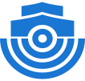
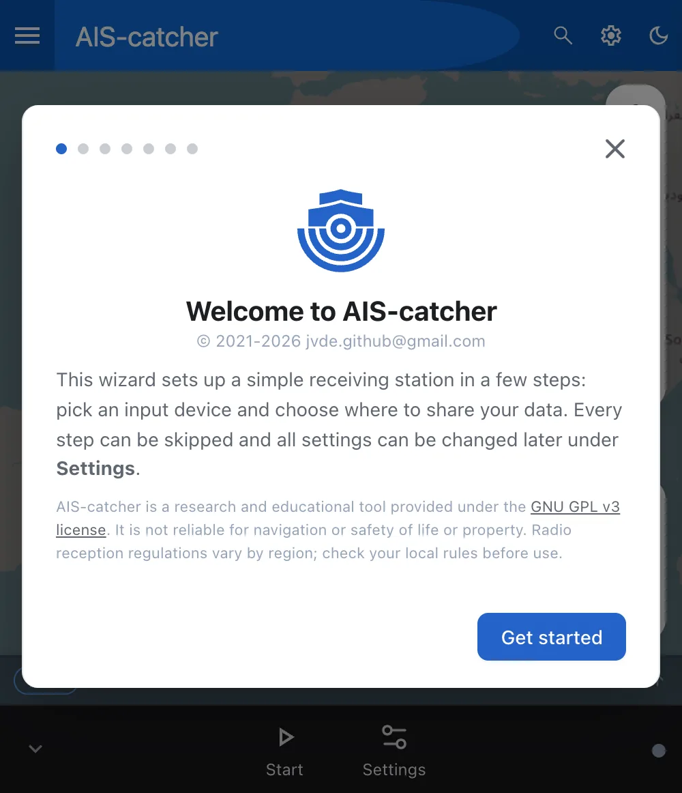
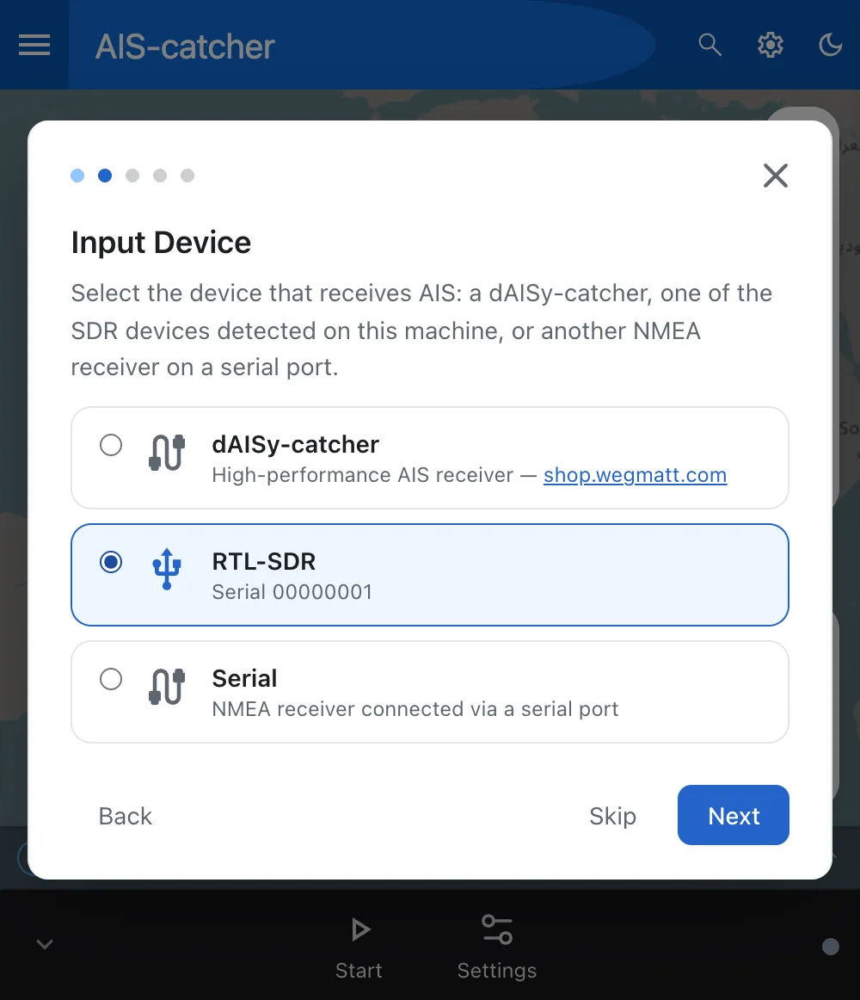
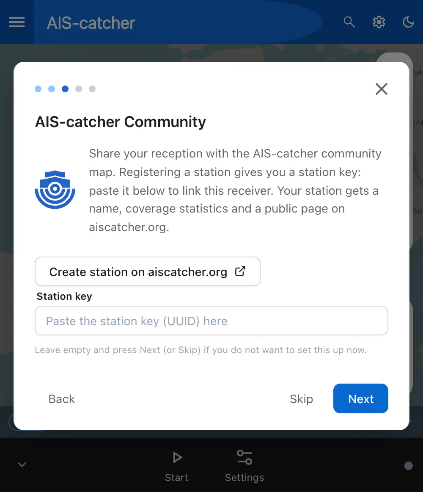
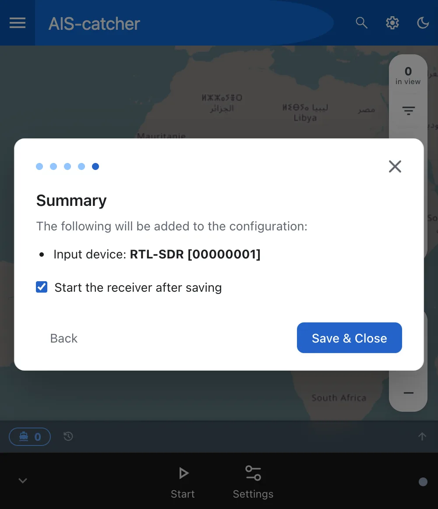

---
hide:
  - toc
  - navigation
---

# Quick Start

<div class="stepper-stage" markdown>

<div class="stepper" data-eyebrow="Your own station · Quick Start" markdown>

<div class="stepper-step" markdown>

## Before you start

<div class="stepper-welcome" markdown>



From a receiver in its box to ships on your own map, in five steps. AIS-catcher runs in **managed mode**: it runs in the background, and you set it up in the dashboard in your browser.

</div>

<p class="ready-label">Have these ready</p>

<div class="ready" markdown>

<svg xmlns="http://www.w3.org/2000/svg" viewBox="0 0 16 16" aria-hidden="true"><path d="M8 1a1 1 0 0 1 1-1h6a1 1 0 0 1 1 1v14a1 1 0 0 1-1 1H9a1 1 0 0 1-1-1zm1 13.5a.5.5 0 1 0 1 0 .5.5 0 0 0-1 0m2 0a.5.5 0 1 0 1 0 .5.5 0 0 0-1 0M9.5 1a.5.5 0 0 0 0 1h5a.5.5 0 0 0 0-1zM9 3.5a.5.5 0 0 0 .5.5h5a.5.5 0 0 0 0-1h-5a.5.5 0 0 0-.5.5M1.5 2A1.5 1.5 0 0 0 0 3.5v7A1.5 1.5 0 0 0 1.5 12H6v2h-.5a.5.5 0 0 0 0 1H7v-4H1.5a.5.5 0 0 1-.5-.5v-7a.5.5 0 0 1 .5-.5H7V2z"/></svg> **Computer** A Raspberry Pi, a PC or a Mac

<svg xmlns="http://www.w3.org/2000/svg" viewBox="0 0 16 16" aria-hidden="true"><path d="M6 .5a.5.5 0 0 1 .5-.5h4a.5.5 0 0 1 .5.5v4H6zM7 1v1h1V1zm2 0v1h1V1zM6 5a1 1 0 0 0-1 1v8.5A1.5 1.5 0 0 0 6.5 16h4a1.5 1.5 0 0 0 1.5-1.5V6a1 1 0 0 0-1-1zm0 1h5v8.5a.5.5 0 0 1-.5.5h-4a.5.5 0 0 1-.5-.5z"/></svg> **Receiver** An RTL-SDR dongle or a dAISy-catcher

<svg xmlns="http://www.w3.org/2000/svg" viewBox="0 0 16 16" aria-hidden="true"><path d="M3.05 3.05a7 7 0 0 0 0 9.9.5.5 0 0 1-.707.707 8 8 0 0 1 0-11.314.5.5 0 0 1 .707.707m2.122 2.122a4 4 0 0 0 0 5.656.5.5 0 1 1-.708.708 5 5 0 0 1 0-7.072.5.5 0 0 1 .708.708m5.656-.708a.5.5 0 0 1 .708 0 5 5 0 0 1 0 7.072.5.5 0 1 1-.708-.708 4 4 0 0 0 0-5.656.5.5 0 0 1 0-.708m2.122-2.12a.5.5 0 0 1 .707 0 8 8 0 0 1 0 11.313.5.5 0 0 1-.707-.707 7 7 0 0 0 0-9.9.5.5 0 0 1 0-.707zM6 8a2 2 0 1 1 2.5 1.937V15.5a.5.5 0 0 1-1 0V9.937A2 2 0 0 1 6 8"/></svg> **Antenna** A VHF antenna, tuned to 162 MHz

</div>

<div class="stepper-fine" markdown>

Not sure what to get? See [What you need](../what-you-need.md). Connect the antenna to the receiver, and the receiver to the computer. To run AIS-catcher with a configuration file or command-line options instead, see [Manual Mode](../usage/overview.md).

</div>

</div>

<div class="stepper-step" markdown>

## Install AIS-catcher

Pick your computer:

=== "Raspberry Pi and Linux"

    One command installs AIS-catcher and what it needs, and runs it in managed mode as a service that starts at boot:

    ```console
    sudo bash -c "$(curl -fsSL https://raw.githubusercontent.com/jvde-github/AIS-catcher/main/scripts/aiscatcher-install) -p -M"
    ```

    It works on Raspberry Pi OS, Debian, Ubuntu and Fedora. See [Raspberry Pi and Linux](../installation/ubuntu-debian.md) for the details.

=== "Windows"

    1. Download the **Edge** build from the [downloads](../installation/windows.md#downloads) and unzip it.
    2. With an RTL-SDR, use [Zadig](https://www.rtl-sdr.com/tag/zadig/) to give it the WinUSB driver, once per dongle.
    3. Double-click `start-GUI.bat` in the unzipped folder.

=== "macOS"

    Build it with [Homebrew](https://brew.sh). This takes a few minutes:

    ```bash
    brew install git make gcc cmake pkg-config sqlite3 librtlsdr
    git clone https://github.com/jvde-github/AIS-catcher.git --depth 1
    cd AIS-catcher && mkdir build && cd build
    cmake .. && make && sudo make install
    ```

    Then start it in managed mode:

    ```bash
    AIS-catcher -E ~/aiscatcher.json 127.0.0.1:8118
    ```

    See [macOS](../installation/macos.md) for other receivers.

=== "Docker"

    ```console
    docker run --rm -it --network=host --device-cgroup-rule='c 189:* rmw' -v /dev/bus/usb:/dev/bus/usb -v ais-config:/config ghcr.io/jvde-github/ais-catcher:edge -E /config/config.json 127.0.0.1:8118
    ```

    The settings live in the `ais-config` volume, so they survive a restart. With a dAISy-catcher, add `--device /dev/ttyACM0`. See [Docker](../installation/docker.md).

Something else, such as Android? See [all installs](../installation/overview.md).

</div>

<div class="stepper-step" markdown>

## Open the dashboard

On the computer that runs AIS-catcher, open this address in your browser:

```console
http://localhost:8118
```

From another device on your network, use that computer's name or IP address in its place, for example `http://raspberrypi.local:8118`. AIS-catcher then first asks you to set a password. On macOS and in Docker, the commands in the previous step only let the computer itself in: replace `127.0.0.1` with `0.0.0.0` to open the dashboard from elsewhere.

</div>

<div class="stepper-step" markdown>

## Run the setup wizard

The first time, a short wizard sets up the station. Every step can be skipped, and everything can be changed later under **Settings**.

<div class="walk" markdown>

<div class="walk-step" markdown>

**Welcome** Press **Get started**.

{ .shot loading=lazy }

</div>

<div class="walk-step" markdown>

**Input Device** Pick your receiver. The wizard lists the SDRs it finds on the computer, the dAISy-catcher and other serial receivers.

{ .shot loading=lazy }

</div>

<div class="walk-step" markdown>

**AIS-catcher Community** To put your station on the community map, press **Create station on aiscatcher.org**, register it and paste the station key you get. Or press **Skip**.

{ .shot loading=lazy }

</div>

<div class="walk-step" markdown>

**Summary** Check it, keep **Start the receiver after saving** ticked, and press **Save & Close**.

{ .shot loading=lazy }

</div>

</div>

With a station key, your station gets a name, coverage statistics and its own page on aiscatcher.org. Before the summary the wizard also offers **AISHub**, for members of that data exchange: otherwise press **Skip**.

</div>

<div class="stepper-step" markdown>

## See your ships

In an area with traffic, the first ships appear on the dashboard map within a few minutes. Names can take longer: ships send them less often than their position.

!!! question "No ships after a few minutes?"
    - Check that the antenna is connected, and that the station can see water with traffic.
    - Check that no other program uses the receiver.
    - See [Troubleshooting](../advanced/troubleshooting.md).

Where to go next:

- [Getting Around the Dashboard](../managed/dashboard.md): the map, the receiver controls and the settings.
- [Send Ships to Your Chart Plotter](../managed/chart-plotter.md).
- [Outputs](../managed/output.md): the community map, other programs and services.

</div>

</div>

</div>
