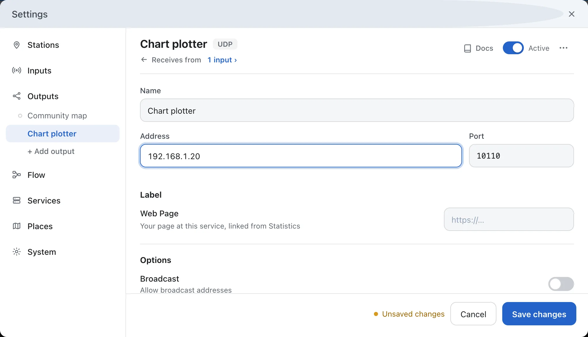

<header class="ais-page-hero">
  <h1>Do more with your station.</h1>
  
Step-by-step guides for what comes after the first ships: place your station, add receivers, send your ships on and build on what you receive. Each guide shows the dashboard, a configuration file and the command line.

</header>

<section aria-labelledby="by-goal">
  <h2 id="by-goal">By goal</h2>
  

    

      <svg aria-hidden="true"><use href="../assets/ais-home-icons.svg#signal"></use></svg>
      <h3>Set up your station</h3>
      <ul>
        <li><a href="../managed/station/">Name and place your station</a></li>
        <li><a href="../managed/receivers/">Connect your receivers</a></li>
        <li><a href="../advanced/GPS/">Location from GPS</a></li>
        <li><a href="../advanced/Low-spec-devices/">Small computers</a></li>
      </ul>
    

    

      <svg aria-hidden="true"><use href="../assets/ais-home-icons.svg#map"></use></svg>
      <h3>Send your ships on</h3>
      <ul>
        <li><a href="../managed/chart-plotter/">Send ships to your chart plotter</a></li>
        <li><a href="../managed/community-map/">Share with the community map</a></li>
        <li><a href="../managed/home-assistant/">Vessels in Home Assistant</a></li>
        <li><a href="../advanced/grafana/">Grafana</a></li>
      </ul>
    

    

      <svg aria-hidden="true"><use href="../assets/ais-home-icons.svg#layers"></use></svg>
      <h3>Build on your station</h3>
      <ul>
        <li><a href="../managed/api/">Ask your station, the API</a></li>
        <li><a href="../managed/assistant/">Let an AI assistant read your station</a></li>
      </ul>
    

    

      <svg aria-hidden="true"><use href="../assets/ais-home-icons.svg#chart"></use></svg>
      <h3>More</h3>
      <ul>
        <li><a href="../advanced/offline/">Offline web viewer</a></li>
        <li><a href="../advanced/ADSB/">Aircraft (ADS-B)</a></li>
        <li><a href="../advanced/GNUradio/">GNU Radio</a></li>
        <li><a href="../advanced/long-range/">Long-range AIS</a></li>
      </ul>
    

  

</section>

<section class="ais-featured" aria-labelledby="featured">
  

  

    <h2 id="featured">Send ships to your chart plotter</h2>
    
A good first guide: pass every ship AIS-catcher receives on to OpenCPN, a chart plotter or a navigation app on your network.

    <a class="ais-action ais-action--blue" href="../managed/chart-plotter/">Open the guide</a>
  

</section>

<section aria-labelledby="tutorials">
  <h2 id="tutorials">Tutorials</h2>
  
A series that builds one station up step by step, from a second receiver to home automation.

  <ol class="ais-series">
    <li><a href="../tutorials/stations/"><b>1</b><strong>Multiple receivers and stations</strong><small>Several antennas, each a station of its own</small></a></li>
    <li><a href="../tutorials/places/"><b>2</b><strong>Geofencing with places</strong><small>Ports, berths and guard zones on your map</small></a></li>
    <li><a href="../tutorials/api-and-mcp/"><b>3</b><strong>The API and MCP</strong><small>Your station's data for programs and assistants</small></a></li>
    <li><a href="../tutorials/home-automation/"><b>4</b><strong>Home automation and webhooks</strong><small>Notifications when a ship comes in</small></a></li>
  </ol>
</section>

