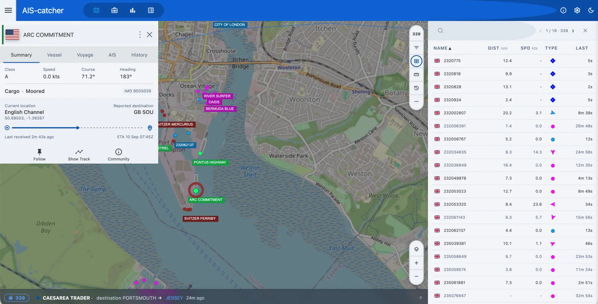
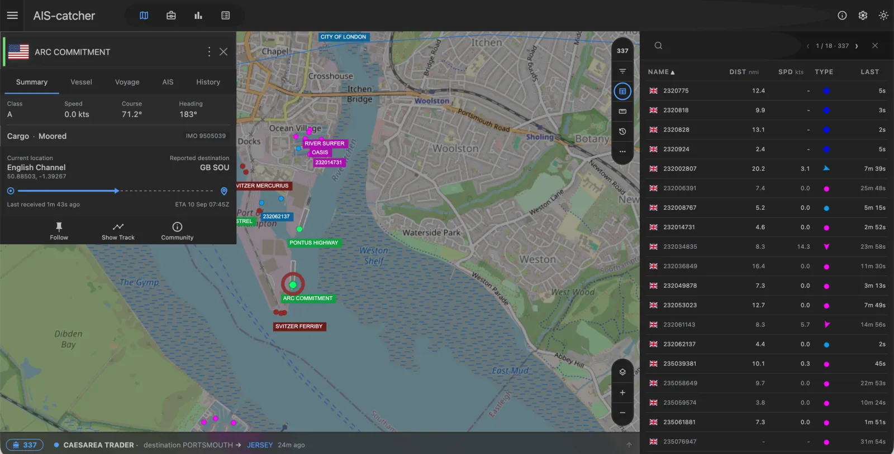
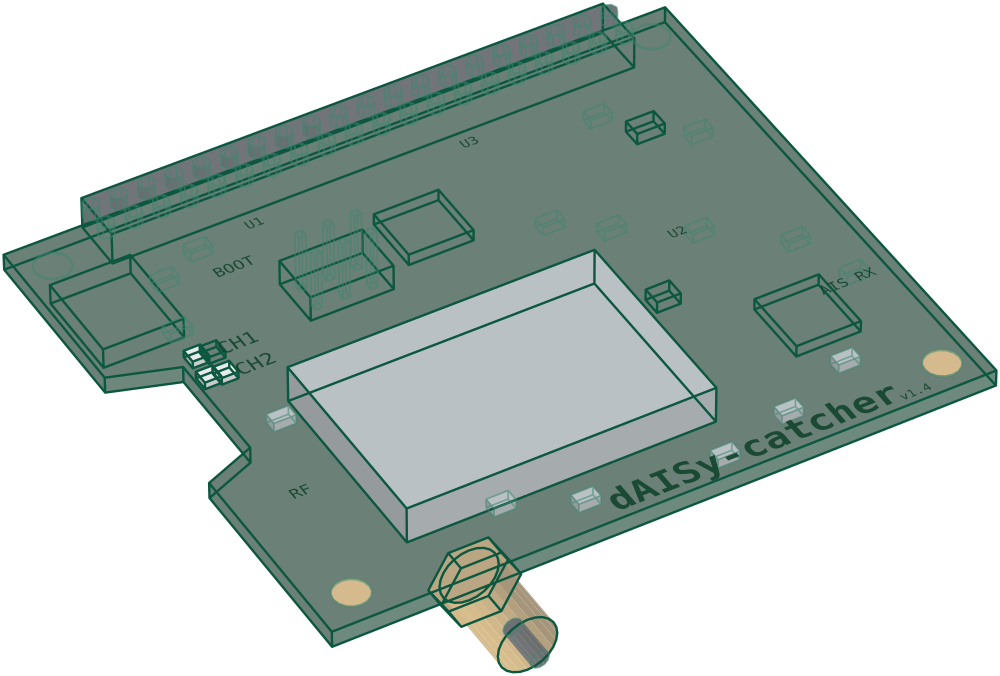
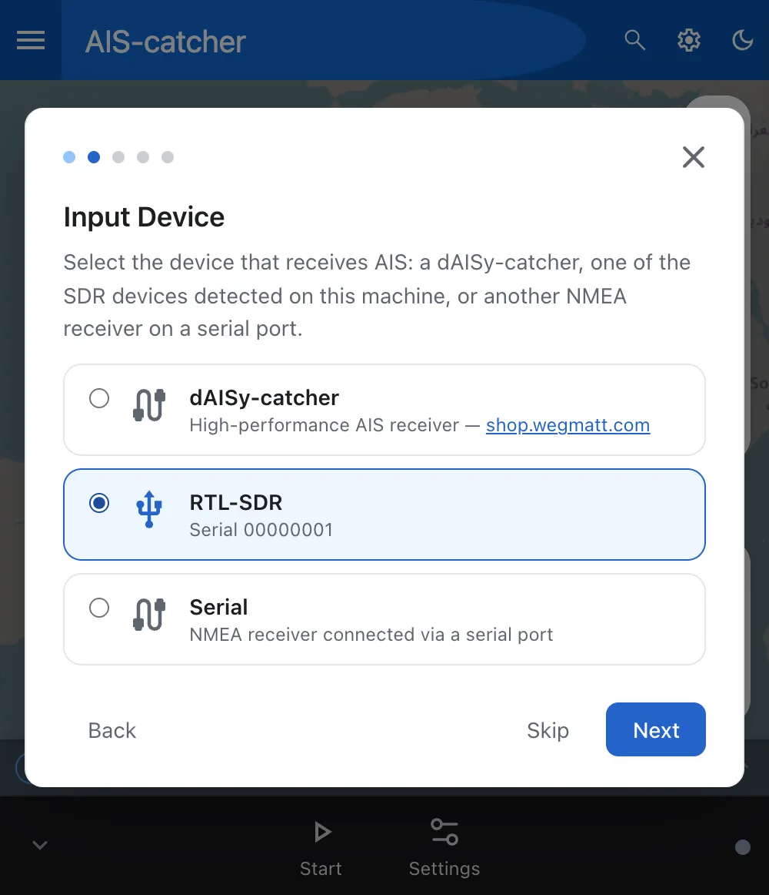
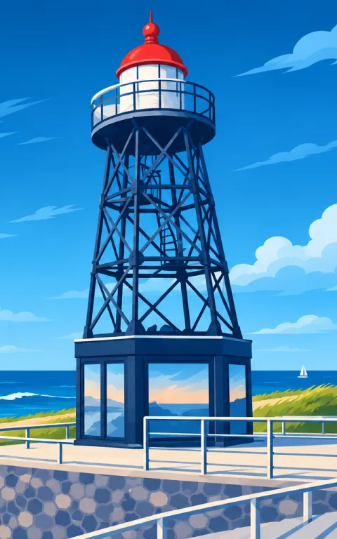

  <aside class="ais-landing__rail" aria-label="Documentation sections">
    

      <a class="ais-rail__brand" href="./" aria-label="AIS-catcher documentation home">
        
        <strong>AIS-<em>catcher</em></strong><small>Documentation</small>
      </a>
      <nav class="ais-rail__nav" aria-label="Documentation navigation">
        <a class="is-current" aria-current="page" href="./"><svg aria-hidden="true"><use href="assets/ais-home-icons.svg#home"></use></svg>Home</a>
        <a href="getting-started/overview/"><svg aria-hidden="true"><use href="assets/ais-home-icons.svg#rocket"></use></svg>Start Receiving</a>
        <a href="managed/dashboard/"><svg aria-hidden="true"><use href="assets/ais-home-icons.svg#monitor"></use></svg>Use Your Station</a>
        <a href="guides/"><svg aria-hidden="true"><use href="assets/ais-home-icons.svg#book"></use></svg>Guides</a>
        <a href="installation/overview/"><svg aria-hidden="true"><use href="assets/ais-home-icons.svg#tool"></use></svg>Install &amp; Maintain</a>
        <a href="configuration/overview/"><svg aria-hidden="true"><use href="assets/ais-home-icons.svg#code"></use></svg>Reference</a>
        <a href="advanced/troubleshooting/"><svg aria-hidden="true"><use href="assets/ais-home-icons.svg#lifebuoy"></use></svg>Help</a>
        <a href="what-is-new/"><svg aria-hidden="true"><use href="assets/ais-home-icons.svg#sparkles"></use></svg>What's New</a>
      </nav>
      
Open source, community driven. <a href="https://github.com/jvde-github/AIS-catcher">AIS-catcher on GitHub ↗</a>

    

  </aside>

  

    <section class="ais-home-hero" aria-labelledby="ais-hero-heading">
      

        <h1 id="ais-hero-heading">From radio signals  to live ships.</h1>
        
Receive and decode the messages ships send, and watch them on a map of your own. Start with one SDR dongle; add receivers and connect your own tools later.

        

          <a class="ais-action ais-action--primary" href="getting-started/overview/">Quick Start</a>
          <a class="ais-action ais-action--outline" href="#ais-choose">Browse the docs</a>
        

        
Free and open source, under the GPLv3. Runs on Raspberry Pi, Linux, Windows, macOS and Docker.

      

      <figure class="ais-daynight">
        
        
      </figure>
    </section>

    <section class="ais-home-section" id="ais-choose" aria-labelledby="ais-paths-heading">
      <h2 id="ais-paths-heading">Choose your path</h2>
      
New to AIS, or building a bigger station? Start where you are.

      

        <a class="ais-path-card" href="getting-started/overview/"><svg aria-hidden="true"><use href="assets/ais-home-icons.svg#rocket"></use></svg><strong>Start Receiving</strong>Install, connect your receiver and see your first ships.</a>
        <a class="ais-path-card" href="managed/dashboard/"><svg aria-hidden="true"><use href="assets/ais-home-icons.svg#monitor"></use></svg><strong>Use Your Station</strong>The dashboard, your receivers and outputs, and manual mode.</a>
        <a class="ais-path-card" href="guides/"><svg aria-hidden="true"><use href="assets/ais-home-icons.svg#book"></use></svg><strong>Guides</strong>Step by step, from a chart plotter to Home Assistant.</a>
        <a class="ais-path-card" href="installation/overview/"><svg aria-hidden="true"><use href="assets/ais-home-icons.svg#tool"></use></svg><strong>Install &amp; Maintain</strong>Install on your system, run it as a service and keep it up to date.</a>
        <a class="ais-path-card" href="configuration/overview/"><svg aria-hidden="true"><use href="assets/ais-home-icons.svg#code"></use></svg><strong>Reference</strong>Every setting: command line, configuration file, inputs, outputs and the API.</a>
        <a class="ais-path-card" href="advanced/troubleshooting/"><svg aria-hidden="true"><use href="assets/ais-home-icons.svg#lifebuoy"></use></svg><strong>Help</strong>No ships yet? Find where the signal stops, and where to ask.</a>
      

    </section>

    <section class="ais-home-start" aria-labelledby="ais-start-heading">
      

        <h2 id="ais-start-heading">From hardware  to your first ship.</h2>
        
Four steps. The setup wizard in the dashboard does most of the work.

        <ol class="ais-start-list">
          <li><a href="getting-started/overview/#install-ais-catcher"><b>1</b>Install AIS-catcher</a></li>
          <li><a href="getting-started/overview/#open-the-dashboard"><b>2</b>Open the dashboard</a></li>
          <li><a href="getting-started/overview/#run-the-setup-wizard"><b>3</b>Run the setup wizard</a></li>
          <li><a href="getting-started/overview/#see-your-ships"><b>4</b>See your ships</a></li>
        </ol>
        <a class="ais-action ais-action--blue" href="getting-started/overview/">Follow the Quick Start</a>
      

      

        

          

          Step 1<h3>Connect and install</h3>
An antenna, a receiver such as a dAISy-catcher or an RTL-SDR, and a computer.

        

        

          

          Steps 2–3<h3>Configure</h3>
The setup wizard finds your receiver and starts it.

        

        

          

          Step 4<h3>See your ships</h3>
The first ships appear on your own map within minutes.

        

      

    </section>

    <section class="ais-home-feature" aria-labelledby="ais-feature-heading">
      <picture class="ais-home-feature__art"><source media="(max-width: 1030px)" srcset="assets/ais-home-lighthouse.webp" width="1200" height="800"></picture>
      

        <h2 id="ais-feature-heading">Your station, your view.</h2>
        
Everything your receivers hear, in your own browser: ships and their tracks, charts and station statistics.

        <a class="ais-text-link" href="managed/dashboard/">Getting around the dashboard</a>
      

      <ul class="ais-feature-list">
        <li><a href="managed/dashboard/#the-map"><svg aria-hidden="true"><use href="assets/ais-home-icons.svg#map"></use></svg><strong>Map and tracks</strong><small>Ships near you and where they went</small></a></li>
        <li><a href="managed/input/"><svg aria-hidden="true"><use href="assets/ais-home-icons.svg#signal"></use></svg><strong>Inputs and outputs</strong><small>Your receivers, and where the data goes</small></a></li>
        <li><a href="managed/dashboard/#the-map"><svg aria-hidden="true"><use href="assets/ais-home-icons.svg#chart"></use></svg><strong>Statistics</strong><small>Messages, range and activity over time</small></a></li>
        <li><a href="api/overview/"><svg aria-hidden="true"><use href="assets/ais-home-icons.svg#layers"></use></svg><strong>API and integrations</strong><small>Programs, assistants and Home Assistant</small></a></li>
      </ul>
    </section>

    <section class="ais-home-section" aria-labelledby="ais-modes-heading">
      <h2 id="ais-modes-heading">One receiver. Different ways to run it.</h2>
      
Set it up in your browser, or write the configuration yourself.

      

        <a href="managed/dashboard/" class="ais-mode"><svg aria-hidden="true"><use href="assets/ais-home-icons.svg#monitor"></use></svg><strong>Managed mode <em>Recommended</em></strong><small>Set up and run AIS-catcher from the dashboard in your browser.</small></a>
        <a href="usage/overview/" class="ais-mode"><svg aria-hidden="true"><use href="assets/ais-home-icons.svg#terminal"></use></svg><strong>Manual mode</strong><small>A command line or a configuration file says exactly what it does.</small></a>
        <a href="usage/gui/" class="ais-mode"><svg aria-hidden="true"><use href="assets/ais-home-icons.svg#layers"></use></svg><strong>AIS-catcher-control</strong><small>The optional control tool for Raspberry Pi and Debian: start, stop and update AIS-catcher from the browser.</small></a>
      

    </section>

    <section class="ais-home-outro" aria-labelledby="ais-outro-heading">
      <h2 id="ais-outro-heading">Build. Customize. Integrate.</h2>
      
Several receivers, geofences, the API, an AI assistant and home automation: a tutorial series on building on your station.

      <a class="ais-action ais-action--blue" href="tutorials/">Read the tutorials</a>
      

    </section>

    <footer class="ais-home-footer">AIS-catcher is free and open source, under the GPLv3.<strong>Receive-only.</strong> Not approved for navigation or safety-of-life use. <a href="disclaimer/">Disclaimer</a></footer>
  

