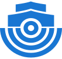

#  AIS-Catcher

**AIS-Catcher** is free and open-source software that turns an inexpensive **Software Defined Radio** (SDR) into a complete **AIS** receiver: receive and visualize ship traffic on a live map, and share the data over the network or with the community. The source code is available on [GitHub](https://github.com/jvde-github/AIS-catcher) under the **GPLv3** license.

[Quick Start](getting-started/overview.md){ .md-button .md-button--primary }
[Install](installation/overview.md){ .md-button .md-button--secondary }
[What's New](what-is-new.md){ .md-button .md-button--secondary }

New to AIS? Read [What is AIS?](ais-basics.md) and [What You Need](what-you-need.md).

!!! warning "Disclaimer"
    **AIS-Catcher is intended for hobbyist and research projects only. It is NOT approved for use in navigation or safety-of-life applications.** [Read the full disclaimer](disclaimer.md).

## What do you want to do?

<a class="install-card" href="getting-started/overview/">
See ships on a map
Install AIS-catcher, connect a receiver and watch the first ships come in.
</a>

<a class="install-card" href="managed/chart-plotter/">
Send ships to a chart plotter
OpenCPN, a plotter or a navigation app on your network.
</a>

<a class="install-card" href="managed/community-map/">
Share with the community map
Add what you hear to the live map at aiscatcher.org.
</a>

<a class="install-card" href="managed/receivers/">
Connect more receivers
A second radio, a dAISy, or ships arriving over the network.
</a>

<a class="install-card" href="managed/api/">
Build on your station
The API, an AI assistant and Home Assistant.
</a>

<a class="install-card" href="advanced/troubleshooting/">
No ships yet?
Find out where the signal stops: the receiver, the radio or the map.
</a>

## Two ways to run it

<a class="install-card" href="managed/dashboard/">
Managed mode Recommended
AIS-catcher runs in the background, and you set it up in the dashboard in your browser. The Quick Start sets it up this way.
</a>

<a class="install-card" href="usage/overview/">
Manual mode
You start AIS-catcher with a configuration file or command-line options, and it does exactly what they say. For scripts, small setups and complex configurations.
</a>

The guides show every step for both, in tabs: **Managed mode**, **Config file** and **Command line**. The [API](api/overview.md) works the same in both.

[AIS-catcher-control](usage/gui.md) is a separate, optional tool for Raspberry Pi and Debian. It starts and stops the AIS-catcher service and looks after the computer it runs on; the receiver itself is set up in AIS-catcher.
