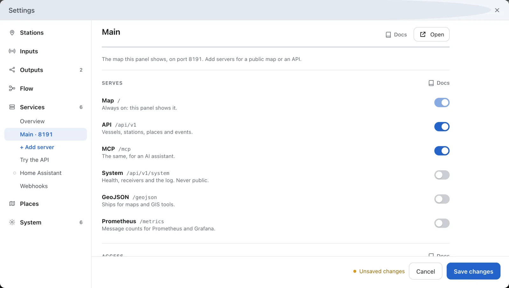
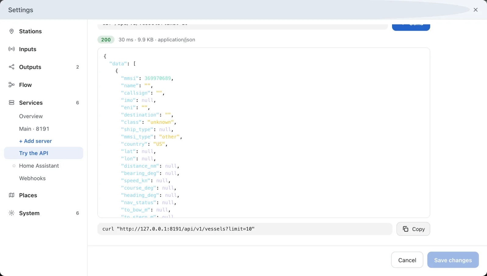

---
hide:
  - toc
---

# Ask Your Station, the API

Your station answers questions over HTTP: the vessels it hears, their tracks, port calls and events, as JSON. Any program that can fetch a web address can read them.

**You need:** AIS-catcher receiving ships.

<div class="stepper" data-eyebrow="Guide" markdown>

<div class="stepper-step" markdown>

## Switch the API on

=== "Managed mode"

    In the dashboard, open **Settings → Services → Main**. Main is the server that serves the dashboard's map, on the port after the dashboard's: 8119 unless you changed it.

    Under **Serves**, switch **API** on and press **Save changes**. The server serves it at once.

    

    !!! tip "Dashboard open to your network?"
        Then Main is too, and its **Access** section asks who may read the API. Press **New key** to make a key, or choose **Open** to let everyone on the network read it.

=== "Config file"

    Add `"api": true` to the `server` entry of the web viewer, or add an entry:

    ```json
    {
      "config": "aiscatcher",
      "version": 1,
      "server": [
        { "port": 8100, "api": true }
      ]
    }
    ```

    | Key | What it does |
    |-----|--------------|
    | `port` | The server's port. |
    | `api` | Serves the API under `/api/v1`. |

    Then restart AIS-catcher with the file:

    ```bash
    AIS-catcher -C config.json
    ```

    !!! tip "Map open to your network?"
        A server with the API and no keys listens on this computer alone, and the map with it: the log says so. To keep the map open, give the API a server of its own: `{ "port": 8101, "ui": false, "api": true }` beside the map's `{ "port": 8100 }`.

=== "Command line"

    Add `-N` with a port and `api on` to the command you already use. If it has a `-N` already, add `api on` after it:

    ```bash
    AIS-catcher -N 8100 api on
    ```

    !!! tip "Map open to your network?"
        A server with the API and no keys listens on this computer alone, and the map with it: the log says so. To keep the map open, give the API a server of its own: `AIS-catcher -N 8100 -N 8101 ui off api on`.

</div>

<div class="stepper-step" markdown>

## Try it

=== "Managed mode"

    At the top of Main's page, press **Try the API**. Pick an **Endpoint**, such as `/api/v1/vessels`, and press **Send**. The answer appears below it, with the `curl` line that repeats the request.

    

=== "Config file"

    **Try the API** is part of the dashboard, which only managed mode has. A browser shows the answers too: on the computer that runs AIS-catcher, open `http://127.0.0.1:8100/api/v1`. The answer lists what the API offers, such as `/api/v1/vessels`.

=== "Command line"

    **Try the API** is part of the dashboard, which only managed mode has. A browser shows the answers too: on the computer that runs AIS-catcher, open `http://127.0.0.1:8100/api/v1`. The answer lists what the API offers, such as `/api/v1/vessels`.

</div>

<div class="stepper-step" markdown>

## Ask from a program

=== "Managed mode"

    On the computer that runs AIS-catcher, send the same request from a terminal:

    ```console
    curl "http://127.0.0.1:8119/api/v1/vessels?limit=10"
    ```

=== "Config file"

    On the computer that runs AIS-catcher, send a request from a terminal:

    ```console
    curl "http://127.0.0.1:8100/api/v1/vessels?limit=10"
    ```

=== "Command line"

    On the computer that runs AIS-catcher, send a request from a terminal:

    ```console
    curl "http://127.0.0.1:8100/api/v1/vessels?limit=10"
    ```

The answer is `{"data": [ ... ], "meta": { ... }}`, with one vessel in each row of `data`.

</div>

<div class="stepper-step" markdown>

## Reach it from another computer

=== "Managed mode"

    To let programs on other computers ask, give them a server of their own. Under **Settings → Services**, press **+ Add server**. The new server has the API switched on and its own **Port**.

    Set **Listens on** to **Network**. Under **Access**, keep **Keys** and press **New key**. Name the key, press **Make key** and copy it: it is shown once. Then press **Save changes**.

=== "Config file"

    To let programs on other computers ask, give them a server of their own, with a key. `AIS-catcher -K` prints a new key and its SHA-256. Give the key to the program. The file holds only the SHA-256:

    ```json
    {
      "config": "aiscatcher",
      "version": 1,
      "server": [
        { "port": 8100, "api": true },
        { "port": 8110, "api": true,
          "keys": [ { "name": "laptop", "sha256": "<sha256>", "scopes": ["data"] } ] }
      ]
    }
    ```

    | Key | What it does |
    |-----|--------------|
    | `keys` | The keys the server takes, each with a `name`, the `sha256` of the key and its `scopes`. |

    A server with keys listens on the network. Restart AIS-catcher with the file.

    To let everyone on the network read it without a key, write `"public": true` in place of `keys`.

=== "Command line"

    To let programs on other computers ask, give them a server of their own, with a key. `AIS-catcher -K` prints a new key and its SHA-256. Give the key to the program, and add a `-N` with the SHA-256 to your command:

    ```bash
    AIS-catcher -N 8100 api on -N 8110 api on keys laptop:data:<sha256>
    ```

    `keys` takes the key's name, its scopes and its SHA-256, separated by colons. A server with keys listens on the network.

    To let everyone on the network read it without a key, write `public on` in place of `keys` and its value.

A program sends the key with every request, to the server's own port:

```console
curl -H "Authorization: Bearer $KEY" "http://station.local:8110/api/v1/vessels?limit=10"
```

</div>

<div class="stepper-step" markdown>

## What next

- [API](../api/overview.md) explains the lists, the filters and the keys. The [API reference](../api/reference.md) lists every route and field.
- [Let an AI Assistant Read Your Station](assistant.md) offers the same data to an assistant.

</div>

</div>
