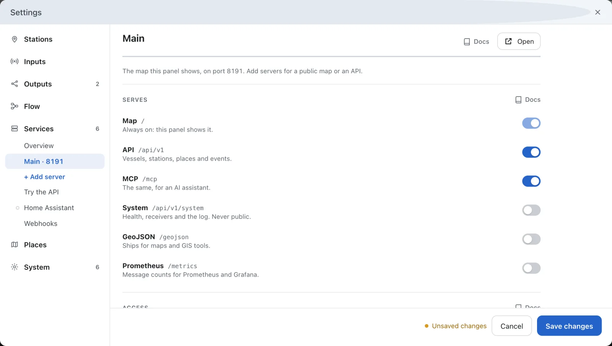
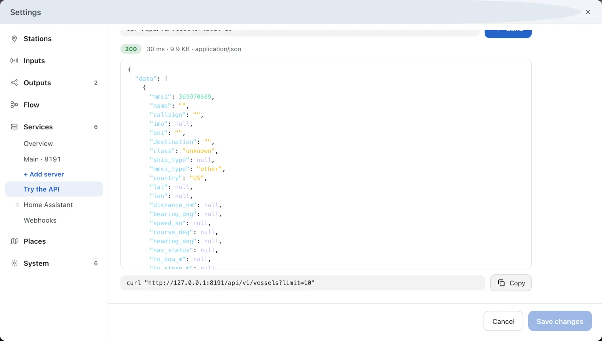

---
hide:
  - toc
---

# Ask Your Station, the API

Your station answers questions over HTTP: the vessels it hears, their tracks, port calls and events, as JSON. Any program that can fetch a web address can read them.

**You need:** AIS-catcher receiving ships.

<div class="stepper" data-eyebrow="Managed mode · Guide" markdown>

<div class="stepper-step" markdown>

## Switch the API on

In the dashboard, open **Settings → Services → Main**. Main is the server that serves the dashboard's map, on the port after the dashboard's: 8119 unless you changed it.

Under **Serves**, switch **API** on and press **Save changes**. The server serves it at once.



!!! tip "Dashboard open to your network?"
    Then Main is too, and its **Access** section asks who may read the API. Press **New key** to make a key, or choose **Open** to let everyone on the network read it.

</div>

<div class="stepper-step" markdown>

## Try it

At the top of Main's page, press **Try the API**. Pick an **Endpoint**, such as `/api/v1/vessels`, and press **Send**. The answer appears below it, with the `curl` line that repeats the request.



</div>

<div class="stepper-step" markdown>

## Ask from a program

On the computer that runs AIS-catcher, send the same request from a terminal:

```console
curl "http://127.0.0.1:8119/api/v1/vessels?limit=10"
```

The answer is `{"data": [ ... ], "meta": { ... }}`, with one vessel in each row of `data`.

</div>

<div class="stepper-step" markdown>

## Reach it from another computer

To let programs on other computers ask, give them a server of their own. Under **Settings → Services**, press **+ Add server**. The new server has the API switched on and its own **Port**.

Set **Listens on** to **Network**. Under **Access**, keep **Keys** and press **New key**. Name the key, press **Make key** and copy it: it is shown once. Then press **Save changes**.

A program sends the key with every request, to the server's own port:

```console
curl -H "Authorization: Bearer $KEY" "http://station.local:8110/api/v1/vessels?limit=10"
```

</div>

<div class="stepper-step" markdown>

## What next

- [API](../api/overview.md) explains the lists, the filters and the keys. The [API reference](../api/reference.md) lists every route and field.
- [Let an AI Assistant Read Your Station](assistant.md) offers the same data to an assistant.

</div>

</div>

## In manual mode

In a configuration file, `"api": true` switches the API on for a server of the `services` list. On the command line, `api on` after `-N` does the same. See [API](../api/overview.md).
