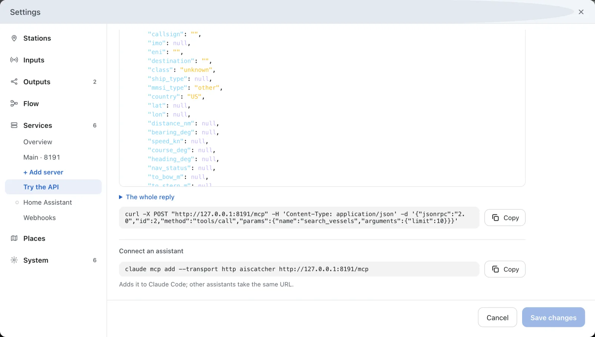

---
hide:
  - toc
---

# Let an AI Assistant Read Your Station

With MCP switched on, an AI assistant can ask your station questions: which ships are near, who arrived today, whether the station is healthy. The assistant only reads. It cannot change the station.

**You need:** AIS-catcher receiving ships, and an assistant that speaks MCP over HTTP, such as Claude Code.

<div class="stepper" data-eyebrow="Managed mode · Guide" markdown>

<div class="stepper-step" markdown>

## Switch MCP on

In the dashboard, open **Settings → Services → Main**. Under **Serves**, switch **MCP** on. Switch **System** on too if the assistant should also see the station's health, its receivers and the log.

Press **Save changes**. The server serves it at once.

!!! tip "Dashboard open to your network?"
    Then Main is too, and its **Access** section asks who may read it. Press **New key** to make a key. **System** is never open on the network: it always takes a key.

</div>

<div class="stepper-step" markdown>

## Try a tool

At the top of Main's page, press **Try the API** and choose **MCP**. Pick a **Tool**, such as `search_vessels`, and press **Call**. The answer is what the assistant gets.



</div>

<div class="stepper-step" markdown>

## Connect the assistant

Under **Connect an assistant**, press **Copy** and run the line where your assistant runs. For Claude Code on the computer that runs AIS-catcher, it reads:

```console
claude mcp add --transport http aiscatcher http://127.0.0.1:8119/mcp
```

Other assistants that speak MCP over HTTP take the same address.

</div>

<div class="stepper-step" markdown>

## From another computer

An assistant on another computer needs a server that listens on the network and takes keys. Add one as in [Ask Your Station, the API](api.md#reach-it-from-another-computer), and switch **MCP** on for it.

In **Try the API**, pick that server under **Server** and enter its key under **Key**. The line under **Connect an assistant** then names the server's address and adds the header for the key.

</div>

<div class="stepper-step" markdown>

## Check it works

Ask your assistant: *Which vessels did my station hear in the last hour?* It answers with ships from your own station.

[MCP: an assistant reads the station](../api/overview.md#mcp-an-assistant-reads-the-station) lists every tool, and says how much room a model on your own computer needs for them.

</div>

</div>

## In manual mode

In a configuration file, `"mcp": true` switches MCP on for a server of the `services` list. On the command line, `mcp on` after `-N` does the same. See [MCP: an assistant reads the station](../api/overview.md#mcp-an-assistant-reads-the-station).
