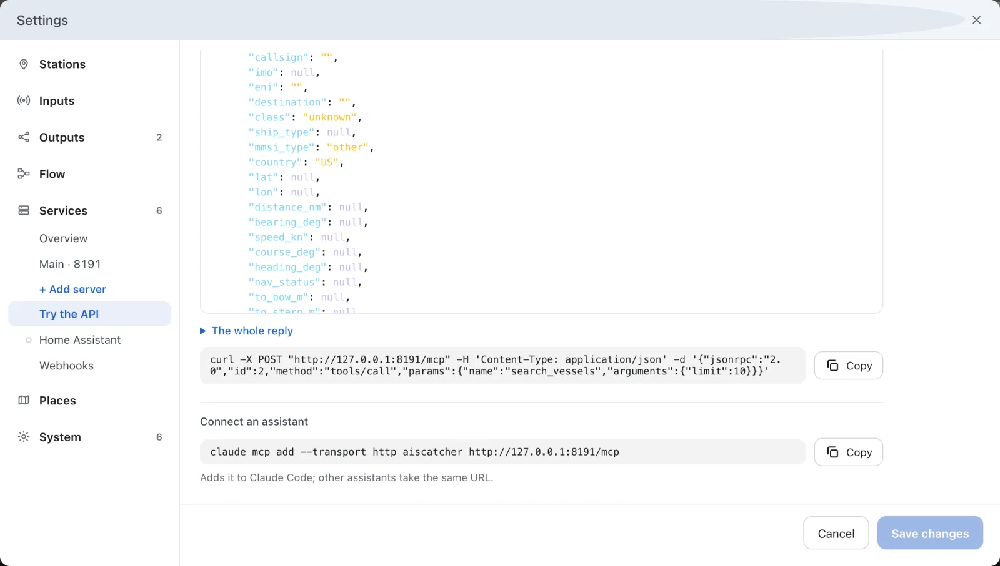

---
hide:
  - toc
---

# Let an AI Assistant Read Your Station

With MCP switched on, an AI assistant can ask your station questions: which ships are near, who arrived today, whether the station is healthy. The assistant only reads. It cannot change the station.

**You need:** AIS-catcher receiving ships, and an assistant that speaks MCP over HTTP, such as Claude Code.

<div class="stepper" data-eyebrow="Guide" markdown>

<div class="stepper-step" markdown>

## Switch MCP on

=== "Managed mode"

    In the dashboard, open **Settings → Services → Main**. Under **Serves**, switch **MCP** on. Switch **System** on too if the assistant should also see the station's health, its receivers and the log.

    Press **Save changes**. The server serves it at once.

    !!! tip "Dashboard open to your network?"
        Then Main is too, and its **Access** section asks who may read it. Press **New key** to make a key. **System** is never open on the network: it always takes a key.

=== "Config file"

    Add `"mcp": true` to the `server` entry of the web viewer, or add an entry. Add `"system": true` too if the assistant should also see the station's health, its receivers and the log:

    ```json
    {
      "config": "aiscatcher",
      "version": 1,
      "server": [
        { "port": 8100, "mcp": true, "system": true }
      ]
    }
    ```

    | Key | What it does |
    |-----|--------------|
    | `mcp` | Serves MCP at `/mcp`. |
    | `system` | Adds the tools for the station itself: its health, receivers, outputs and log. |

    Then restart AIS-catcher with the file:

    ```bash
    AIS-catcher -C config.json
    ```

    !!! tip "Map open to your network?"
        A server with MCP and no keys listens on this computer alone, and the map with it: the log says so. To keep the map open, give MCP a server of its own: `{ "port": 8101, "ui": false, "mcp": true, "system": true }` beside the map's `{ "port": 8100 }`.

=== "Command line"

    Add `-N` with a port and `mcp on` to the command you already use. If it has a `-N` already, add `mcp on` after it. Add `system on` too if the assistant should also see the station's health, its receivers and the log:

    ```bash
    AIS-catcher -N 8100 mcp on system on
    ```

    !!! tip "Map open to your network?"
        A server with MCP and no keys listens on this computer alone, and the map with it: the log says so. To keep the map open, give MCP a server of its own: `AIS-catcher -N 8100 -N 8101 ui off mcp on system on`.

</div>

<div class="stepper-step" markdown>

## Try a tool

=== "Managed mode"

    At the top of Main's page, press **Try the API** and choose **MCP**. Pick a **Tool**, such as `search_vessels`, and press **Call**. The answer is what the assistant gets.

    

=== "Config file"

    **Try the API** is part of the dashboard, which only managed mode has. `curl` calls a tool the way an assistant does. On the computer that runs AIS-catcher:

    ```console
    curl -X POST "http://127.0.0.1:8100/mcp" -H 'Content-Type: application/json' -d '{"jsonrpc": "2.0", "id": 1, "method": "tools/call", "params": {"name": "data_status", "arguments": {}}}'
    ```

    The answer, under `result`, is what the assistant gets: the messages and vessels the station heard in the last minute, hour and day.

=== "Command line"

    **Try the API** is part of the dashboard, which only managed mode has. `curl` calls a tool the way an assistant does. On the computer that runs AIS-catcher:

    ```console
    curl -X POST "http://127.0.0.1:8100/mcp" -H 'Content-Type: application/json' -d '{"jsonrpc": "2.0", "id": 1, "method": "tools/call", "params": {"name": "data_status", "arguments": {}}}'
    ```

    The answer, under `result`, is what the assistant gets: the messages and vessels the station heard in the last minute, hour and day.

</div>

<div class="stepper-step" markdown>

## Connect the assistant

=== "Managed mode"

    Under **Connect an assistant**, press **Copy** and run the line where your assistant runs. For Claude Code on the computer that runs AIS-catcher, it reads:

    ```console
    claude mcp add --transport http aiscatcher http://127.0.0.1:8119/mcp
    ```

=== "Config file"

    For Claude Code on the computer that runs AIS-catcher, run:

    ```console
    claude mcp add --transport http aiscatcher http://127.0.0.1:8100/mcp
    ```

=== "Command line"

    For Claude Code on the computer that runs AIS-catcher, run:

    ```console
    claude mcp add --transport http aiscatcher http://127.0.0.1:8100/mcp
    ```

Other assistants that speak MCP over HTTP take the same address.

</div>

<div class="stepper-step" markdown>

## From another computer

An assistant on another computer needs a server that listens on the network and takes keys.

=== "Managed mode"

    Add one as in [Ask Your Station, the API](api.md#reach-it-from-another-computer), and switch **MCP** on for it.

    In **Try the API**, pick that server under **Server** and enter its key under **Key**. The line under **Connect an assistant** then names the server's address and adds the header for the key.

=== "Config file"

    Add one as in [Ask Your Station, the API](api.md#reach-it-from-another-computer), with `"mcp": true`. For the tools of the station itself, add `"system": true` and give the key both scopes:

    ```json
    {
      "config": "aiscatcher",
      "version": 1,
      "server": [
        { "port": 8100, "mcp": true, "system": true },
        { "port": 8110, "mcp": true, "system": true,
          "keys": [ { "name": "laptop", "sha256": "<sha256>", "scopes": ["data", "system"] } ] }
      ]
    }
    ```

    Restart AIS-catcher with the file.

    To let everyone on the network use it without a key, write `"public": true` in place of `keys` and leave `system` out: AIS-catcher refuses it on a public server.

=== "Command line"

    Add one as in [Ask Your Station, the API](api.md#reach-it-from-another-computer), with `mcp on`. For the tools of the station itself, add `system on` and give the key the scopes `data+system`:

    ```bash
    AIS-catcher -N 8100 mcp on system on -N 8110 mcp on system on keys laptop:data+system:<sha256>
    ```

    To let everyone on the network use it without a key, write `public on` in place of `keys` and its value, and leave `system on` out: AIS-catcher refuses it on a public server.

Claude Code on the other computer then connects with the server's address and the key:

```console
claude mcp add --transport http aiscatcher http://station.local:8110/mcp --header "Authorization: Bearer $KEY"
```

</div>

<div class="stepper-step" markdown>

## Check it works

Ask your assistant: *Which vessels did my station hear in the last hour?* It answers with ships from your own station.

[MCP: an assistant reads the station](../api/overview.md#mcp-an-assistant-reads-the-station) lists every tool, and says how much room a model on your own computer needs for them.

</div>

</div>
