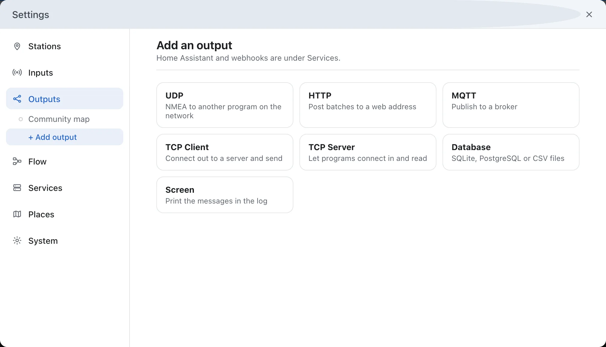
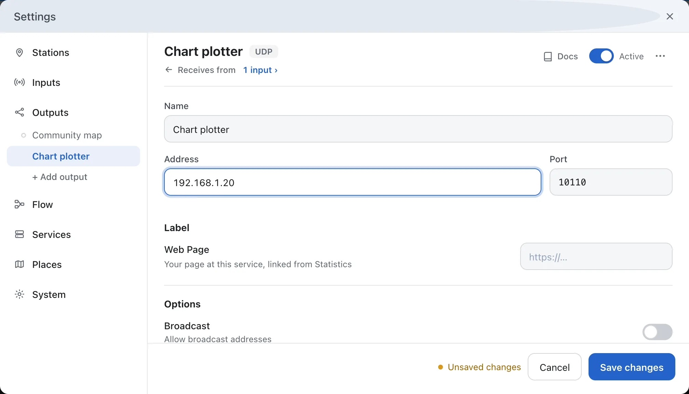
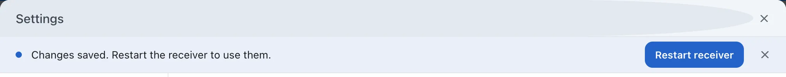
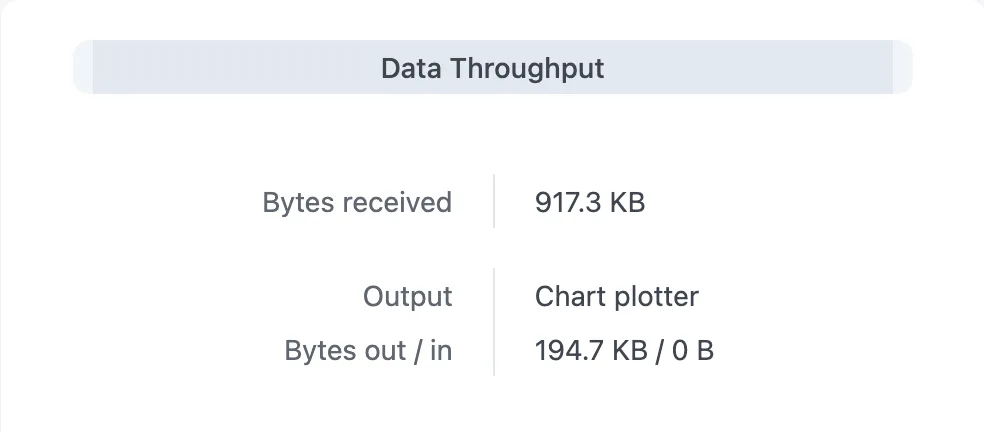

---
hide:
  - toc
---

# Send Ships to Your Chart Plotter

AIS-catcher can pass every message it receives on to OpenCPN, a chart plotter or a navigation app on your network, as NMEA over UDP. The ships then appear on that program's chart.

**You need:** AIS-catcher receiving ships, and the address of the computer or plotter that should get them. Port 10110 is the usual port for AIS.

!!! tip "On the same computer?"
    If the chart plotter runs on the same computer as AIS-catcher, use the address `127.0.0.1`.

## Add a UDP output

In the dashboard, open **Settings**, choose **Outputs** and press **+ Add output**. Pick **UDP**.

## Enter the address

Give the output a **Name**, such as *Chart plotter*. Enter the **Address** and **Port** of the program that receives it.

## Save and restart

Press **Save changes**, then **Restart receiver** in the bar that appears.

## Set up the chart plotter

Tell the receiving program to listen for NMEA over UDP on the same port. In OpenCPN: **Options → Connections → Add Connection**, choose **Network**, protocol **UDP**, port **10110**, and data protocol **NMEA 0183**.

## Check it works

- The ships appear on the plotter's chart within a minute. Names can take a few minutes longer: ships send them less often than their position.
- In the dashboard, open **Statistics**. Under **Data Throughput**, the output's **Bytes out** keeps growing.

    { width="480" }

!!! question "No ships on the plotter?"
    - **Bytes out grows:** AIS-catcher is sending. Check the port in the plotter and the firewall on that computer. UDP gets no reply, so AIS-catcher cannot tell whether anything is listening.
    - **Dropped grows instead:** AIS-catcher cannot send to that address. Check the address, and that both machines are on the same network.

## More

- **Several programs:** add an output for each one.
- **Every device on the network:** enter the network's broadcast address, for example `192.168.1.255`, and switch on **Broadcast** under **Options**.
- **Programs that connect in:** some programs want to connect to AIS-catcher themselves. Add a **TCP Server** output for those instead.
