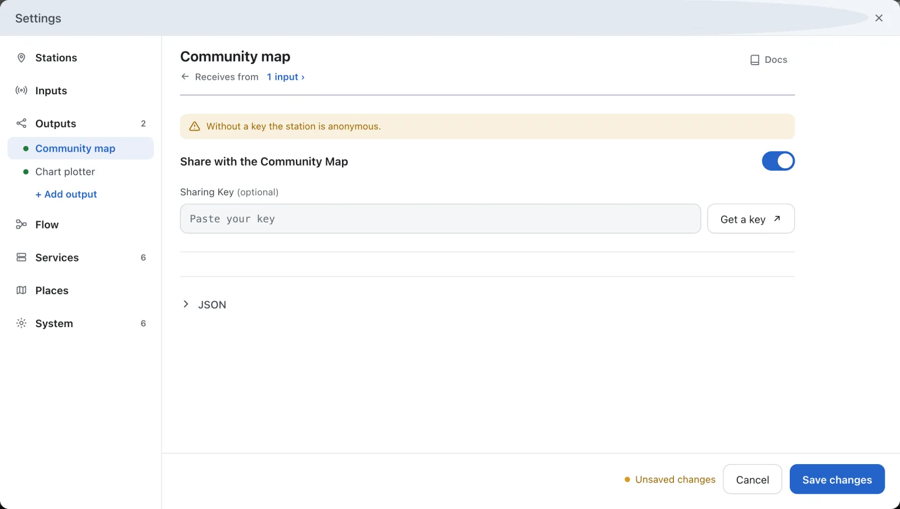

---
hide:
  - toc
---

# Share with the Community Map

AIS-catcher can add the ships you receive to the live map at [aiscatcher.org](https://www.aiscatcher.org). Without a key a station shares anonymously. A free station key gives it a name, coverage statistics and its own page.

**You need:** AIS-catcher receiving ships.

<div class="stepper" data-eyebrow="Guide" markdown>

<div class="stepper-step" markdown>

## Switch sharing on

=== "Managed mode"

    A new station shares from the start, anonymously.

    1. In the dashboard, open **Settings**, choose **Outputs** and then **Community map**.
    2. Check that **Share with the Community Map** is on. Without a key the station is anonymous, and the page says so.

    

    Without a key, the community map takes radio inputs only. A serial receiver or a network input is shared once the station has a key.

=== "Config file"

    Sharing is off until you switch it on. Add `"sharing": true` at the top level of the file:

    ```json
    {
      "config": "aiscatcher",
      "version": 1,
      "sharing": true
    }
    ```

    The `/etc/AIS-catcher/config.json` that the installer writes for the [service](../usage/service.md) has it already. Without a key the station is anonymous. Every input is shared, with or without a key.

=== "Command line"

    Sharing is off until you switch it on. Add `-X` to the command you already use:

    ```bash
    AIS-catcher -X
    ```

    Without a key the station is anonymous. Every input is shared, with or without a key.

    !!! tip "From the command line to a configuration file"
        Add `-J` to print your command line as a configuration file instead of running it: `AIS-catcher -X -J`.

</div>

<div class="stepper-step" markdown>

## Get a station key

This step is optional.

=== "Managed mode"

    Press **Get a key**: it opens aiscatcher.org, where you register the station and get its key. Paste the key in **Sharing Key**.

=== "Config file"

    [Register the station](https://www.aiscatcher.org/addstation_ac) on aiscatcher.org to get its key. Add the key as `sharing_key`:

    ```json
    {
      "config": "aiscatcher",
      "version": 1,
      "sharing": true,
      "sharing_key": "xxxxxxxx-xxxx-xxxx-xxxx-xxxxxxxxxxxx"
    }
    ```

=== "Command line"

    [Register the station](https://www.aiscatcher.org/addstation_ac) on aiscatcher.org to get its key. Put the key after `-X`:

    ```bash
    AIS-catcher -X xxxxxxxx-xxxx-xxxx-xxxx-xxxxxxxxxxxx
    ```

</div>

<div class="stepper-step" markdown>

## Save

=== "Managed mode"

    Press **Save changes**. Once a key is in, the button next to it reads **Edit station details** and opens your station on aiscatcher.org.

=== "Config file"

    Save the file and restart AIS-catcher with it:

    ```bash
    AIS-catcher -C config.json
    ```

=== "Command line"

    Stop AIS-catcher and start it again with the new command line.

</div>

<div class="stepper-step" markdown>

## Check it works

- Within a few minutes your ships show on the [live map](https://www.aiscatcher.org/livemap).
- With a key, your station has its own page under [Stations](https://www.aiscatcher.org/stations).

=== "Managed mode"

    The community map icon in the dashboard's control bar shows whether the station shares.

    To stop sharing, switch **Share with the Community Map** off and save. Nothing then leaves the station.

=== "Config file"

    At start, AIS-catcher logs `Community feed sharing: enabled.` With the [web viewer](../configuration/output/web-viewer.md) on, open **Statistics**. Under **System**, **Feeding Hub** reads **Yes**, or **Yes (anonymous)** without a key.

    To stop sharing, set `"sharing": false`, remove `sharing_key` and restart AIS-catcher. A `sharing_key` left in the file keeps sharing on. Nothing then leaves the station.

=== "Command line"

    At start, AIS-catcher logs `Community feed sharing: enabled.` With the [web viewer](../configuration/output/web-viewer.md) on, open **Statistics**. Under **System**, **Feeding Hub** reads **Yes**, or **Yes (anonymous)** without a key.

    To stop sharing, start AIS-catcher without `-X`. Nothing then leaves the station.

</div>

</div>

Every community feed setting is in the [Community Feed reference](../configuration/output/community-feed.md).
