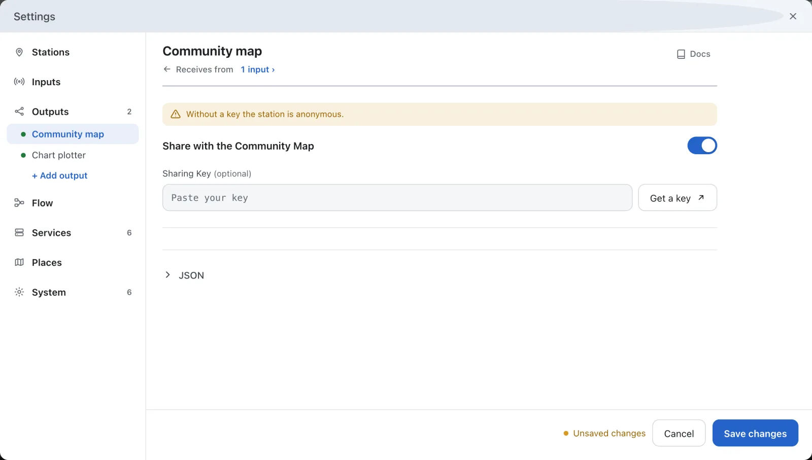

---
hide:
  - toc
---

# Share with the Community Map

AIS-catcher can add the ships you receive to the live map at [aiscatcher.org](https://www.aiscatcher.org). A new station shares from the start, anonymously. A free station key gives it a name, coverage statistics and its own page.

**You need:** AIS-catcher receiving ships.

## Open the community map page

In the dashboard, open **Settings**, choose **Outputs** and then **Community map**.

## Switch sharing on

Check that **Share with the Community Map** is on. Without a key the station is anonymous, and the page says so.

Without a key, the community map takes radio inputs only. A serial receiver or a network input is shared once the station has a key.

## Get a station key

This step is optional. Press **Get a key**: it opens aiscatcher.org, where you register the station and get its key. Paste the key in **Sharing Key**.

## Save

Press **Save changes**. Once a key is in, the button next to it reads **Edit station details** and opens your station on aiscatcher.org.

## Check it works

- Within a few minutes your ships show on the [live map](https://www.aiscatcher.org/livemap).
- With a key, your station has its own page under [Stations](https://www.aiscatcher.org/stations).
- The community map icon in the dashboard's control bar shows whether the station shares.

To stop sharing, switch **Share with the Community Map** off and save. Nothing then leaves the station.

## In manual mode

On the command line, `-X` switches sharing on, with the station key after it. In a configuration file the keys are `sharing` and `sharing_key`. See [Community Feed](../configuration/output/community-feed.md).
