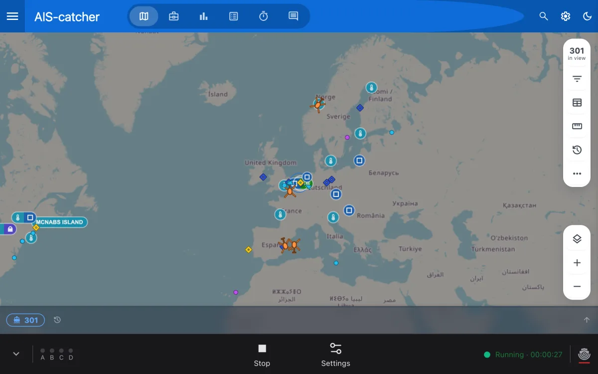

# Getting Around the Dashboard

In managed mode, AIS-catcher runs in the background and you set it up in the dashboard, in your browser. Open port 8118 of the computer that runs it, for example `http://localhost:8118`{ .address }. The [Quick Start](../getting-started/overview.md) covers the first start and the setup wizard.



## The Map

The map fills the dashboard and shows the ships your station receives, live. Its menus at the top open the ship list, statistics and the map's own settings.

This map loads no plugins and no about page, and it has no log tab: the dashboard keeps the log under **Settings → System → Log**. For a map with plugins or an about page, add a server under **Settings → Services** and open that map instead.

## The Control Bar

The bar at the bottom runs the station:

- **A B C D**: a light for each AIS channel, which flashes as messages arrive.
- **Start** or **Stop**: starts and stops the receiver.
- **Settings**: opens the settings.
- **Running** or **Stopped**, with the time since the start. A count of warnings and errors appears next to it; press it to open the log.
- The community map icon, on the right: its colour shows whether the station shares with the community map. It links to aiscatcher.org.
- The arrow on the left hides the bar. **Controls** brings it back.

## Settings

**Settings** opens a list on the left. Each item opens a page:

| Item | What it holds |
|------|---------------|
| **Stations** | Your station's name and position. |
| **Inputs** | Your receivers. See [Receiver](input.md). |
| **Outputs** | The community map and the programs that get your data. See [Outputs](output.md). |
| **Flow** | Which input reaches which output. |
| **Services** | The map servers, Home Assistant and webhooks. |
| **Places** | Ports, berths, anchorages and zones on the map. See [Places](#places). |
| **System** | **Status**, **Data & history**, **Log**, **Config file**, **Access** and **About**. |

Each page ends with **Cancel** and **Save changes**. A saved change is used at once; the receiver restarts by itself when a change needs it.

Under **System**:

- **Status** shows the receiver and the computer. **Copy for bug report** copies both.
- **Data & history** sets whether ships and statistics are kept over a restart.
- **Config file** shows the file the dashboard writes.
- **Access** sets the password and HTTPS. See [Remote Access and Security](remote-access.md).
- **About** has **Run setup**, which runs the setup wizard again.

## Places

**Settings → Places** is an editor for the places on the map: ports, berths, anchorages, terminals, guard zones and more. The first time, it asks to enable places and shows the folder they are saved in. Press **Save and continue**.

Pick a place from the list or on the map, or press **New place**. Draw or reshape its outline, set its **Type** and its **Parent**, and press **Save place**. A save takes effect at once, on the map and for every ship inside the changed outline.

- **Import…**, in the place menu, takes a GeoJSON Feature from anywhere. What it recognises is carried over: the name, the type, codes, the parent, category and rank. Everything else in the file is kept, and a Feature that says nothing about itself becomes a guard zone. The result opens for review and is stored when you save.
- **Import shape** and **Paste shape**, in the map's toolbar, replace only the outline of the place you are editing.

To use a folder of place files instead, enter it under **System → Data & history → Files → Place directory**.

## Starting Managed Mode Yourself

The installs start AIS-catcher in managed mode for you. Started by hand, it takes `-E` with its configuration file and the address the dashboard listens on:

```console
AIS-catcher -E ~/aiscatcher.json 127.0.0.1:8118
```

With `127.0.0.1`, only this computer can open the dashboard. See [Remote Access and Security](remote-access.md) to open it to your network.

Prefer a configuration file or the command line? See [Manual Mode](../usage/overview.md).
