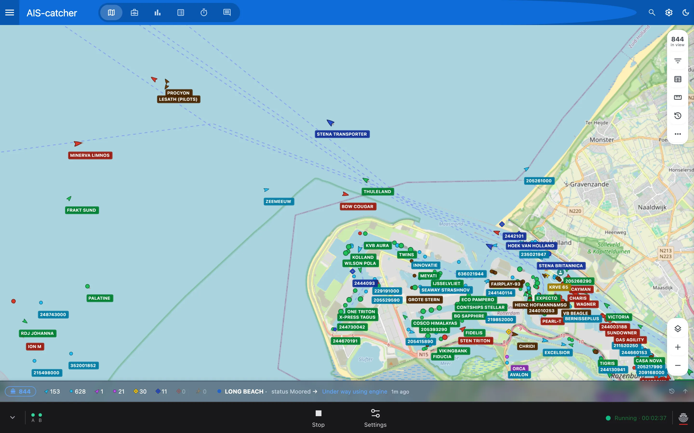
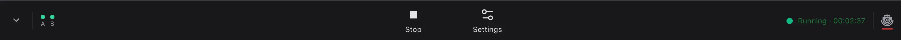

<header class="ais-hero ais-hero--night">
  

    Use your station · Managed mode
    <h1>Your station, at a glance.</h1>
    
In managed mode, AIS-catcher runs in the background and you run your station from the dashboard, in your browser: the ships it receives, the receiver, and every setting.

    
Web dashboardPort 8118: <code>localhost:8118</code>

  

</header>

<strong>Already installed?</strong> Open port 8118 of the computer that runs AIS-catcher, for example <code>http://localhost:8118</code>. First time? The <a href="../../getting-started/overview/">Quick Start</a> covers the first start and the setup wizard.

<ol class="ais-steps ais-steps--3" aria-label="On this page">
  <li><a href="#the-map"><b>1</b><strong>Explore the map</strong>Live ships and the map's menus</a></li>
  <li><a href="#the-control-bar"><b>2</b><strong>Run your station</strong>Start, stop and see it working</a></li>
  <li><a href="#settings"><b>3</b><strong>Change settings</strong>Receivers, outputs and more</a></li>
</ol>

<section aria-labelledby="meet-your-dashboard">
  

    The dashboard
    <h2 id="meet-your-dashboard">Meet your dashboard</h2>
    
The map fills the screen. Its menus sit at the top; the bar that runs the station sits at the bottom.

  

  <figure class="ais-shot">
    

      
      1
      2
      3
    

  </figure>
  <ol class="ais-steps ais-steps--3" aria-label="What the numbers show">
    <li><b>1</b><strong>The map</strong>The ships your station receives, live</li>
    <li><b>2</b><strong>The menus</strong>The ship list, statistics and the map's settings</li>
    <li><b>3</b><strong>The control bar</strong>Start, stop, settings and how the station is doing</li>
  </ol>
</section>

<section class="ais-panel ais-two" aria-labelledby="the-map">
  

    1 · The map
    <h2 id="the-map">Watch the ships around you</h2>
    
The map shows the ships your station receives, live. Its menus at the top open the ship list, statistics and the map's own settings.

  

  
<strong>The dashboard's map is a plain one.</strong> It loads no plugins and no about page, and it has no log tab: the log is under <strong>Settings → System → Log</strong>. For a map with plugins or an about page, add a server under <strong>Settings → Services</strong> and open that map instead.

</section>

<section aria-labelledby="the-control-bar">
  

    2 · The control bar
    <h2 id="the-control-bar">Run your station from the bar</h2>
    
The bar at the bottom of the dashboard runs the station.

  

  
  

    
<strong>Channel lights</strong>A light for each AIS channel, A B C D, which flashes as messages arrive.

    
<strong>Start or Stop</strong>Starts and stops the receiver.

    
<strong>Settings</strong>Opens the settings.

    
<strong>Running or Stopped</strong>With the time since the start. A count of warnings and errors appears next to it; press it to open the log.

    
<strong>The community map icon</strong>On the right. Its colour shows whether the station shares with the community map; it links to aiscatcher.org.

    
<strong>The arrow</strong>On the left, it hides the bar. <strong>Controls</strong> brings it back.

  

</section>

<section aria-labelledby="settings">
  

    3 · Settings
    <h2 id="settings">Everything under Settings</h2>
    
<strong>Settings</strong> opens a list on the left. Each item opens a page.

  

  

    <a class="ais-path-card" href="../station/"><svg aria-hidden="true"><use href="../../assets/ais-home-icons.svg#tower"></use></svg><strong>Stations</strong>Your station's name and position.</a>
    <a class="ais-path-card" href="../input/"><svg aria-hidden="true"><use href="../../assets/ais-home-icons.svg#signal"></use></svg><strong>Inputs</strong>Your receivers.</a>
    <a class="ais-path-card" href="../output/"><svg aria-hidden="true"><use href="../../assets/ais-home-icons.svg#link"></use></svg><strong>Outputs</strong>The community map and the programs that get your data.</a>
    
<svg aria-hidden="true"><use href="../../assets/ais-home-icons.svg#layers"></use></svg><strong>Flow</strong>Which input reaches which output.

    
<svg aria-hidden="true"><use href="../../assets/ais-home-icons.svg#globe"></use></svg><strong>Services</strong>The map servers, Home Assistant and webhooks.

    <a class="ais-path-card" href="#places"><svg aria-hidden="true"><use href="../../assets/ais-home-icons.svg#map"></use></svg><strong>Places</strong>Ports, berths, anchorages and zones on the map.</a>
    <a class="ais-path-card" href="#system"><svg aria-hidden="true"><use href="../../assets/ais-home-icons.svg#cpu"></use></svg><strong>System</strong>Status, data and history, the log, the configuration file, access and about.</a>
  

  
<strong>Saving.</strong> Each page ends with <strong>Cancel</strong> and <strong>Save changes</strong>. A saved change is used at once; the receiver restarts by itself when a change needs it.

  

    
<svg aria-hidden="true"><use href="../../assets/ais-home-icons.svg#cpu"></use></svg>What is under System?

    

      
<strong>Status</strong> shows the receiver and the computer. <strong>Copy for bug report</strong> copies both.

      
<strong>Data &amp; history</strong> sets whether ships and statistics are kept over a restart.

      
<strong>Log</strong> holds the log, which the dashboard's map does not show.

      
<strong>Config file</strong> shows the file the dashboard writes.

      
<strong>Access</strong> sets the password and HTTPS. See <a href="../remote-access/">Remote Access and Security</a>.

      
<strong>About</strong> has <strong>Run setup</strong>, which runs the setup wizard again.

    

  

</section>

<section class="ais-panel ais-panel--flow" aria-labelledby="places">
  

    Settings · Places
    <h2 id="places">Draw your own places</h2>
    
<strong>Settings → Places</strong> is an editor for the places on the map: ports, berths, anchorages, terminals, guard zones and more.

  

  <ol class="ais-steps ais-steps--3">
    <li><b>1</b><strong>Open Places</strong>The first time, it asks to enable places and shows the folder they are saved in. Press <b>Save and continue</b>.</li>
    <li><b>2</b><strong>Pick or draw a place</strong>Pick one from the list or on the map, or press <b>New place</b>. Draw or reshape its outline, and set its <b>Type</b> and its <b>Parent</b>.</li>
    <li><b>3</b><strong>Save the place</strong>Press <b>Save place</b>. It takes effect at once, on the map and for every ship inside the changed outline.</li>
  </ol>
  

    
<svg aria-hidden="true"><use href="../../assets/ais-home-icons.svg#layers"></use></svg>Import a place, or keep places in a folder

    

      
<strong>Import…</strong>, in the place menu, takes a GeoJSON Feature from anywhere. What it recognises is carried over: the name, the type, codes, the parent, category and rank. Everything else in the file is kept, and a Feature that says nothing about itself becomes a guard zone. The result opens for review and is stored when you save.

      
<strong>Import shape</strong> and <strong>Paste shape</strong>, in the map's toolbar, replace only the outline of the place you are editing.

      
To use a folder of place files instead, enter it under <strong>System → Data &amp; history → Files → Place directory</strong>.

    

  

</section>

<section aria-label="Start managed mode yourself">

  
<svg aria-hidden="true"><use href="../../assets/ais-home-icons.svg#terminal"></use></svg>Start managed mode yourself

  

    
The installs start AIS-catcher in managed mode for you. Started by hand, it takes <code>-E</code> with its configuration file and the address the dashboard listens on:

    
<pre><code>AIS-catcher -E ~/aiscatcher.json 127.0.0.1:8118</code></pre>

    
With <code>127.0.0.1</code>, only this computer can open the dashboard. See <a href="../remote-access/">Remote Access and Security</a> to open it to your network. Prefer a configuration file or the command line? See <a href="../../usage/overview/">Manual Mode</a>.

  

</section>

<section class="ais-cta" aria-label="Next">
  
Keep exploring<h2>What's next for your station?</h2>

  
<a class="ais-action ais-action--primary" href="../receivers/">Connect your receivers</a><a class="ais-action ais-action--primary" href="../output/">Outputs</a><a class="ais-action ais-action--primary" href="../remote-access/">Access and security</a>

</section>

