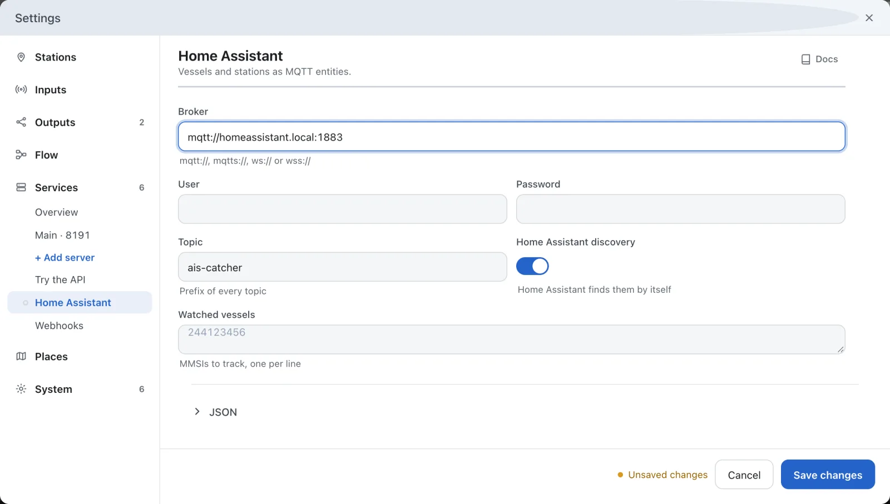

---
hide:
  - toc
---

# Vessels in Home Assistant

AIS-catcher can publish your station and the vessels you follow to Home Assistant over MQTT. With discovery on, Home Assistant adds them as entities by itself.

**You need:** Home Assistant with its MQTT integration set up, and the address of the MQTT broker it uses, with the user and password if it asks for them.

<div class="stepper" data-eyebrow="Guide" markdown>

<div class="stepper-step" markdown>

## Connect to the broker

=== "Managed mode"

    1. In the dashboard, open **Settings**, choose **Services** and then **Home Assistant**.
    2. Enter the **Broker**, for example `mqtt://homeassistant.local:1883`. Fill in **User** and **Password** if the broker asks for them.
    3. Leave **Home Assistant discovery** on. Under **Watched vessels**, enter the MMSI of each vessel you want to follow, one per line. Each one becomes a device tracker in Home Assistant.
    4. Press **Save changes**.

    

=== "Config file"

    Add an `mqtt_state` section:

    ```json
    {
      "config": "aiscatcher",
      "version": 1,
      "mqtt_state": {
        "url": "mqtt://homeassistant.local:1883",
        "username": "ais",
        "password": "secret",
        "watch": [244123456, 211234567]
      }
    }
    ```

    | Key | What it does |
    |-----|--------------|
    | `url` | The broker. |
    | `username`, `password` | Leave them out if the broker does not ask for them. |
    | `watch` | The MMSI of each vessel you want to follow. Each one becomes a device tracker in Home Assistant. |

    Home Assistant discovery is on unless you add `"discovery": false`.

    Then restart AIS-catcher with the file:

    ```bash
    AIS-catcher -C config.json
    ```

=== "Command line"

    Add `-W` with the broker to the command you already use. After it come the user, the password and the vessels to follow, their MMSIs separated by commas:

    ```bash
    AIS-catcher -W mqtt://homeassistant.local:1883 USERNAME ais PASSWORD secret WATCH 244123456,211234567
    ```

    Leave out `USERNAME` and `PASSWORD` if the broker does not ask for them. Each watched vessel becomes a device tracker in Home Assistant. Home Assistant discovery is on unless you add `DISCOVERY off`.

    !!! tip "From the command line to a configuration file"
        Add `-J` to print your command line as a configuration file instead of running it: `AIS-catcher -W mqtt://homeassistant.local:1883 WATCH 244123456 -J`.

</div>

<div class="stepper-step" markdown>

## Check it works

In Home Assistant, open **Settings → Devices & services → MQTT**. It lists an AIS-catcher device with your station's entities, such as Vessels, Message rate and Range of the last 24 hours, and a device tracker for each watched vessel.

[Home Assistant and MQTT state](../api/home-assistant.md) lists every topic and entity. To post events to Home Assistant without MQTT, see [Webhooks](../api/webhooks.md).

</div>

</div>
