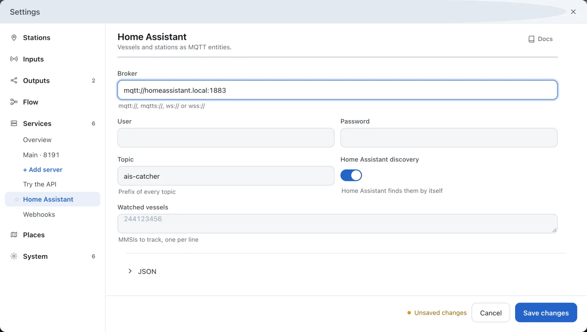

---
hide:
  - toc
---

# Vessels in Home Assistant

AIS-catcher can publish your station and the vessels you follow to Home Assistant over MQTT. With discovery on, Home Assistant adds them as entities by itself.

**You need:** Home Assistant with its MQTT integration set up, and the address of the MQTT broker it uses, with the user and password if it asks for them.

## Open the Home Assistant page

In the dashboard, open **Settings**, choose **Services** and then **Home Assistant**.

## Enter the broker

Enter the **Broker**, for example `mqtt://homeassistant.local:1883`. Fill in **User** and **Password** if the broker asks for them.

## Choose the vessels to follow

Leave **Home Assistant discovery** on. Under **Watched vessels**, enter the MMSI of each vessel you want to follow, one per line. Each one becomes a device tracker in Home Assistant.

## Save

Press **Save changes**.

## Check it works

In Home Assistant, open **Settings → Devices & services → MQTT**. It lists an AIS-catcher device with your station's entities, such as Vessels, Message rate and Range of the last 24 hours, and a device tracker for each watched vessel.

[Home Assistant and MQTT state](../api/home-assistant.md) lists every topic and entity.

## In manual mode

In a configuration file, the section is `mqtt_state`. On the command line, `-W` takes the broker's address and the same keys. See [Home Assistant and MQTT state](../api/home-assistant.md); to post events to Home Assistant without MQTT, see [Webhooks](../api/webhooks.md).
