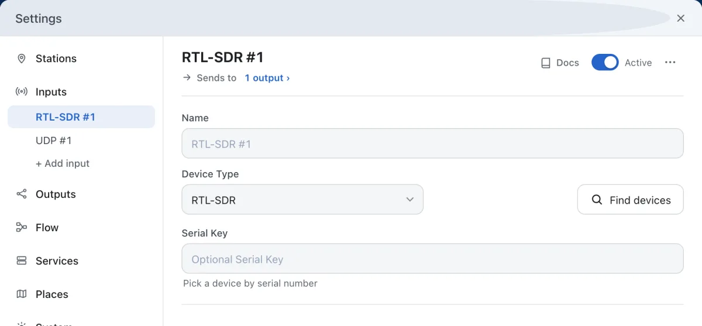

# Receiver

**Settings → Inputs** lists your receivers. Each one has its own page. The setup wizard adds the first one; **+ Add input** adds another.

- **Device Type**: the kind of receiver: RTL-SDR, Airspy, HackRF, SDRplay and the other SDRs, **Serial (NMEA receiver)**, **UDP (NMEA over the network)**, a **Network client** or **SpyServer**. A dAISy-catcher is a **Serial (NMEA receiver)** input; the setup wizard fills in its settings for you.
- **Find devices** looks for receivers on this computer. Pick one to fill in its details.
- **Serial Key** picks one dongle by its serial number, when more than one is plugged in. With a single dongle, leave it empty.
- **Active** switches the input on or off without deleting it. A hollow dot in the list marks an input that is off.
- **Station** is where this antenna stands, from the stations under **Settings → Stations**.
- **Advanced settings** holds the rest, such as the tuner gain, the sample rate, the frequency correction and the decoding engine.
- **Docs** opens the reference for that kind of receiver.

Press **Save changes**, then **Restart receiver**, to use a change.

A mark next to an input in the list means it needs attention: hover over it to see why, for example a device that is unplugged or used by another program.
