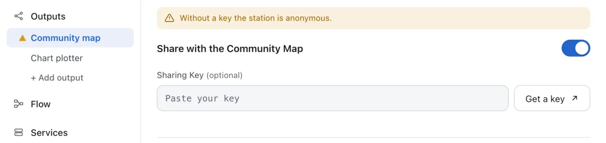

# Outputs

**Settings → Outputs** lists where your data goes: the community map first, then the outputs you added.

## Community Map

**Share with the Community Map** sends your ships to the [aiscatcher.org](https://www.aiscatcher.org) community map. A new station shares from the start, anonymously.

To give your station a name, coverage statistics and its own page, register it:

1. [Create a station on aiscatcher.org](https://www.aiscatcher.org/addstation_ac). You get a station key.
2. Paste the key in **Sharing Key** and press **Save changes**, then **Restart receiver**.

Once a key is in, the button next to it reads **Edit station details** and opens your station on aiscatcher.org. Switch sharing off and nothing leaves the station.

The community map icon in the control bar shows the state at a glance.

## Other Programs

**+ Add output** opens **Add an output**:

| Output | What it does |
|--------|--------------|
| **UDP** | NMEA to another program on the network |
| **HTTP** | Post batches to a web address |
| **MQTT** | Publish to a broker |
| **TCP Client** | Connect out to a server and send |
| **TCP Server** | Let programs connect in and read |
| **Database** | SQLite, PostgreSQL or CSV files |
| **Screen** | Print the messages in the log |

Fill in what the output needs, such as an address and a port, and give it a **Name**. The rest is under **Advanced settings**. **Active** switches an output off without deleting it.

[Send Ships to Your Chart Plotter](chart-plotter.md) walks through a UDP output, start to finish.

A mark next to an output in the list means it needs attention: amber for a setting, red for a problem while it runs. Hover over it to see why.

## Maps, Home Assistant and Webhooks

These are under **Settings → Services**. **+ Add server** adds a map of its own on another port, which you can share on your network or publicly, with the API and other feeds beside it. **Home Assistant** and **Webhooks** have their own pages there.

Press **Save changes**, then **Restart receiver**, to use a change.
