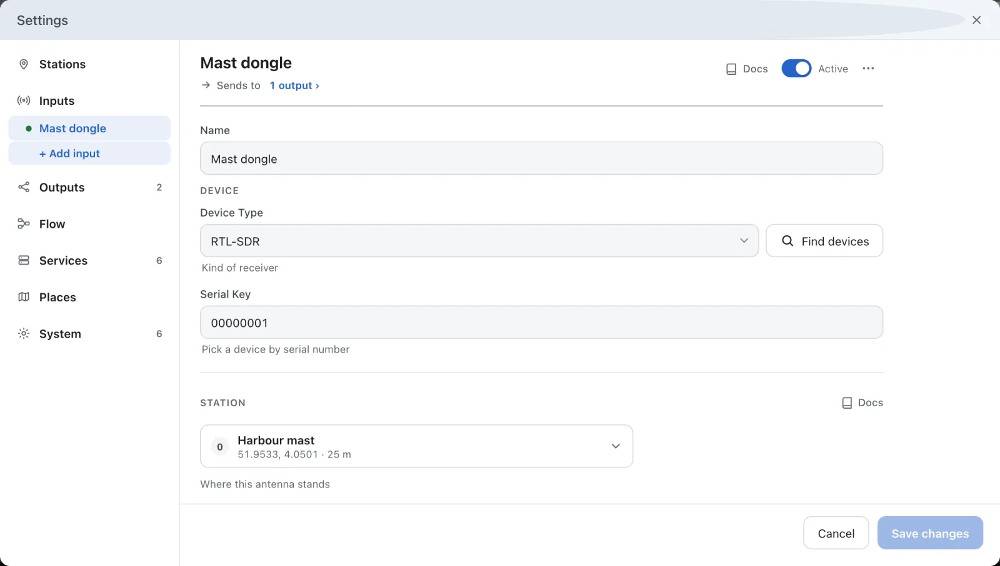
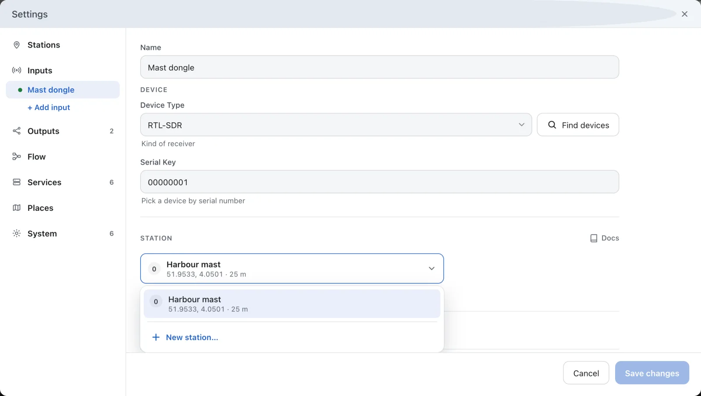

---
hide:
  - toc
---

# Connect Your Receivers

Each input is a receiver that AIS comes from: an RTL-SDR or another radio, a dAISy-catcher on a serial port, or NMEA that arrives over the network. Add an input for every receiver you have.

**You need:** each receiver plugged into the computer that runs AIS-catcher. For NMEA over the network, the port it arrives on.

<div class="stepper" data-eyebrow="Guide" markdown>

<div class="stepper-step" markdown>

## Add a receiver

=== "Managed mode"

    1. In the dashboard, open **Settings**, choose **Inputs** and press **+ Add input**. The setup wizard adds the first receiver; **+ Add input** adds another.
    2. Press **Find devices** and pick the receiver from the list. This fills in its **Device Type** and its **Serial Key**, the serial number that tells two dongles apart.

        For a receiver that is not in the list, choose the **Device Type** yourself. A dAISy-catcher is a **Serial (NMEA receiver)**: press **Find ports** to pick its port.

    3. Give the input a **Name**, such as *Mast dongle*. With more than one receiver, **Statistics** lists each by its name.

    

=== "Config file"

    Add an entry to the `receiver` list for each receiver:

    ```json
    {
      "config": "aiscatcher",
      "version": 1,
      "receiver": [
        { "input": "rtlsdr", "serial": "00000001", "description": "Mast dongle" },
        { "input": "serialport", "serialport": { "baudrate": 115200, "port": "/dev/ttyACM0" }, "description": "dAISy" },
        { "input": "udpserver", "udpserver": { "server": "0.0.0.0", "port": 10110 }, "description": "Pier feed" }
      ]
    }
    ```

    | Key | What it does |
    |-----|--------------|
    | `input` | The kind of device: `rtlsdr`, `airspy`, `serialport` for a dAISy-catcher or another NMEA receiver, `udpserver` for NMEA over the network, and so on. |
    | `serial` | Picks one device of that kind by its serial number, the number that tells two dongles apart. |
    | `serialport` | The `port` of a serial receiver and its `baudrate`. A dAISy-catcher runs at 115200. |
    | `udpserver` | The `port` NMEA arrives on. `"server": "0.0.0.0"` listens on every network the computer is on. |
    | `description` | The receiver's name. With more than one receiver, **Statistics** lists each by its name. |

    `AIS-catcher -l` lists the devices that are connected, with their serial numbers. [Inputs](../configuration/input/overview.md) has a page for every kind of device.

=== "Command line"

    Each input switch adds a receiver: `-d` picks a device by its serial number, `-e` opens a serial port at a baud rate, and `-x` listens for NMEA over UDP. Add them to the command you already use:

    ```bash
    AIS-catcher -d 00000001 -e 115200 /dev/ttyACM0 -x 0.0.0.0 10110
    ```

    `AIS-catcher -l` lists the devices that are connected, with their serial numbers. A dAISy-catcher runs at 115200. With `-x`, `0.0.0.0` listens on every network the computer is on. [Inputs](../configuration/input/overview.md) has a page for every kind of device.

    The command line has no setting for a receiver's name: **Statistics** lists each by its kind and number, such as *RTL-SDR #1*. To name them, use a configuration file.

    !!! tip "From the command line to a configuration file"
        Add `-J` to print your command line as a configuration file instead of running it: `AIS-catcher -d 00000001 -J`.

</div>

<div class="stepper-step" markdown>

## Choose its station

=== "Managed mode"

    Under **Station**, choose where this antenna stands. With one station, leave it as it is. For an antenna at another place, pick **New station…** in the list.

    

=== "Config file"

    `station` is the `id` of the entry in `stations` where this antenna stands. With one station, leave it out: a receiver that names none stands at station `0`. For an antenna at another place, add a station and name it:

    ```json
    {
      "config": "aiscatcher",
      "version": 1,
      "stations": [
        { "id": 0, "name": "Harbour mast", "lat": 52.10, "lon": 4.27, "share_loc": true },
        { "id": 1, "name": "Pier", "lat": 52.11, "lon": 4.25, "share_loc": true }
      ],
      "receiver": [
        { "input": "rtlsdr", "serial": "00000001", "description": "Mast dongle" },
        { "input": "udpserver", "udpserver": { "server": "0.0.0.0", "port": 10110 }, "description": "Pier feed", "station": 1 }
      ]
    }
    ```

    [Name and Place Your Station](station.md) explains the keys of a station.

=== "Command line"

    The command line describes one station, on the `-N` of the web viewer, and every receiver stands there: see [Name and Place Your Station](station.md). Antennas at different places need a configuration file.

</div>

<div class="stepper-step" markdown>

## Save and start

=== "Managed mode"

    Press **Save changes**. If the receiver is stopped, press **Start** in the control bar.

=== "Config file"

    Restart AIS-catcher with the file:

    ```bash
    AIS-catcher -C config.json
    ```

=== "Command line"

    Restart AIS-catcher with the new command line.

</div>

<div class="stepper-step" markdown>

## Check it works

=== "Managed mode"

    - In an area with traffic, the ships the new receiver hears appear on the dashboard map within a few minutes.
    - In the dashboard, open **Statistics**. Under **System**, each input is listed as a **Device**, and **Message rate** shows what comes in.

    !!! question "Nothing from the new receiver?"
        Open **Settings → Inputs**. A mark next to an input means it needs attention: hover over it to see why, for example a device that is unplugged or used by another program. A hollow dot marks an input that is switched off.

=== "Config file"

    - In an area with traffic, the ships the new receiver hears appear on the map of the [web viewer](../configuration/output/web-viewer.md) within a few minutes.
    - In the web viewer, open **Statistics**. Under **System**, each input is listed as a **Device**, and **Message rate** shows what comes in.

    !!! question "Nothing from the new receiver?"
        AIS-catcher says why in its log when it starts, for example that it cannot find a device with that serial number. `AIS-catcher -l` lists the devices it can see. An entry with `"active": false` is switched off.

=== "Command line"

    - In an area with traffic, the ships the new receiver hears appear on the map of the [web viewer](../configuration/output/web-viewer.md) within a few minutes.
    - In the web viewer, open **Statistics**. Under **System**, each input is listed as a **Device**, and **Message rate** shows what comes in.

    !!! question "Nothing from the new receiver?"
        AIS-catcher says why in its log when it starts, for example that it cannot find a device with that serial number. `AIS-catcher -l` lists the devices it can see.

</div>

</div>
