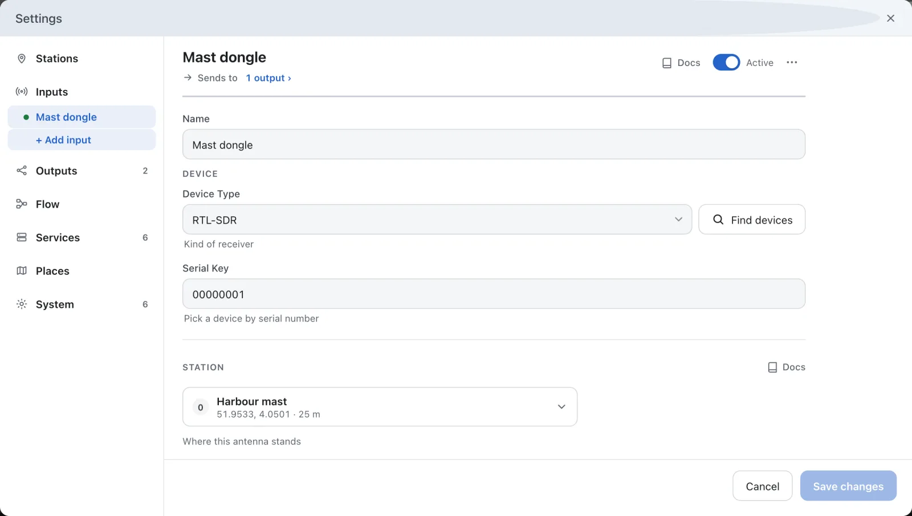
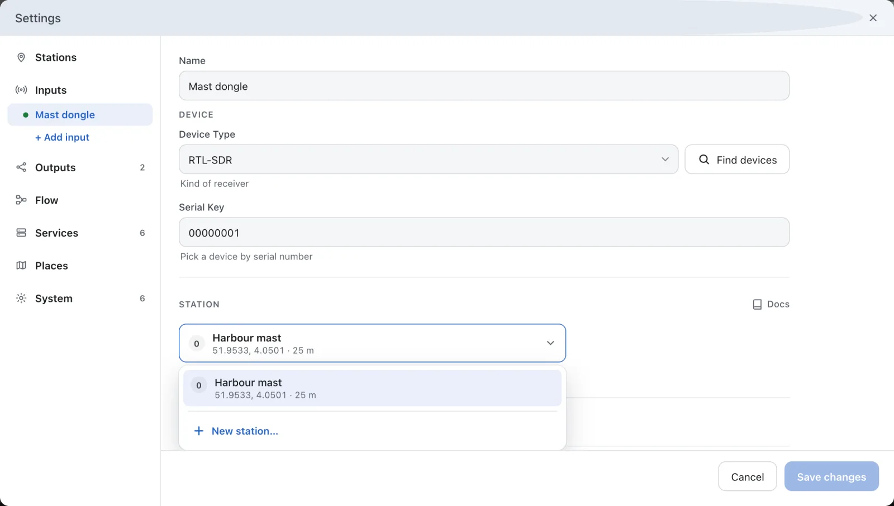

---
hide:
  - toc
---

# Connect Your Receivers

Each input is a receiver that AIS comes from: an RTL-SDR or another radio, a dAISy-catcher on a serial port, or NMEA that arrives over the network. Add an input for every receiver you have.

**You need:** each receiver plugged into the computer that runs AIS-catcher. For NMEA over the network, the port it arrives on.

## Add an input

In the dashboard, open **Settings**, choose **Inputs** and press **+ Add input**. The setup wizard adds the first receiver; **+ Add input** adds another.

## Pick the receiver

Press **Find devices** and pick the receiver from the list. This fills in its **Device Type** and its **Serial Key**, the serial number that tells two dongles apart.

For a receiver that is not in the list, choose the **Device Type** yourself. A dAISy-catcher is a **Serial (NMEA receiver)**: press **Find ports** to pick its port.

## Name it

Give the input a **Name**, such as *Mast dongle*. With more than one receiver, **Statistics** lists each by its name.

## Choose its station

Under **Station**, choose where this antenna stands. With one station, leave it as it is. For an antenna at another place, pick **New station…** in the list.

## Save and start

Press **Save changes**. If the receiver is stopped, press **Start** in the control bar.

## Check it works

- In an area with traffic, the ships the new receiver hears appear on the dashboard map within a few minutes.
- In the dashboard, open **Statistics**. Under **System**, each input is listed as a **Device**, and **Message rate** shows what comes in.

!!! question "Nothing from the new receiver?"
    Open **Settings → Inputs**. A mark next to an input means it needs attention: hover over it to see why, for example a device that is unplugged or used by another program. A hollow dot marks an input that is switched off.

## In manual mode

In a configuration file, each receiver is an entry of the `receiver` list: see [Receivers](../usage/json-configuration.md#receivers-receiver). [Input Configuration](../configuration/input/overview.md) covers the command line and has a page for every kind of device.
