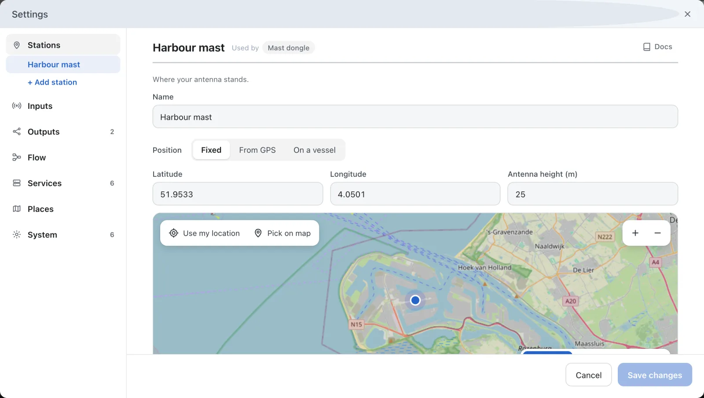

---
hide:
  - toc
---

# Name and Place Your Station

Tell AIS-catcher where your antenna stands. Every ship's distance and bearing, and your station's range, are measured from there.

**You need:** the position of your antenna, as a latitude and longitude or as a spot you can find on a map.

<div class="stepper" data-eyebrow="Guide" markdown>

<div class="stepper-step" markdown>

## Name and place the station

=== "Managed mode"

    1. In the dashboard, open **Settings** and choose **Stations**. Your station comes first: every input stands there until you add more stations. Give it a **Name**, such as *Harbour mast*.
    2. Under **Position**, switch **No position** off if it is on. Type the **Latitude** and **Longitude** in decimal degrees, or press **Pick on map** and click where the antenna stands. **Antenna height (m)** is optional.

    

=== "Config file"

    Add an entry to the `stations` list:

    ```json
    {
      "config": "aiscatcher",
      "version": 1,
      "stations": [
        { "id": 0, "name": "Harbour mast", "lat": 52.10, "lon": 4.27, "alt": 20, "share_loc": true }
      ]
    }
    ```

    | Key | What it does |
    |-----|--------------|
    | `id` | `0` is the station where every receiver stands that names no other. |
    | `name` | The station's name. |
    | `lat`, `lon` | Where the antenna stands, in decimal degrees. |
    | `alt` | The height of the antenna in metres. Optional. |
    | `share_loc` | Lets the web viewer show where the station is, and each ship's distance and bearing. Off unless set. |

    Every key of a station is in [Stations](../usage/json-configuration.md#stations-stations).

=== "Command line"

    On the command line, the `-N` of the web viewer describes the station. Add its name and position to the `-N` of the command you already use:

    ```bash
    AIS-catcher -N 8100 station "Harbour mast" lat 52.10 lon 4.27 share_loc on
    ```

    `station` is the name, and `lat` and `lon` are where the antenna stands, in decimal degrees. `alt 20` adds the height of the antenna in metres. `share_loc on` lets the web viewer show where the station is, and each ship's distance and bearing.

</div>

<div class="stepper-step" markdown>

## A station that moves

On land, skip this step.

=== "Managed mode"

    On a boat, the position you typed is where the station stands until something moves it:

    - **Follow GPS** moves the station with each fix from a GPS, or from an AIS receiver that passes GPS sentences.
    - **Rides a vessel (MMSI)** takes the MMSI of the ship the station is on. The station is then wherever that ship last reported.

=== "Config file"

    On a boat, `lat` and `lon` are where the station stands until something moves it. Add one of these to its entry:

    - `"gps": true` moves the station with each fix from a GPS, or from an AIS receiver that passes GPS sentences.
    - `"mmsi": 244123456` takes the MMSI of the ship the station is on. The station is then wherever that ship last reported.

=== "Command line"

    On a boat, `lat` and `lon` are where the station stands until something moves it:

    - GPS moves the station with each fix from a GPS, or from an AIS receiver that passes GPS sentences. On the command line this is on already: `use_gps off` on the `-N` keeps the station in place.
    - `own_mmsi 244123456` on the `-N` takes the MMSI of the ship the station is on. The station is then wherever that ship last reported.

</div>

<div class="stepper-step" markdown>

## Save

=== "Managed mode"

    Press **Save changes**. The station uses the new position at once.

=== "Config file"

    Restart AIS-catcher with the file:

    ```bash
    AIS-catcher -C config.json
    ```

=== "Command line"

    Restart AIS-catcher with the new command line.

</div>

<div class="stepper-step" markdown>

## Check it works

=== "Managed mode"

    - The dashboard map shows the station where you put it.
    - Click a ship: its card shows the **Distance** and **Bearing** from the station.
    - In the dashboard, open **Statistics**. Under **This Session**, **Max Distance** is the furthest ship heard since the start.

    !!! question "No distance or bearing?"
        A map shows them only when its server shows where the stations are. Open **Settings → Services → Main** and, under **Shows**, switch **Station locations** on. On a new installation it is on already.

=== "Config file"

    - The map of the [web viewer](../configuration/output/web-viewer.md) shows the station where you put it.
    - Click a ship: its card shows the **Distance** and **Bearing** from the station.
    - In the web viewer, open **Statistics**. Under **This Session**, **Max Distance** is the furthest ship heard since the start.

    !!! question "No distance or bearing?"
        The web viewer shows them only when the station's entry has `"share_loc": true`. A `share_loc` in the server's own section counts over it.

=== "Command line"

    - The map of the [web viewer](../configuration/output/web-viewer.md) shows the station where you put it.
    - Click a ship: its card shows the **Distance** and **Bearing** from the station.
    - In the web viewer, open **Statistics**. Under **This Session**, **Max Distance** is the furthest ship heard since the start.

    !!! question "No distance or bearing?"
        The web viewer shows them only with `share_loc on` on the `-N`.

</div>

</div>
