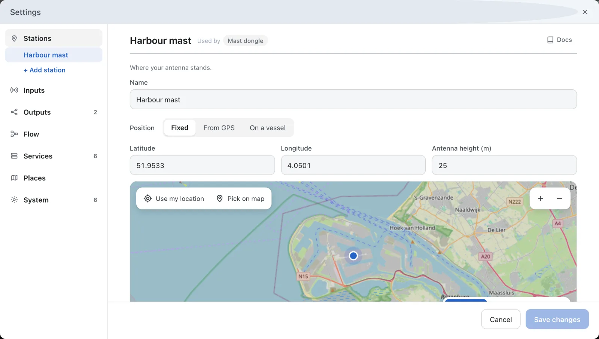

---
hide:
  - toc
---

# Name and Place Your Station

Tell AIS-catcher where your antenna stands. Every ship's distance and bearing, and your station's range, are measured from there.

**You need:** the position of your antenna, as a latitude and longitude or as a spot you can find on a map.

## Open your station

In the dashboard, open **Settings** and choose **Stations**. Your station comes first: every input stands there until you add more stations.

Give it a **Name**, such as *Harbour mast*.

## Set the position

Under **Position**, switch **No position** off if it is on. Type the **Latitude** and **Longitude** in decimal degrees, or press **Pick on map** and click where the antenna stands. **Antenna height (m)** is optional.

## A station that moves

On land, skip this step. On a boat, the position you typed is where the station stands until something moves it:

- **Follow GPS** moves the station with each fix from a GPS, or from an AIS receiver that passes GPS sentences.
- **Rides a vessel (MMSI)** takes the MMSI of the ship the station is on. The station is then wherever that ship last reported.

## Save

Press **Save changes**. The station uses the new position at once.

## Check it works

- The dashboard map shows the station where you put it.
- Click a ship: its card shows the **Distance** and **Bearing** from the station.
- In the dashboard, open **Statistics**. Under **This Session**, **Max Distance** is the furthest ship heard since the start.

!!! question "No distance or bearing?"
    A map shows them only when its server shows where the stations are. Open **Settings → Services → Main** and, under **Shows**, switch **Station locations** on. On a new installation it is on already.

## In manual mode

In a configuration file, a station is an entry of the `stations` list: see [Stations](../usage/json-configuration.md#stations-stations). On the command line, the web viewer's `lat` and `lon` place the station: see [Web Viewer](../configuration/output/web-viewer.md).
