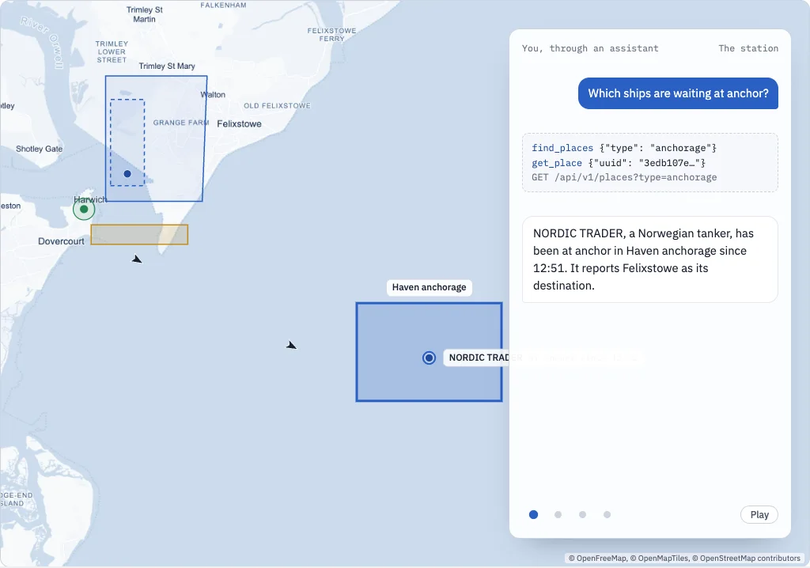
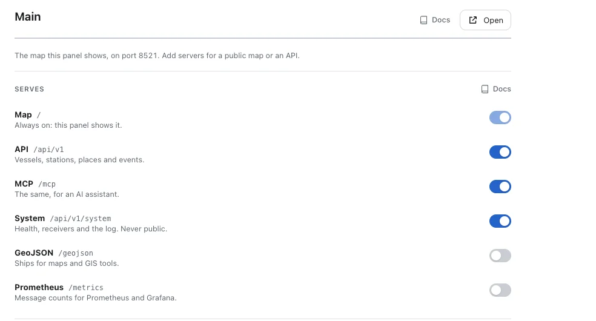
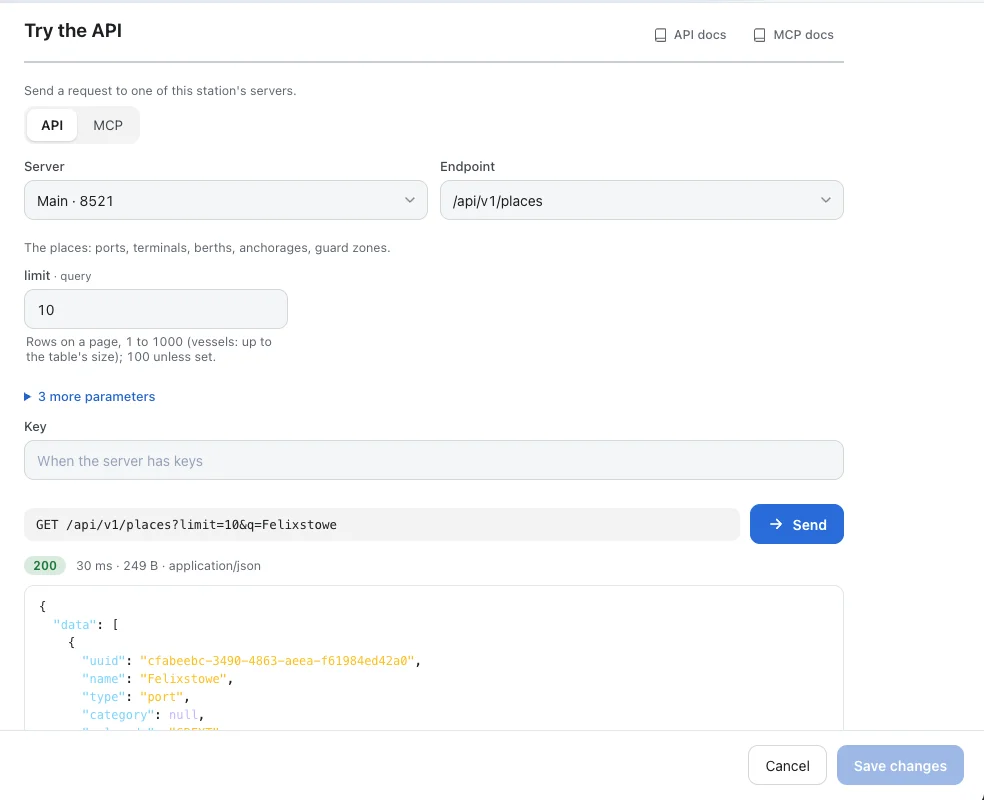

<nav class="series" aria-label="The parts of this series" markdown>

[<small>Part 1</small> Multiple receivers](stations.md) [<small>Part 2</small> Geofencing](places.md) [<small>Part 3</small> API and MCP](api-and-mcp.md){ .is-current } [<small>Part 4</small> Home automation](home-automation.md)

</nav>

# Querying your station with the API and MCP

Every station answers questions: over HTTP for your scripts and spreadsheets, and in plain words through an AI assistant. The same data, the same places, two ways to ask.
{ .lead }

Connecting your station to other tools, part 3 · 8 minutes to read
{ .tutorial-meta }

<figure markdown>
{ loading=lazy }
<figcaption>The first of four questions to the station at Harwich: the assistant calls two tools, and the answer comes from the station's own data.</figcaption>
</figure>

Four questions to the station at Harwich. Each one is answered by a tool; the third column is the same question over HTTP, and the last the answer. The answers come from the station's own data.

| Question | Tool the assistant calls | API request | The answer |
|----------|--------------------------|-------------|---|
| Which ships are waiting at anchor? | `find_places {"type": "anchorage"}`<br>`get_place {"uuid": "3edb107e…"}` | `GET /api/v1/places?type=anchorage` | NORDIC TRADER, a Norwegian tanker, has been at anchor in Haven anchorage since 12:51. It reports Felixstowe as its destination. |
| Who came through the harbour mouth in the last hour? | `place_visits {"uuid": "508906af…", "hours": 1}` | `GET /api/v1/places/508906af…/visits?hours=1` | Three ships: MAAS CARRIER came in at 12:54, HOOK EXPRESS went out at 13:02, and the pilot boat STOUR PILOT crossed three times. |
| Where did MAAS CARRIER go? | `vessel_visits {"mmsi": 244870001}`<br>`vessel_track {"mmsi": 244870001}` | `GET /api/v1/vessels/244870001/track` | It came in through the harbour mouth at 12:54, entered Felixstowe at 12:58 and has been moored at Trinity Terminal since 13:02. |
| Is my station healthy? | `health {}`<br>`list_receivers {}` | `GET /api/v1/health` | Yes. The engine and its receiver pass their checks, and the Harwich station was heard a second ago. |

Your station knows a lot: which ships it hears, where they went, who called at which port, what happened and when. There are two ways to ask. Programs ask over HTTP, through the **API**. People ask in plain words, through an AI assistant connected over **MCP**, the Model Context Protocol. Both read the same data, including the stations and places of the earlier parts of this series.

## Switch them on

In the dashboard open **Settings**, then **Services** and **Main**, the server beside the dashboard. Switch on **API** and **MCP**, and **System** as well if questions about the station itself, its receivers, health and log, should be answered too. On a standard installation Main can be reached from your network, so **Access** asks who may read it: **Open** for anyone on the network, or **Keys** for those you give one with **New key**. System needs Keys. Then **Save changes**.

<figure markdown>
{ loading=lazy }
<figcaption>Services, Main: each service is a switch. The screenshots come from a test installation on its own ports.</figcaption>
</figure>

On a standard installation the dashboard is on port 8118 and the Main server, with the map, the API and MCP, on 8119. Without the dashboard the switches follow the server's port, and the server stays on this machine until you give it keys or make it public:

**Command line**

```bash
AIS-catcher -d 00000001 -N 8100 api on mcp on system on
```

**config.json**

```json
"services": [ { "port": 8100, "api": true, "mcp": true, "system": true } ]
```

## In plain words: MCP

MCP is an open standard for handing an assistant a set of tools. Your station offers up to twenty-two: find vessels, look up a place, list its visits, read the events, check the receivers. The assistant picks the tools, reads the answers and writes its reply. Every tool only reads; none can change a setting, stop anything or send anything out.

For Claude Code on the station itself, one line connects it. **Try the API**, under **Connect an assistant** in its MCP view, shows the same line with your station's address, and with the key when Main uses Keys:

**Terminal**

```bash
claude mcp add --transport http aiscatcher http://127.0.0.1:8119/mcp
```

Other assistants that speak MCP over HTTP take the same address. Here is a real exchange with the test station, asked in Claude Code:

> Which ships are waiting at anchor off Harwich, and which ships are bound for Felixstowe? Keep the answer short.

Claude called six tools:

1. `find_places {"q": "Harwich"}`
2. `find_places {"type": "anchorage"}`
3. `find_places {"q": "Felixstowe"}`
4. `get_place {"uuid": "3edb107e-96d4-4da8-9865-fac336fcf2c4"}`
5. `vessels_in_area {"bbox": "0.5,51.3,2.5,52.5", "limit": 25}`
6. `get_place {"uuid": "cfabeebc-3490-4863-aeea-f61984ed42a0"}`

and answered:

> **At anchor off Harwich (Haven anchorage):** NORDIC TRADER, a Norwegian tanker (IMO 9765433), at anchor with 8.5 m draught.
>
> **Bound for Felixstowe:** NORDIC TRADER, whose destination is "FELIXSTOWE". It is the ship waiting at anchor. MAAS CARRIER, a Dutch cargo ship (IMO 9876543), with destination "GB FXT" (Felixstowe's port code). It is already moored inside the port.
>
> ORWELL FISHER is fishing inside the anchorage area and HOOK EXPRESS is passing at 20 kn. Neither is anchored, and neither is going to Felixstowe.
>
> — Claude Code, connected to the test station over MCP

Right on every count, including the two ships it left out and why. The places did the hard part: an anchorage and a port are named areas the assistant can look up, not coordinates it has to guess.

| Tools | What they answer |
|-------|------------------|
| `search_vessels` | Vessels by name, call sign, MMSI or IMO number |
| `vessels_in_area` `vessels_near` | Vessels in a box, or near a point |
| `list_vessels` | Vessels by any of the API's filters together: destination, speed, distance, station |
| `get_vessel` `vessel_track` `vessel_visits` | One vessel in full, where it went, where it called |
| `find_places` `get_place` `place_visits` | Ports and other places, and who came and went |
| `list_stations` `station_statistics` `data_status` | The stations and their figures, and how fresh the data is |
| `recent_events` | Safety messages, new destinations and statuses, arrivals and departures |
| `list_aircraft` `get_aircraft` | Aircraft, when an ADS-B receiver feeds the station |
| `system_status` `health` `list_receivers` `list_outputs` `read_log` `system_events` | The installation itself, with **System** switched on |

## Over HTTP: the API

Every tool above is one request of the API, under `/api/v1`. The quickest way to look around is **Try the API**, under **Services**: pick an endpoint, fill in what it asks and press **Send**. Below the answer is the curl line that does the same from a terminal.

<figure markdown>
{ loading=lazy }
<figcaption>Try the API, looking up the port of Felixstowe by name.</figcaption>
</figure>

A few of the questions programs ask most, here of an Open Main; with Keys, add `-H "Authorization: Bearer $KEY"`:

**Terminal**

```bash
# the ships within two nautical miles of the harbour mouth
curl "http://raspberrypi.local:8119/api/v1/vessels?near=51.94,1.30&radius_nm=2"

# a port by name, for its uuid
curl "http://raspberrypi.local:8119/api/v1/places?q=Felixstowe"

# who came through the harbour mouth, with times and whether they stopped
curl "http://raspberrypi.local:8119/api/v1/places/508906af-27ba-4219-9f92-6fee2b610516/visits"

# where a ship went, as GeoJSON for QGIS or geojson.io
curl "http://raspberrypi.local:8119/api/v1/vessels/244870001/track?format=geojson"
```

**Answer to the visits request, the newest row**

```json
{
  "mmsi": 235870003,
  "name": "STOUR PILOT",
  "entered": "2026-10-23T12:21:43Z",
  "left": "2026-10-23T12:22:48Z",
  "inside": false,
  "call": true,
  ...
}
```

Every list has its rows under `data`, and under `meta` how many there are and, where there is more, `next`: the request for the following page. Times are UTC, distances nautical miles and speeds knots. A problem comes back as `application/problem+json` with a detail that says what to fix, and `/api/v1/openapi.json` describes every endpoint for Postman, Insomnia or a client generator.

### Following what happens

`/api/v1/events` is the station's journal: arrivals, departures, safety messages, new destinations. A script that keeps asking for `meta.poll` sees every event once, and a 410 tells it the journal started again. This one prints the ships crossing the harbour mouth, with nothing but Python's standard library:

**follow.py**

```python
import json, time, urllib.error, urllib.request

STATION = "http://raspberrypi.local:8119"
PLACE = "Harbour mouth"

def get(path):
    with urllib.request.urlopen(STATION + path) as r:
        return json.load(r)

def start():                             # what comes after the newest event
    return get("/api/v1/events?limit=25")["meta"]["poll"]

url = start()
while True:
    try:
        page = get(url)
    except urllib.error.HTTPError as err:
        if err.code != 410:              # 410: the journal started again
            raise
        url = start()
        continue
    for e in page["data"]:
        if e["kind"] in ("place_enter", "place_exit") and e.get("text") == PLACE:
            verb = "entered" if e["kind"] == "place_enter" else "left"
            print(e["time"], e["name"], verb, e["text"], flush=True)
    if page["meta"]["next"]:             # more already waiting
        url = page["meta"]["next"]
    else:
        url = page["meta"]["poll"]
        time.sleep(10)
```

**Output**

```text
2026-10-23T12:21:43Z STOUR PILOT entered Harbour mouth
2026-10-23T12:22:48Z STOUR PILOT left Harbour mouth
```

Rather be called than ask? The same events go out as webhooks, which the [next part](home-automation.md) puts to work.

## From another machine

A server you add, or one started with `-N` or from the configuration file, listens only on the station itself until you open it. Main follows the dashboard, which a standard installation opens to your network. An open server is one of two kinds, never both:

- **Keys.** Press **New key**, name it and press **Make key**. The key is shown once; the configuration keeps only its SHA-256. Without it the answer is `401`. A key with only the **Data** scope reads ships, places and events, but never the installation: no health, receivers or log.
- **Open**, `"public": true` in the configuration. Anyone who reaches the server reads its data, without a key. System is never open on the network.

To give a laptop its own way in: under **Services** press **Add server**, let it listen on the network, switch on what it should offer, make a key and press **Save changes**.

**Terminal**

```bash
curl -H "Authorization: Bearer $KEY" "http://raspberrypi.local:8120/api/v1/vessels?limit=5"
claude mcp add --transport http aiscatcher http://raspberrypi.local:8120/mcp --header "Authorization: Bearer $KEY"
```

For a server anyone may use, switch on **Limited** as well: every caller then gets short rows, 25 to a page, and 25 data calls an hour from one address. Poll a Limited server every few minutes, not every ten seconds.

## Text that ships send

A ship's name and destination are typed by its crew, and AIS lets anyone send any text. To an assistant that could look like an instruction. AIS-catcher tells every assistant that connects that names, call signs, destinations and messages are broadcast data and never instructions, and that positions are not for navigation. Its tools only read, so even a confused assistant can do no more than answer wrongly.

Next: turning the station's events into automations, in [Home Assistant and anything else that takes a webhook](home-automation.md).

## Where to go next

New to AIS-catcher, or setting it up step by step? Start with the Quick Start. Every option of this tutorial is in the documentation.

- [Quick Start](../getting-started/overview.md): install AIS-catcher and see your first ships, in a few steps.
- [Ask your station: the API](../managed/api.md): the set-up guide for the API.
- [Let an AI assistant read your station](../managed/assistant.md): the set-up guide for MCP.
- [The API and MCP](../api/overview.md): every service, key and tool, with examples.
