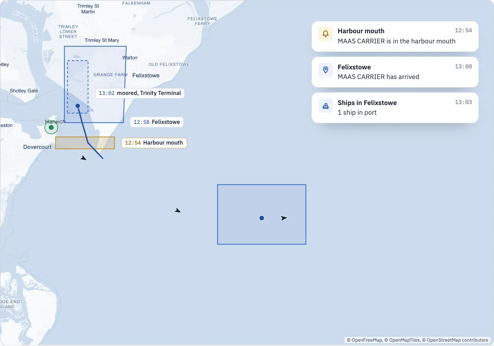
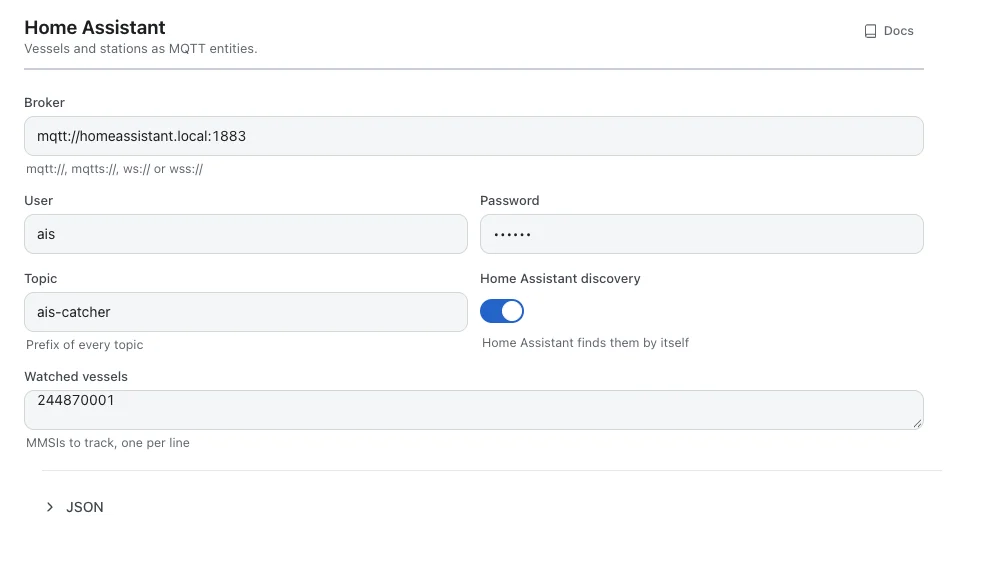
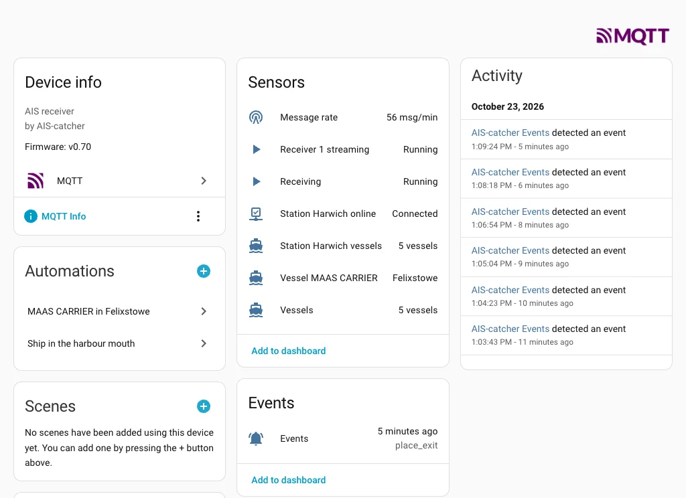
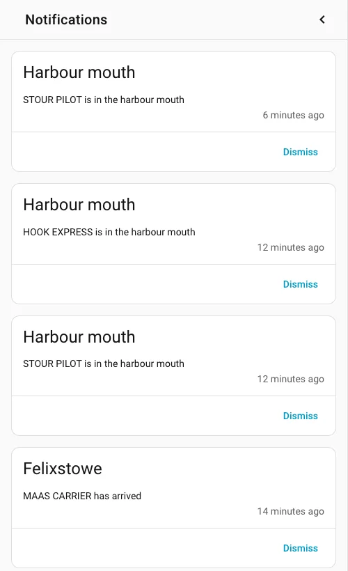

<nav class="series" aria-label="The parts of this series" markdown>

[<small>Part 1</small> Multiple receivers](stations.md) [<small>Part 2</small> Geofencing](places.md) [<small>Part 3</small> API and MCP](api-and-mcp.md) [<small>Part 4</small> Home automation](home-automation.md){ .is-current }

</nav>

# Home automation with Home Assistant and webhooks

Turn the events of your station into automations: a notification when a ship crosses the harbour mouth, a light when your ferry is in, the ships in port on a dashboard. With Home Assistant over MQTT, or anything that takes a webhook.
{ .lead }

Connecting your station to other tools, part 4 · 7 minutes to read
{ .tutorial-meta }

<figure markdown>
{ loading=lazy }
<figcaption>What Home Assistant received while MAAS CARRIER came in: a notification from the guard zone, the watched ship entering a Home Assistant zone, and the sensor counting it in port once it stopped.</figcaption>
</figure>

The station from the earlier parts knows when a ship enters the harbour mouth, calls at Felixstowe or sends a safety message. This part sends that news on: to Home Assistant, which turns it into notifications, lights and dashboards, and as webhooks to anything else that listens.

Two routes lead out of the station. MQTT carries its state and its events to Home Assistant, which finds everything by itself. Webhooks post each event to an address you choose, for Home Assistant or any other tool.

<figure>
<div style="overflow-x: auto">
<svg viewBox="0 0 960 300" width="960" height="300" style="display: block; width: 100%; min-width: 640px; height: auto" role="img" aria-label="AIS-catcher sends its state and events two ways: over MQTT to a broker, where Home Assistant finds an AIS-catcher device with sensors, an Events entity and trackers; and as webhooks, one signed POST per event, to a Home Assistant webhook trigger, Node-RED or n8n.">
<style>
.dg-box { fill: #ffffff; stroke: #cdd4df; stroke-width: 1.2; }
.dg-box--core { fill: #edf2fb; stroke: #9db5de; }
.dg-title { font-size: 15px; font-weight: 600; fill: #18202e; }
.dg-sub { font-size: 13px; fill: #525c6e; }
.dg-tag { font-family: var(--md-code-font-family), monospace; font-size: 12px; fill: #1f4a9c; }
.dg-line { fill: none; stroke: #9db5de; stroke-width: 1.6; }
.dg-head { fill: #9db5de; }
.dg-lab { font-family: var(--md-code-font-family), monospace; font-size: 12px; fill: #6b7486; }
</style>
<defs><marker id="dg-arrow-h" viewBox="0 0 10 10" refX="9" refY="5" markerWidth="8" markerHeight="8" orient="auto-start-reverse"><path class="dg-head" d="M0 0 L10 5 L0 10 Z"/></marker></defs>
<rect class="dg-box dg-box--core" x="20" y="80" width="230" height="140" rx="12"/>
<text class="dg-title" x="40" y="112">AIS-catcher</text>
<text class="dg-tag" x="40" y="138">place_enter, place_exit</text>
<text class="dg-tag" x="40" y="158">safety, status, destination</text>
<text class="dg-sub" x="40" y="184">and its state: vessels,</text>
<text class="dg-sub" x="40" y="202">stations, receivers</text>
<path class="dg-line" d="M250 120 C290 120 290 70 330 70" marker-end="url(#dg-arrow-h)"/>
<text class="dg-lab" x="262" y="104">MQTT</text>
<rect class="dg-box" x="332" y="30" width="230" height="80" rx="10"/>
<text class="dg-title" x="352" y="62">Your MQTT broker</text>
<text class="dg-sub" x="352" y="86">state kept, events passed on</text>
<path class="dg-line" d="M562 70 L658 70" marker-end="url(#dg-arrow-h)"/>
<text class="dg-lab" x="574" y="60">discovery</text>
<rect class="dg-box" x="660" y="30" width="280" height="80" rx="10"/>
<text class="dg-title" x="680" y="62">Home Assistant</text>
<text class="dg-sub" x="680" y="86">sensors, Events, vessel trackers</text>
<path class="dg-line" d="M250 180 C300 180 300 230 350 230 L658 230" marker-end="url(#dg-arrow-h)"/>
<text class="dg-lab" x="380" y="220">webhooks: one signed POST per event</text>
<rect class="dg-box" x="660" y="190" width="280" height="80" rx="10"/>
<text class="dg-title" x="680" y="222">Your automation</text>
<text class="dg-sub" x="680" y="246">Home Assistant, Node-RED, n8n</text>
</svg>
</div>
<figcaption>The broker keeps the station's state for Home Assistant to read whenever it starts; a webhook is one POST per event, signed when you give it a secret.</figcaption>
</figure>

## Home Assistant over MQTT

MQTT is the message broker most Home Assistant installations already run for their sensors. In the dashboard:

1. Open **Settings**, then **Services** and **Home Assistant**.
2. Enter the **Broker**, for instance `mqtt://homeassistant.local:1883`, with the **User** and **Password** it asks for.
3. Leave **Home Assistant discovery** on. Under **Watched vessels**, put the MMSI of each ship you want to follow, one per line.
4. Press **Save changes**.

<figure markdown>
{ loading=lazy }
<figcaption>Services, Home Assistant: a broker, and the vessels to follow.</figcaption>
</figure>

**config.json**

```json
"mqtt_state": {
    "url": "mqtt://homeassistant.local:1883",
    "username": "ais",
    "password": "secret",
    "watch": [244870001]
}
```

**Command line**

```bash
AIS-catcher -d 00000001 -W mqtt://homeassistant.local:1883 USERNAME ais PASSWORD secret WATCH 244870001
```

With discovery on there is nothing to set up in Home Assistant. Under **Settings, Devices & services, MQTT** a device called **AIS-catcher** appears, with:

- **Vessels** and **Message rate**: how busy the station is.
- **Receiving**, and for each receiver whether it is streaming: the station's health.
- For each station, whether it is online and how many vessels it heard in the last hour.
- **Events**: every arrival, departure, safety message and change of destination, as it happens.
- A device tracker for each watched vessel, with its position, speed and when it was last heard.

<figure markdown>
{ loading=lazy }
<figcaption>The device in Home Assistant. The watched container ship reads "Felixstowe": it is inside a Home Assistant zone of that name.</figcaption>
</figure>

!!! note
    The station's position is never published to the broker. A station that is private on the community map stays private here too.

### A notification when a ship comes through the harbour mouth

The **Events** entity changes with every event. Its attributes say what happened: `event_type` is `place_enter` or `place_exit` for a place, `text` is the place's name, `name` and `mmsi` are the ship's.

**automations.yaml**

```yaml
- alias: Ship in the harbour mouth
  triggers:
    - trigger: state
      entity_id: event.ais_catcher_events
      not_from: unavailable
  conditions:
    - condition: template
      value_template: >
        {{ trigger.to_state.attributes.event_type == 'place_enter'
           and trigger.to_state.attributes.text == 'Harbour mouth' }}
  actions:
    - action: notify.mobile_app_your_phone
      data:
        title: Harbour mouth
        message: "{{ trigger.to_state.attributes.name }} is in the harbour mouth"
```

Use your own notifier in place of `notify.mobile_app_your_phone`. `not_from: unavailable` keeps the automation quiet while Home Assistant starts. If you rename places now and then, compare `trigger.to_state.attributes.place` instead: the place's id, which never changes.

<figure markdown>
{ loading=lazy }
<figcaption>One notification for each crossing, about ten seconds after it: AIS-catcher waits for the next position to confirm it.</figcaption>
</figure>

### When your ferry is in

A watched vessel is a device tracker, so Home Assistant's own zones work on it. Draw a zone around the port in **Settings, Areas, labels & zones** and the tracker's state becomes the zone's name once the ship is inside:

**automations.yaml**

```yaml
- alias: MAAS CARRIER in Felixstowe
  triggers:
    - trigger: zone
      entity_id: device_tracker.ais_catcher_vessel_244870001
      zone: zone.felixstowe
      event: enter
  actions:
    - action: light.turn_on
      target:
        entity_id: light.hallway
```

Look up the tracker's entity id on the device page: it carries the ship's MMSI or its name, depending on what the station had heard when Home Assistant first saw it. A zone is a circle and works only for watched ships. A place has the port's real outline, knows whether the ship has stopped, and works for every ship.

### The ships in port, on a dashboard

For counts, ask the station directly. With the API switched on, every place answers with the number of ships inside it:

**configuration.yaml**

```yaml
rest:
  - resource: http://raspberrypi.local:8119/api/v1/places/cfabeebc-3490-4863-aeea-f61984ed42a0
    scan_interval: 60
    sensor:
      - name: Ships in Felixstowe
        value_template: "{{ value_json.vessels_inside }}"
        unit_of_measurement: ships
```

A ship counts as inside a port once it has stopped there, so ships steaming through do not push the number up. A server that uses keys needs one from every caller: add `headers: {Authorization: "Bearer ..."}`. An Open server needs none.

## Webhooks, for everything else

A webhook posts each event to an address as it happens. Home Assistant takes them, and so do Node-RED, n8n and most automation tools. Add one under **Services, Webhooks**, or in the configuration:

**config.json**

```json
"webhooks": [
    { "url": "http://homeassistant.local:8123/api/webhook/ais-events",
      "events": ["place_enter", "place_exit"] },
    { "url": "https://example.org/hooks/ais", "events": ["safety", "system"], "secret": "whsec_..." }
]
```

The body is the event itself:

**POST body**

```json
{ "id": "evt_1792744453_3", "time": "2026-10-23T11:54:13Z", "kind": "place_enter", "level": "notice",
  "mmsi": 244870001, "name": "MAAS CARRIER", "place": "508906af-27ba-4219-9f92-6fee2b610516",
  "text": "Harbour mouth", "lat": 51.935364, "lon": 1.315287 }
```

In Home Assistant a webhook trigger picks it up, no MQTT needed:

**automations.yaml**

```yaml
- alias: Ship left the harbour mouth
  triggers:
    - trigger: webhook
      webhook_id: ais-events
      allowed_methods: [POST]
      local_only: true
  conditions:
    - condition: template
      value_template: "{{ trigger.json.kind == 'place_exit' and trigger.json.text == 'Harbour mouth' }}"
  actions:
    - action: notify.mobile_app_your_phone
      data:
        message: "{{ trigger.json.name }} left the harbour mouth"
```

- **Signed.** With a `secret`, each request carries a signature as [Standard Webhooks](https://www.standardwebhooks.com) describes it, which their libraries check in one call.
- **Once per event.** A beacon that repeats its safety text every minute is posted once, and again only after half an hour.
- **Retried.** An address that does not answer is tried again, from five seconds up to an hour apart, while the other webhooks carry on.
- **At once.** A saved webhook starts posting without restarting AIS-catcher.

From antenna to automation: stations for every antenna, geofences for the water, the API and MCP to ask about it, and automations to act on it. If you build something with your station, tell us in the [forum](https://github.com/jvde-github/AIS-catcher/discussions).

## Where to go next

New to AIS-catcher, or setting it up step by step? Start with the Quick Start. Every option of this tutorial is in the documentation.

- [Quick Start](../getting-started/overview.md): install AIS-catcher and see your first ships, in a few steps.
- [Vessels in Home Assistant](../managed/home-assistant.md): the set-up guide for Home Assistant.
- [Home Assistant and MQTT state](../api/home-assistant.md): every key and every topic.
- [Webhooks](../api/webhooks.md): every key, the request headers and the signature.
