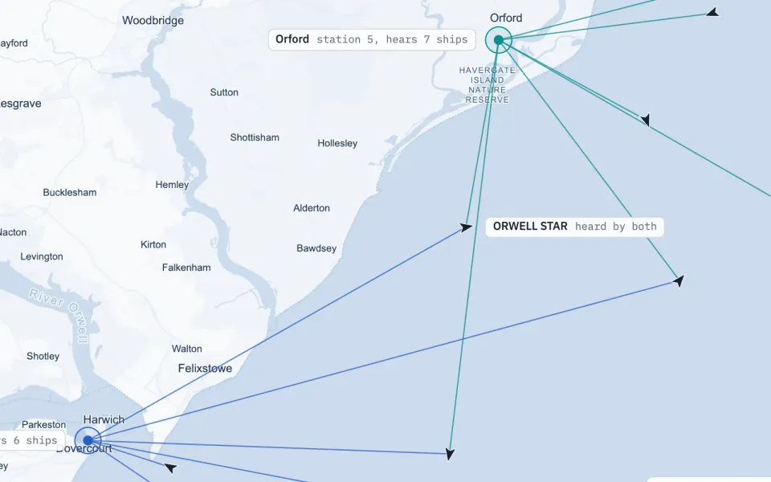
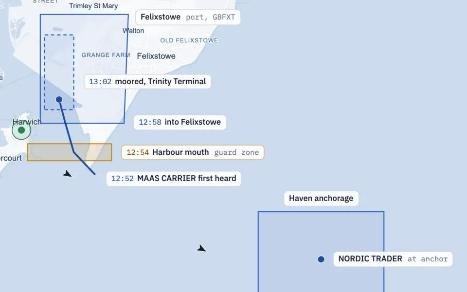
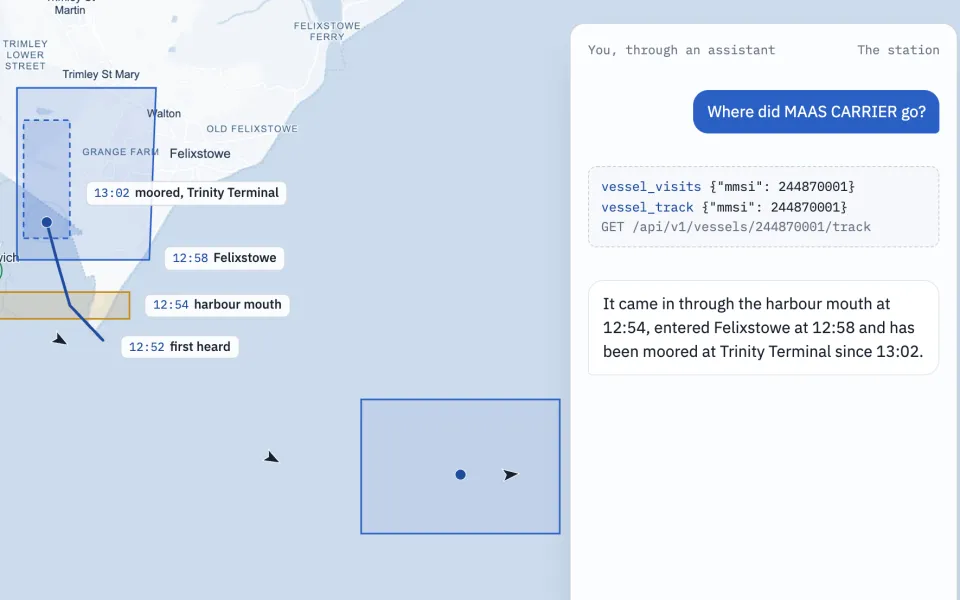
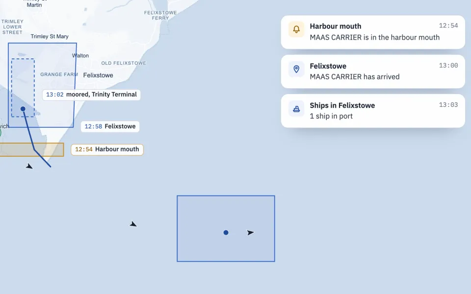

# Tutorials

Out of the box, AIS-catcher shows the ships it hears on a map. It can do much more: feed other applications, and serve as the base you build your own on. A second receiver joining the same installation, a notification on your phone when a ship comes in, a script that logs every arrival, an assistant that answers questions about the harbour. All of it is built in.
{ .lead }

## Connecting your station to other tools

Multiple receivers as stations, geofencing with places, queries over the API and from an AI assistant, and home automation with Home Assistant and webhooks. One example runs through every part: a station at Harwich, where the Stour and the Orwell meet the North Sea.

[{ loading=lazy } <small>Part 1, 6 minutes</small> **Running multiple receivers at one or more stations** Run more than one receiver from one AIS-catcher. Receivers in one place are one station, receivers elsewhere are stations of their own, each with its range and figures, and the ships they hear together form one picture.](stations.md)

[{ loading=lazy } <small>Part 2, 6 minutes</small> **Geofencing: monitoring ports and guard zones** Places are the geofences of AIS-catcher: a port, a guard zone across the harbour mouth, any area you draw on the map. Your station then keeps track of who is inside, who came and went and who is on the way, and announces each crossing.](places.md)

[{ loading=lazy } <small>Part 3, 8 minutes</small> **Querying your station with the API and MCP** Every station answers questions: over HTTP for your scripts and spreadsheets, and in plain words through an AI assistant. The same data, the same places, two ways to ask.](api-and-mcp.md)

[{ loading=lazy } <small>Part 4, 7 minutes</small> **Home automation with Home Assistant and webhooks** Turn the events of your station into automations: a notification when a ship crosses the harbour mouth, a light when your ferry is in, the ships in port on a dashboard. With Home Assistant over MQTT, or anything that takes a webhook.](home-automation.md)

