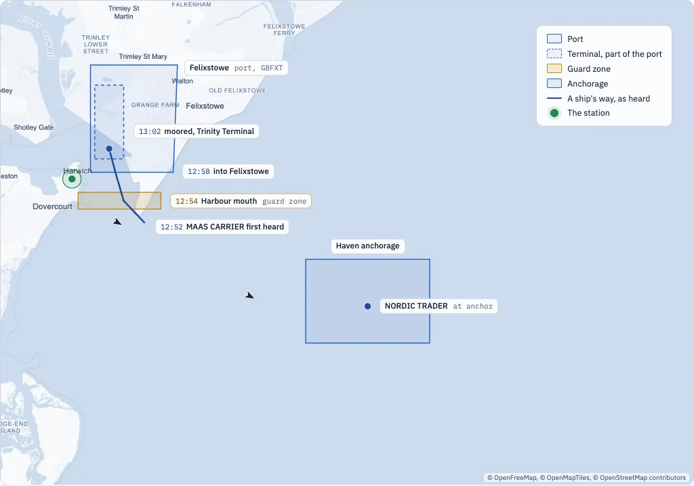
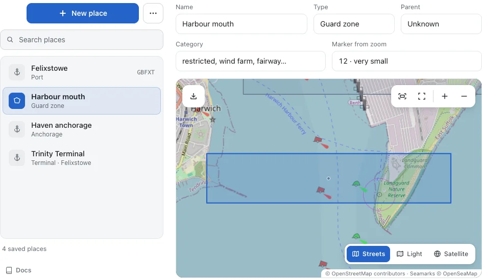
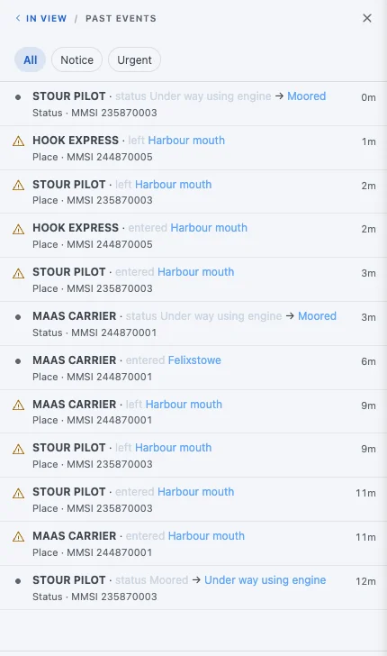
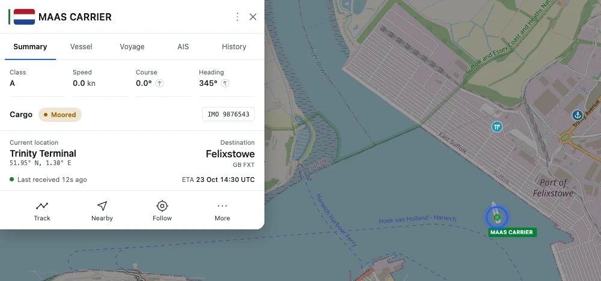
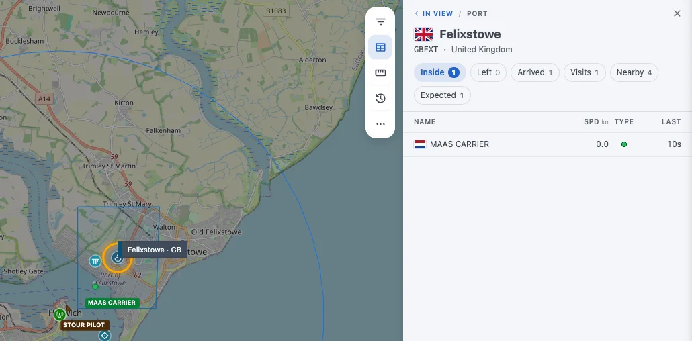
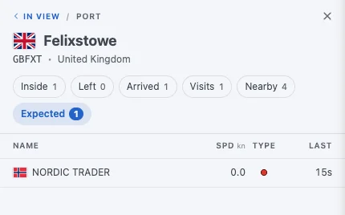
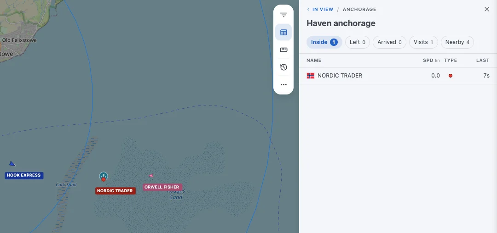

<nav class="series" aria-label="The parts of this series" markdown>

[<small>Part 1</small> Multiple receivers](stations.md) [<small>Part 2</small> Geofencing](places.md){ .is-current } [<small>Part 3</small> API and MCP](api-and-mcp.md) [<small>Part 4</small> Home automation](home-automation.md)

</nav>

# Geofencing: monitoring ports and guard zones

Places are the geofences of AIS-catcher: a port, a guard zone across the harbour mouth, any area you draw on the map. Your station then keeps track of who is inside, who came and went and who is on the way, and announces each crossing.
{ .lead }

Connecting your station to other tools, part 2 · 6 minutes to read
{ .tutorial-meta }

<figure markdown>
{ loading=lazy }
<figcaption>The example: a port with its terminal, a guard zone across the harbour mouth and an anchorage offshore, drawn around the station at Harwich, the green dot; the dark line is the way the container ship MAAS CARRIER came in, by the clock in Harwich.</figcaption>
</figure>

To an AIS receiver a ship is a dot with a name. You see it move, and that is about it. Geofencing changes that. Draw a few areas on the map, which AIS-catcher calls **places**, and the dots start telling stories: this ship came in through the harbour mouth, that one is waiting at anchor, a third is on its way to the port you care about.

!!! note
    The ships in this series are a scripted replay in a test installation. Their names and numbers are made up, the behaviour of AIS-catcher is not.

## A port and a guard zone

Two kinds of geofence do most of the work, and they behave differently on purpose.

- **A port**, like Felixstowe, with its UN/LOCODE GBFXT. A ship that steams through without stopping has not called there. Only a ship that stops counts, and ships that report the port as their destination are listed as expected.
- **A guard zone**, like the harbour mouth: any area you want to be told about. Every ship that crosses it counts, stopped or not, and each crossing is announced.

A port can have parts: Trinity Terminal is drawn as part of Felixstowe, so a ship alongside is at the terminal and in the port at the same time. There are more types: berths, anchorages, marinas, moorings, traffic sectors and whole waters such as a strait. The [places documentation](../configuration/output/places.md) lists them all.

| Type | A visit counts | In the ticker |
|------|----------------|---------------|
| Port | After the ship has stopped for a minute | Arrivals and departures, as routine |
| Terminal, berth | After a stop | Not announced: the port already is |
| Anchorage | After a stop | Not announced |
| Guard zone | Every passage | Entering and leaving, as a notice ⚠ |

## Drawing one

1. Open the dashboard, then **Settings** and **Places**. Places are on from the start, kept in a `places` folder beside the configuration; an older installation asks to switch them on when you add the first one.
2. Press **New place**, give it a name and a type, and draw its outline on the map.
3. Save. The place is live at once, on the map and for every ship already inside it.

<figure markdown>
{ loading=lazy }
<figcaption>The Places editor. The guard zone is a plain rectangle across the entrance: a few straight edges are all a place needs.</figcaption>
</figure>

Each place is a small GeoJSON file, so outlines can come from elsewhere too: **Import…**, in the menu beside **New place**, takes a Feature from any GIS tool or from OpenStreetMap, and **Paste shape**, while you edit a place, replaces just its outline. Without the dashboard, point AIS-catcher at a folder of place files:

**Command line**

```bash
AIS-catcher -d 00000001 -N 8100 PLACES /home/pi/places
```

**config.json**

```json
"tracking": { "places": "/home/pi/places" },
"services": [ { "port": 8100 } ]
```

## One arrival, as the station saw it

The container ship MAAS CARRIER comes in from the North Sea, bound for "GB FXT". This is what the station recorded, by the clock in Harwich:

- **12:52** First heard south of the harbour mouth at 10 knots. Its destination already matches Felixstowe, so the port lists it under **Expected**.
- **12:54** Enters the **Harbour mouth**. A guard zone, so the ticker shows a notice.
- **12:56** Leaves the harbour mouth, two minutes and ten seconds later.
- **12:58** Enters **Felixstowe**, announced as routine.
- **13:00** Inside **Trinity Terminal**. The ship's card now names the terminal as its location.
- **13:02** Reports itself moored.
- **13:03** Stopped for a minute: the stay becomes a call, and the ship counts as inside the port.

<figure markdown>
{ loading=lazy }
<figcaption>Past events in the web viewer. Notices from the guard zone carry the ⚠ mark. The pilot boat crossed it twice while the container ship came in.</figcaption>
</figure>

Click a ship and its card says where it is now, in words rather than coordinates. When a ship lies inside several places at once, the most specific is named first: the terminal before the port.

<figure markdown>
{ loading=lazy }
<figcaption>The ship's card: at Trinity Terminal, bound for Felixstowe, which it reported as GB FXT.</figcaption>
</figure>

Click a place and you get its ships, in tabs: who is **Inside**, who **Left**, who **Arrived** lately, the **Visits** with their times, the ships **Nearby**, and for a port the ships **Expected**. Point at a place's marker to see its outline.

<figure markdown>
{ loading=lazy }
<figcaption>Felixstowe, with the container ship inside once it has stopped. Pointing at the marker draws the outline.</figcaption>
</figure>

## Who is on the way

Crews type their destination by hand, and they type it in many ways. AIS-catcher matches it to your ports, first by UN/LOCODE and then by a name or alias that fits exactly one port. Case, spaces and punctuation do not matter, so "GB FXT" and "gbfxt" both find Felixstowe. A partial name never counts.

That is how the tanker NORDIC TRADER, waiting at the anchorage with "FELIXSTOWE" as its destination, shows under **Expected** before it has moved towards the port at all.

<figure markdown>
{ loading=lazy }
<figcaption>Expected: the tanker at the anchorage, matched to Felixstowe by the name it reports.</figcaption>
</figure>

## It does not cry wolf

AIS is noisy. A corrupted message can put a ship on the wrong side of the world, and a weak signal leaves gaps. Places are built to ignore that:

- **A position has to be believable.** One the ship could not have reached from its last at 60 knots is left out, unless the next one agrees with it.
- **A crossing needs two positions.** A ship enters when two positions in a row, at least ten seconds apart, are inside. One stray position across the line changes nothing.
- **Silence does not end a stay.** A ship heard again after an hour, still inside, keeps its original arrival time.
- **A call needs a stop.** The fishing boat ORWELL FISHER sailed straight across the anchorage and is listed as nearby, not inside. Only the tanker at anchor counts.

<figure markdown>
{ loading=lazy }
<figcaption>Haven anchorage: the tanker at anchor counts, the fishing boat passing through does not.</figcaption>
</figure>

## Places in the other tools

Everything above is available to other programs as well. The arrivals and departures are events, the ships inside a place are a list, and each ship has its visits. The [next part](api-and-mcp.md) asks the station about them, over HTTP and in plain words.

## Where to go next

New to AIS-catcher, or setting it up step by step? Start with the Quick Start. Every option of this tutorial is in the documentation.

- [Quick Start](../getting-started/overview.md): install AIS-catcher and see your first ships, in a few steps.
- [Places](../configuration/output/places.md): every place type and every property of a place file, with examples.
