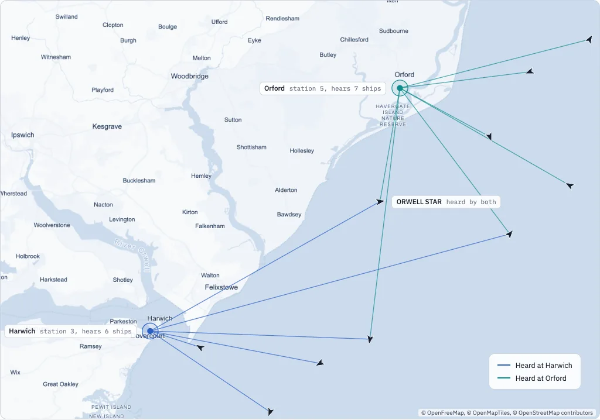
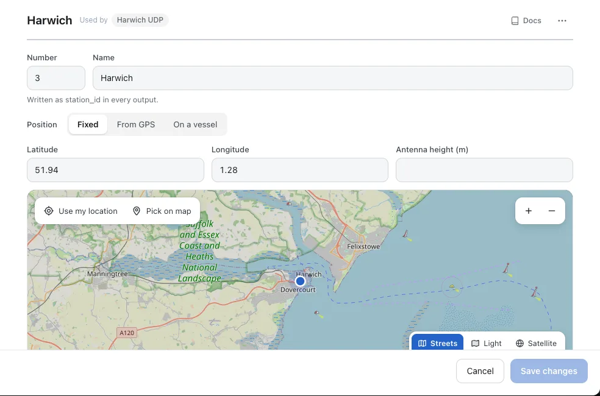
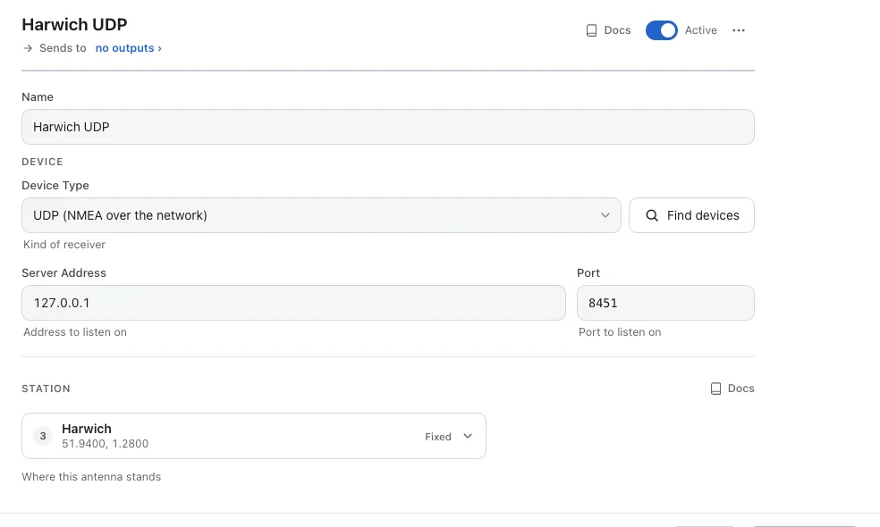
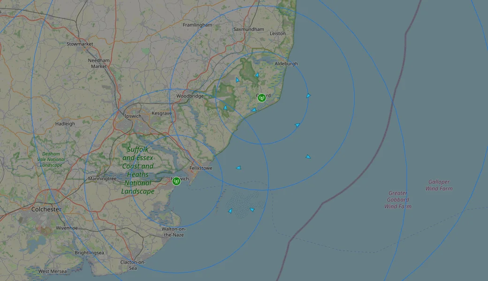
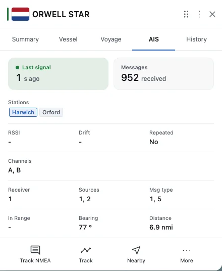
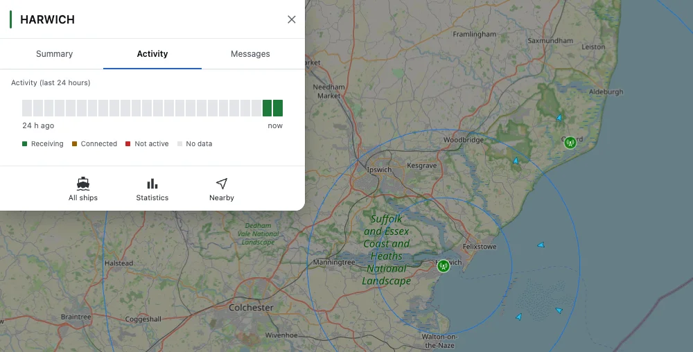
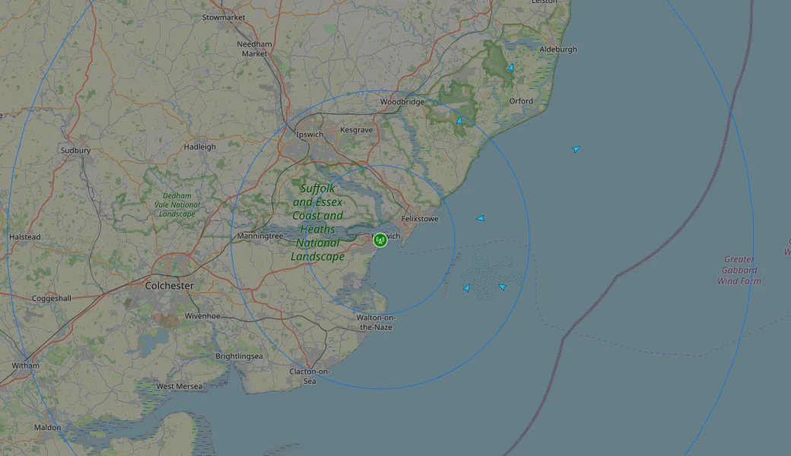

<nav class="series" aria-label="The parts of this series" markdown>

[<small>Part 1</small> Multiple receivers](stations.md){ .is-current } [<small>Part 2</small> Geofencing](places.md) [<small>Part 3</small> API and MCP](api-and-mcp.md) [<small>Part 4</small> Home automation](home-automation.md)

</nav>

# Running multiple receivers at one or more stations

Run more than one receiver from one AIS-catcher. Receivers in one place are one station, receivers elsewhere are stations of their own, each with its range and figures, and the ships they hear together form one picture.
{ .lead }

Connecting your station to other tools, part 1 · 6 minutes to read
{ .tutorial-meta }

<figure markdown>
{ loading=lazy }
<figcaption>The example: two stations and the ten ships between them, three of them in reach of both antennas; each station counts what it hears, and the map shows them all.</figcaption>
</figure>

One antenna sees what its horizon allows. A second one, a few miles up the coast or on the other side of a hill, fills in what the first misses. AIS-catcher runs both from one installation. Each place with receivers is a **station**, with its own position, range and figures, however many receivers stand there, and the ships they hear together form one picture.

!!! note
    The example in this series is a station at Harwich, where the Stour and the Orwell meet the North Sea, and for this part a second one at Orford, about thirteen nautical miles up the Suffolk coast. The ships are a scripted replay in a test installation. Their names and numbers are made up, the behaviour of AIS-catcher is not.

## Stations and inputs

Two words do the work. A **station** is a place where receivers stand. An **input** is what delivers a receiver's messages: a dongle on this machine, or another receiver sending NMEA over the network. They are two lists, in the dashboard and in the configuration alike. Each input names the station it stands at, and a station can have many: two dongles on one mast are two inputs at one station. From then on every message carries the number of its station.

<figure>
<div style="overflow-x: auto">
<svg viewBox="0 0 960 330" width="960" height="330" style="display: block; width: 100%; min-width: 640px; height: auto" role="img" aria-label="Two lists feed one AIS-catcher. Inputs: two dongles on the roof at Harwich, both at station 3, and a UDP server on port 10110 that the Raspberry Pi at Orford sends to, at station 5. Stations: 3 Harwich and 5 Orford, each with its position. The one tracker serves a map with both stations, a server filtered on station 3, and figures per station to the API and MQTT.">
<style>
.dg-box { fill: #ffffff; stroke: #cdd4df; stroke-width: 1.2; }
.dg-box--core { fill: #edf2fb; stroke: #9db5de; }
.dg-title { font-size: 15px; font-weight: 600; fill: #18202e; }
.dg-sub { font-size: 13px; fill: #525c6e; }
.dg-tag { font-family: var(--md-code-font-family), monospace; font-size: 12px; fill: #1f4a9c; }
.dg-line { fill: none; stroke: #9db5de; stroke-width: 1.6; }
.dg-head { fill: #9db5de; }
.dg-lab { font-family: var(--md-code-font-family), monospace; font-size: 12px; fill: #6b7486; }
</style>
<defs><marker id="dg-arrow-s" viewBox="0 0 10 10" refX="9" refY="5" markerWidth="8" markerHeight="8" orient="auto-start-reverse"><path class="dg-head" d="M0 0 L10 5 L0 10 Z"/></marker></defs>
<text class="dg-lab" x="20" y="36">INPUTS</text>
<rect class="dg-box" x="20" y="56" width="210" height="60" rx="10"/>
<text class="dg-title" x="38" y="82">Dongle on the roof</text>
<text class="dg-tag" x="38" y="103">rtlsdr &#183; 00000001</text>
<rect class="dg-box" x="20" y="128" width="210" height="60" rx="10"/>
<text class="dg-title" x="38" y="154">Second dongle</text>
<text class="dg-tag" x="38" y="175">rtlsdr &#183; 00000002</text>
<rect class="dg-box" x="20" y="226" width="210" height="60" rx="10"/>
<text class="dg-title" x="38" y="252">Pi at Orford, over UDP</text>
<text class="dg-tag" x="38" y="273">udpserver &#183; port 10110</text>
<path class="dg-line" d="M230 86 C276 86 272 112 316 112" marker-end="url(#dg-arrow-s)"/>
<text class="dg-lab" x="240" y="78">station 3</text>
<path class="dg-line" d="M230 158 C276 158 272 132 316 132" marker-end="url(#dg-arrow-s)"/>
<text class="dg-lab" x="240" y="178">station 3</text>
<path class="dg-line" d="M230 256 L316 256" marker-end="url(#dg-arrow-s)"/>
<text class="dg-lab" x="240" y="248">station 5</text>
<text class="dg-lab" x="318" y="36">STATIONS</text>
<rect class="dg-box" x="318" y="79" width="130" height="86" rx="10"/>
<text class="dg-tag" x="336" y="103">id 3</text>
<text class="dg-title" x="336" y="126">Harwich</text>
<text class="dg-sub" x="336" y="148">51.94, 1.28</text>
<rect class="dg-box" x="318" y="213" width="130" height="86" rx="10"/>
<text class="dg-tag" x="336" y="237">id 5</text>
<text class="dg-title" x="336" y="260">Orford</text>
<text class="dg-sub" x="336" y="282">52.09, 1.53</text>
<path class="dg-line" d="M448 122 C472 122 468 166 490 166" marker-end="url(#dg-arrow-s)"/>
<path class="dg-line" d="M448 256 C472 256 468 206 490 206" marker-end="url(#dg-arrow-s)"/>
<rect class="dg-box dg-box--core" x="492" y="82" width="156" height="208" rx="12"/>
<text class="dg-title" x="510" y="154">AIS-catcher</text>
<text class="dg-sub" x="510" y="176">one tracker</text>
<text class="dg-sub" x="510" y="206">every message</text>
<text class="dg-sub" x="510" y="224">carries its station</text>
<path class="dg-line" d="M648 140 C704 140 706 86 762 86" marker-end="url(#dg-arrow-s)"/>
<text class="dg-lab" x="680" y="78">all ships</text>
<path class="dg-line" d="M648 186 L762 186" marker-end="url(#dg-arrow-s)"/>
<text class="dg-lab" x="664" y="178">filter id 3</text>
<path class="dg-line" d="M648 232 C704 232 706 286 762 286" marker-end="url(#dg-arrow-s)"/>
<text class="dg-lab" x="680" y="310">per station</text>
<rect class="dg-box" x="764" y="54" width="176" height="64" rx="10"/>
<text class="dg-title" x="782" y="82">The main map</text>
<text class="dg-sub" x="782" y="104">both stations, every ship</text>
<rect class="dg-box" x="764" y="154" width="176" height="64" rx="10"/>
<text class="dg-title" x="782" y="182">A filtered server</text>
<text class="dg-sub" x="782" y="204">what station 3 heard</text>
<rect class="dg-box" x="764" y="254" width="176" height="64" rx="10"/>
<text class="dg-title" x="782" y="282">API, MQTT, health</text>
<text class="dg-sub" x="782" y="304">figures for each station</text>
</svg>
</div>
<figcaption>Two lists: the inputs, and the stations they stand at. Both dongles at Harwich are station 3. The one tracker keeps the station with every message, so every view can show all stations or just one.</figcaption>
</figure>

In the dashboard:

1. Open **Settings**, then **Stations**, and press **Add station**. Give it a name and a position: fixed, from a GPS, or on a vessel for a receiver that sails.
2. Open **Inputs**, pick an input and choose its station under **Station**.
3. Press **Save changes**.

<figure markdown>
{ loading=lazy }
<figcaption>A station has a number, a name and a position. The page names the inputs that stand on it.</figcaption>
</figure>

<figure markdown>
{ loading=lazy }
<figcaption>An input picks its station from the list.</figcaption>
</figure>

A second antenna rarely sits on the same machine. The usual set-up is a small receiver at the far site, a Raspberry Pi with a dongle, that forwards what it hears over UDP to the central installation:

**On the Pi at Orford**

```bash
AIS-catcher -d 00000001 -u 192.168.1.10 10110
```

The central machine takes that stream in as an input of its own, standing at the Orford station. In its configuration file:

**config.json, on the central machine**

```json
"stations": [
    { "id": 3, "name": "Harwich", "lat": 51.94, "lon": 1.28 },
    { "id": 5, "name": "Orford",  "lat": 52.09, "lon": 1.53 }
],
"receiver": [
    { "input": "rtlsdr", "serial": "00000001", "station": 3 },
    { "input": "rtlsdr", "serial": "00000002", "station": 3 },
    { "input": "udpserver", "udpserver": { "port": 10110 }, "station": 5 }
]
```

Stations are optional. Out of the box every input stands at the **default station**, numbered 0: one dongle, or several on the same mast, is one station, and nothing needs setting up. Stations matter once receivers stand in different places.

## What you see in the browser

The map shows both stations with their range rings, and every ship either of them hears. Distance and bearing are measured from the station that heard the ship, so each antenna's range stands on its own.

<figure markdown>
{ loading=lazy }
<figcaption>Harwich in the south, Orford in the north: ten ships, heard by one station or both.</figcaption>
</figure>

A ship in reach of both lists both, on the **AIS** tab of its card.

<figure markdown>
{ loading=lazy }
<figcaption>ORWELL STAR, heard at Harwich and at Orford.</figcaption>
</figure>

Click a station and its card opens: the ships it hears, its message rate, whether it is receiving, how far it reaches, and an **Activity** strip of the last 24 hours. While the card is open the map looks through that station alone, and the header says so. Close the card and the full picture is back.

<figure markdown>
{ loading=lazy }
<figcaption>The Harwich card. The map now shows what Harwich hears, and the header names the station.</figcaption>
</figure>

To stay with one station longer, pick it under **Filter** in the viewer's settings. The statistics can be read per station too: messages, ranges and plots for one station, or **Plots, Compare** to set two against each other.

## One station on a server of its own

Sometimes one station belongs to someone else: a sailing club's antenna on the harbour wall, say, and the club would like a map of its own. That is not a viewer per station but a filter. Add a server under **Services** and switch on its filter for that station: the server keeps the ships the station hears, and its markers, pages and figures are that station's.

**config.json**

```json
"services": [
    { "port": 8120, "bind": "0.0.0.0", "filter": "on", "id": 3 }
]
```

<figure markdown>
{ loading=lazy }
<figcaption>The server filtered on Harwich: six ships, against the ten on the full map.</figcaption>
</figure>

## Private by default

Where an antenna stands is often someone's house. A station's position stays on the machine unless you switch on **Share position** on its page. Without it, no map, API, MQTT topic or webhook says where the station is, and the community map keeps it private too. Ranges and bearings are still measured from it, on the machine itself.

## Stations in the other tools

The station travels with every message, so the tools in the next parts know it too:

- **The API** lists the stations under `/api/v1/stations` with the vessels each heard in the last hour, `/api/v1/stations/{id}/statistics` gives one station's figures, and `/api/v1/vessels?stations=5` gives the ships one station heard.
- **Home Assistant** gets an online sensor and a vessel count for each station.
- **Health** warns when a station has heard nothing for 15 minutes, so a dead antenna at the far site does not go unnoticed.

Next: [geofencing](places.md), the areas on the map that turn positions into arrivals and departures.

## Where to go next

New to AIS-catcher, or setting it up step by step? Start with the Quick Start. Every option of this tutorial is in the documentation.

- [Quick Start](../getting-started/overview.md): install AIS-catcher and see your first ships, in a few steps.
- [Connect your receivers](../managed/receivers.md): the set-up guide for inputs.
- [Locate your station](../managed/station.md): the set-up guide for a station and its position.
