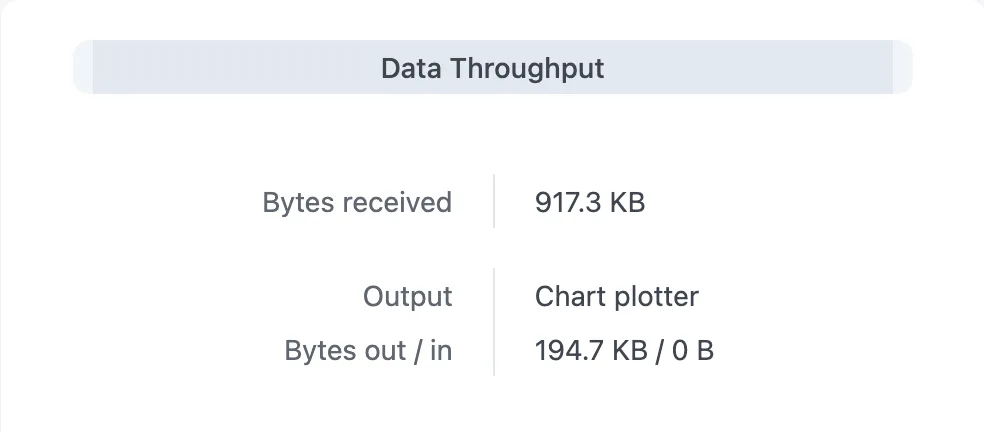

---
hide:
  - toc
---

# Send Ships to Your Chart Plotter

AIS-catcher can pass every message it receives on to OpenCPN, a chart plotter or a navigation app on your network, as NMEA over UDP. The ships then appear on that program's chart.

**You need:** AIS-catcher receiving ships, and the address of the computer or plotter that should get them. Port 10110 is the usual port for AIS.

!!! tip "On the same computer?"
    If the chart plotter runs on the same computer as AIS-catcher, use the address `127.0.0.1`.

<div class="stepper" data-eyebrow="Manual mode · Guide" markdown>

<div class="stepper-step" markdown>

## Add the output

### On the command line

Add `-u` with the address and the port to the command you already use:

```bash
AIS-catcher -u 192.168.1.20 10110
```

To give the output a name in the statistics, add `description "Chart plotter"` after the port.

### In a configuration file

Add a `udp` entry:

```json
{
  "config": "aiscatcher",
  "version": 1,
  "udp": [
    { "host": "192.168.1.20", "port": 10110, "description": "Chart plotter" }
  ]
}
```

| Key | What it does |
|-----|--------------|
| `host`, `port` | Where the receiving program listens. |
| `description` | The output's name in the statistics. |

Then restart AIS-catcher with the file:

```bash
AIS-catcher -C config.json
```

!!! tip "From the command line to a configuration file"
    Add `-J` to print your command line as a configuration file instead of running it: `AIS-catcher -u 192.168.1.20 10110 -J`.

</div>

<div class="stepper-step" markdown>

## Set up the chart plotter

Tell the receiving program to listen for NMEA over UDP on the same port. In OpenCPN: **Options → Connections → Add Connection**, choose **Network**, protocol **UDP**, port **10110**, and data protocol **NMEA 0183**.

</div>

<div class="stepper-step" markdown>

## Check it works

- The ships appear on the plotter's chart within a minute. Names can take a few minutes longer: ships send them less often than their position.
- With the [web viewer](../configuration/output/web-viewer.md) on, open **Statistics**. Under **Data Throughput**, the output's **Bytes out** keeps growing.

    { width="480" }

!!! question "No ships on the plotter?"
    - **Bytes out grows:** AIS-catcher is sending. Check the port in the plotter and the firewall on that computer. UDP gets no reply, so AIS-catcher cannot tell whether anything is listening.
    - **Dropped grows instead:** AIS-catcher cannot send to that address. Check the address, and that both machines are on the same network.

</div>

</div>

## More

- **Several programs:** add a `-u` for each one, or an entry to the `udp` list for each one.
- **Every device on the network:** use the network's broadcast address and switch broadcast on: `-u 192.168.1.255 10110 broadcast on`, or `"broadcast": true` in the `udp` entry.
- **Programs that connect in:** some programs want to connect to AIS-catcher themselves. Use a [TCP server](../configuration/output/TCP-server.md) output for those.
- Every UDP setting is in the [UDP reference](../configuration/output/UDP.md).
