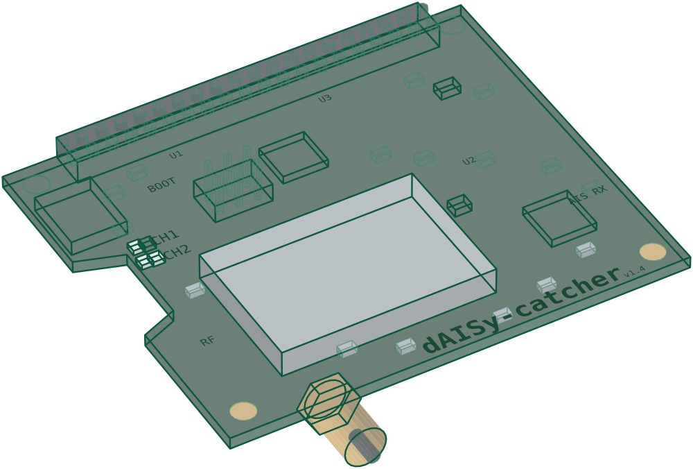

---
hide:
  - toc
---

# What you need

A station is three parts on one cable run: an antenna outside, a receiver, and a small computer that runs AIS-catcher. For the receiver there are two good choices: a radio dongle that AIS-catcher tunes and decodes itself, or a receiver that decodes AIS on its own board.

  <section class="kit-part" aria-label="The antenna">
    
The antenna

    <h3>Glomex RA111AIS</h3>
    
A 14&nbsp;cm marine antenna tuned to AIS, sold with a mounting bracket and its cable. Mount it outside, as high as you can. Its cable ends in a PL-259 plug, so add an adapter to SMA for the receiver.

    
Any marine VHF antenna works too.

    
€70–140marine shops

  </section>
  
coaxPL-259 to SMA

  <section class="kit-part kit-pick" aria-label="The receiver">
    
The receiverPick one

    

    <h3>RTL-SDR Blog V3</h3>
    
A radio on a USB stick. AIS-catcher tunes it to AIS and decodes the signal on the Pi. Its TCXO keeps it on frequency as it warms up, where the cheapest sticks drift.

    
$35–40<a href="https://www.rtl-sdr.com/buy-rtl-sdr-dvb-t-dongles/">RTL-SDR&nbsp;Blog&nbsp;&nearr;</a>

    

    
or

    

    <h3>dAISy-catcher</h3>
    
A receiver made for AIS alone, developed by Wegmatt with the AIS-catcher project. It decodes both AIS channels on the board. Plug it in over USB, or stack it on the Pi.

    
$149<a href="https://shop.wegmatt.com/products/daisy-catcher-high-performance-ais-receiver">Wegmatt&nbsp;&nearr;</a>

    

  </section>
  
USBor stacked

  <section class="kit-part" aria-label="The computer">
    
The computer

    <h3>Raspberry Pi 4</h3>
    
Runs AIS-catcher day and night on a few watts. The smallest model is plenty. Add the official power supply and a 32&nbsp;GB memory card.

    
<small>from</small> $35<a href="https://www.raspberrypi.com/products/raspberry-pi-4-model-b/">Raspberry&nbsp;Pi&nbsp;&nearr;</a>

  </section>

Prices from November 2026, before shipping, tax and import duties.

**Which receiver?** The dongle is the cheapest way in. AIS-catcher does all the radio work on the Pi, so its settings and decoding models are yours to try. The dAISy-catcher suits a station that should simply run: it decodes on the board, needs no tuning, and leaves the computer almost idle.

## The dAISy-catcher up close

Plug it in as a USB device, or stack it on a Raspberry Pi as a HAT. There is no driver to install and no filter or amplifier to try: the RF front end, the radio and the decoding sit on one board, and AIS-catcher reads the messages over its serial line.

<svg class="dz-lines dz-stacked" viewBox="0 0 1000 716" aria-hidden="true"><g class="dz-p" style="--i:0"><path class="dz-lead" pathLength="1" d="M526.9 630.3Q504.9 670.4 500 716"/><circle class="dz-dot" cx="526.9" cy="630.3" r="9"/></g><g class="dz-p" style="--i:1"><path class="dz-lead" pathLength="1" d="M170.3 331.4Q207 524 166.7 716"/><circle class="dz-dot" cx="170.3" cy="331.4" r="9"/></g><g class="dz-p" style="--i:2"><path class="dz-lead" pathLength="1" d="M379.7 170.1Q290.2 63.7 166.7 0"/><circle class="dz-dot" cx="379.7" cy="170.1" r="9"/></g><g class="dz-p" style="--i:3"><path class="dz-lead" pathLength="1" d="M764.7 336.3Q765.4 161.3 833.3 0"/><circle class="dz-dot" cx="764.7" cy="336.3" r="9"/></g><g class="dz-p" style="--i:4"><path class="dz-lead" pathLength="1" d="M501.5 395Q635.3 588.7 833.3 716"/><circle class="dz-dot" cx="501.5" cy="395" r="9"/></g><g class="dz-p" style="--i:5"><path class="dz-lead" pathLength="1" d="M434.3 260.6Q441.1 123.8 500 0"/><circle class="dz-dot" cx="434.3" cy="260.6" r="9"/></g></svg>
<svg class="dz-lines dz-beside" viewBox="0 0 1000 440" aria-hidden="true"><g class="dz-p" style="--i:0"><path class="dz-lead" pathLength="1" d="M515.3 370.1Q368.8 343.7 228 392"/><circle class="dz-dot" cx="515.3" cy="370.1" r="5.5"/></g><g class="dz-p" style="--i:1"><path class="dz-lead" pathLength="1" d="M312.1 199.8Q245.9 224.6 176 214"/><circle class="dz-dot" cx="312.1" cy="199.8" r="5.5"/></g><g class="dz-p" style="--i:2"><path class="dz-lead" pathLength="1" d="M431.4 107.9Q328.2 54.4 212 58"/><circle class="dz-dot" cx="431.4" cy="107.9" r="5.5"/></g><g class="dz-p" style="--i:3"><path class="dz-lead" pathLength="1" d="M650.8 202.6Q737.5 176.5 826 196"/><circle class="dz-dot" cx="650.8" cy="202.6" r="5.5"/></g><g class="dz-p" style="--i:4"><path class="dz-lead" pathLength="1" d="M500.9 236Q623.5 337.3 780 366"/><circle class="dz-dot" cx="500.9" cy="236" r="5.5"/></g><g class="dz-p" style="--i:5"><path class="dz-lead" pathLength="1" d="M462.6 159.5Q612.5 59.9 792 46"/><circle class="dz-dot" cx="462.6" cy="159.5" r="5.5"/></g></svg>

SMA antenna connection

Plug-and-play USB device

Use as Raspberry Pi HAT

Highly sensitive digital radio receiver

RF front end tuned for AIS

Advanced signal processing, proven in practice

**From the same shop:** a Pi 4 case made for it ($14), a stacking kit for the Pi (from $4) and an SMA to SO-239 adapter for the Glomex cable ($5). One stacking kit, USB cable or RF adapter comes free with the receiver.

The setup wizard in the [Quick Start](getting-started/overview.md) finds it.

## Where the antenna goes

The antenna's height and view decide what you receive, more than any part you can buy. VHF travels in a line of sight: water you can see from the antenna is water you can hear.

- **High and outside.** Every metre of height pushes the [radio horizon](ais-basics.md#how-far-will-you-receive) further out. A rooftop facing the water beats a window on the wrong side.
- **A short cable.** Coax loses signal at 162 MHz, so keep the run short. Or put the Pi next to the antenna and run a network cable instead. See [antenna and cable](ais-basics.md#antenna-and-cable).
- **What to expect.** From 5–10 m up, large ships typically come in from 25–30 km (14–16 nmi) away, and further from a higher site.
- **Just trying it out?** The telescopic antenna that comes with many dongles, pulled out to about 44 cm and put in a window facing the water, shows the first ships in a busy area.

## Already have something?

- **Another receiver.** AIS-catcher also works with AirSpy, SDRplay, HackRF and others, and with receivers on your network. See [inputs](configuration/input/overview.md).
- **Another computer.** It runs on Linux, Windows and macOS, and in Docker. A Pi Zero 2 W is enough; a Pi 3 or newer is comfortable.
- **The internet** is only needed to install AIS-catcher and to share with the community map. Receiving and decoding run on your own machine.

[Install AIS-catcher](installation/overview.md){ .md-button .md-button--primary }
