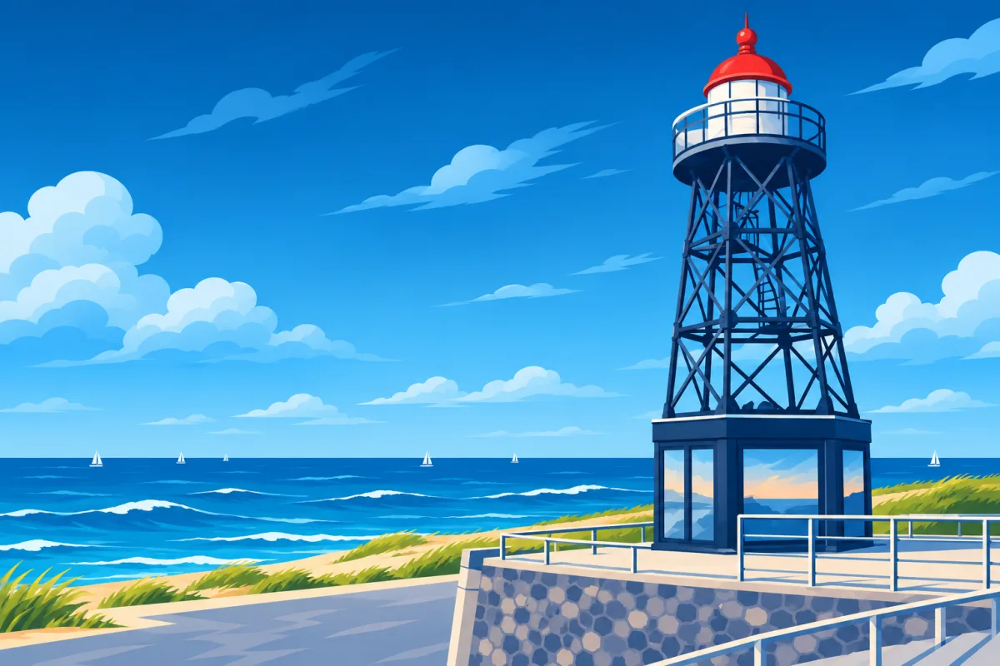
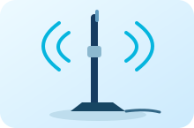
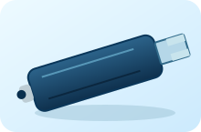
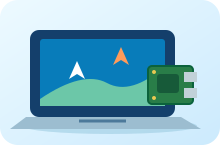
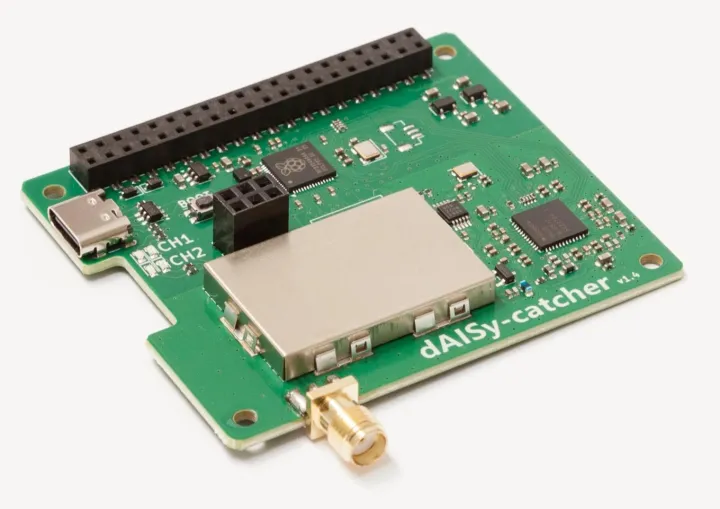
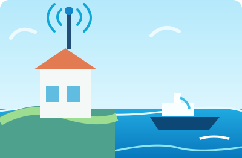
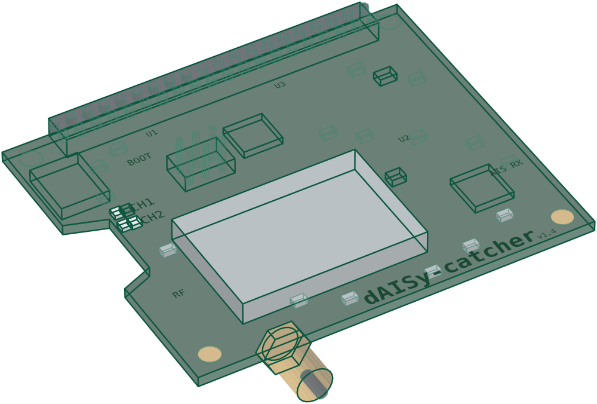

<header class="ais-hero ais-hero--tower">
  

    <h1>What you need.</h1>
    
Three parts: an antenna outside, a receiver, and a computer that runs AIS-catcher. The software is free, and you can start simple and grow the station later.

    

      <a class="ais-action ais-action--blue" href="../getting-started/overview/#install-ais-catcher">Install AIS-catcher</a>
      <a class="ais-action ais-action--soft" href="../ais-basics/">What is AIS?</a>
    

  

  

</header>

<section class="ais-panel" aria-labelledby="the-three-parts">
  
<h2 id="the-three-parts">Three parts.</h2>
The antenna connects to the receiver, and the receiver to the computer.

  

    <article class="ais-kit">
      
      <h3>A VHF antenna</h3>
      
Any antenna for marine VHF, around 162 MHz. Outside and as high as you can is best.

      
<b>€70–140</b>Glomex RA111AIS, from marine shops

    </article>
    <article class="ais-kit">
      
      <h3>A receiver</h3>
      
An RTL-SDR dongle, or a dAISy-catcher that decodes AIS on its own board. <a href="#choose-a-receiver">Which one?</a>

      
<b>$35–149</b>RTL-SDR Blog V3 or dAISy-catcher

    </article>
    <article class="ais-kit">
      
      <h3>A computer</h3>
      
A Raspberry Pi runs AIS-catcher day and night on a few watts. A PC or a Mac works too. You watch the ships in your browser.

      
<b>from $35</b>Raspberry Pi 4, with its power supply and a 32&nbsp;GB card

    </article>
  

  

    ✓
    
<strong>That is the whole station.</strong> AIS-catcher is free and open source: no subscription, and no special display.

    <a href="../getting-started/overview/">Set it up</a>
  

</section>

<section class="ais-section" aria-labelledby="choose-a-receiver">
  
<h2 id="choose-a-receiver">Which receiver?</h2>
Both work with AIS-catcher. They differ in where the radio work happens.

  

    <article class="ais-choice">
      

<h3>RTL-SDR Blog V3</h3>
A radio on a USB stick

      
AIS-catcher tunes it to AIS and decodes both channels on the computer, so its settings and decoding models are yours to try. Its TCXO keeps it on frequency as it warms up, where the cheapest sticks drift.

      <ul>
        <li>The cheapest way in</li>
        <li>The computer does the radio work</li>
        <li>Linux, Windows and macOS</li>
      </ul>
      
<b>$35–40</b><a href="https://www.rtl-sdr.com/buy-rtl-sdr-dvb-t-dongles/">RTL-SDR Blog ↗</a>

    </article>
    <article class="ais-choice">
      

<h3>dAISy-catcher</h3>
A receiver made for AIS alone

      
Developed by Wegmatt with the AIS-catcher project. It decodes both AIS channels on the board, and AIS-catcher reads the messages over its serial line.

      <ul>
        <li>No tuning and no driver</li>
        <li>Leaves the computer almost idle</li>
        <li>Over USB, or stacked on a Raspberry Pi</li>
      </ul>
      
<b>$149</b><a href="https://shop.wegmatt.com/products/daisy-catcher-high-performance-ais-receiver">Wegmatt ↗</a>

    </article>
  

  
Prices from November 2026, before shipping, tax and import duties.

</section>

<section class="ais-panel ais-place" aria-labelledby="where-the-antenna-goes">
  

    <h2 id="where-the-antenna-goes">Give your antenna a view of the water.</h2>
    
Where the antenna goes decides what you receive, more than any part you can buy. VHF travels in a line of sight: water you can see from the antenna is water you can hear.

    <ul class="ais-checks">
      <li><strong>High and outside.</strong> Every metre of height pushes the <a href="../ais-basics/#how-far-will-you-receive">radio horizon</a> further out.</li>
      <li><strong>A short cable.</strong> Coax loses signal at 162 MHz. Or put the Pi next to the antenna and run a network cable: see <a href="../ais-basics/#antenna-and-cable">antenna and cable</a>.</li>
      <li><strong>What to expect.</strong> From 5–10 m up, large ships typically come in from 25–30 km away.</li>
      <li><strong>Just trying it out?</strong> The dongle's telescopic antenna, pulled out to about 44 cm, in a window facing the water shows the first ships in a busy area.</li>
    </ul>
  

  
</section>

<section class="ais-deep" aria-labelledby="hardware-notes">
  
<h2 id="hardware-notes">Practical hardware notes.</h2>
Skip these if you are ready to install.

  

    
<svg aria-hidden="true"><use href="../assets/ais-home-icons.svg#link"></use></svg>Antenna and connectors

    

      
The Glomex RA111AIS is a 14&nbsp;cm marine antenna tuned to AIS, sold with a mounting bracket and its cable. Its cable ends in a PL-259 plug, so add an adapter to SMA for the receiver. Wegmatt sells an SMA to SO-239 adapter for it.

      
Any marine VHF antenna works too.

    

  

  

    
<svg aria-hidden="true"><use href="../assets/ais-home-icons.svg#cpu"></use></svg>The dAISy-catcher up close

    

      
Plug it in as a USB device, or stack it on a Raspberry Pi as a HAT. There is no driver to install and no filter or amplifier to try: the RF front end, the radio and the decoding sit on one board.

      

        

          

            
            <svg class="dz-lines dz-stacked" viewBox="0 0 1000 716" aria-hidden="true"><g class="dz-p" style="--i:0"><path class="dz-lead" pathLength="1" d="M526.9 630.3Q504.9 670.4 500 716"/><circle class="dz-dot" cx="526.9" cy="630.3" r="9"/></g><g class="dz-p" style="--i:1"><path class="dz-lead" pathLength="1" d="M170.3 331.4Q207 524 166.7 716"/><circle class="dz-dot" cx="170.3" cy="331.4" r="9"/></g><g class="dz-p" style="--i:2"><path class="dz-lead" pathLength="1" d="M379.7 170.1Q290.2 63.7 166.7 0"/><circle class="dz-dot" cx="379.7" cy="170.1" r="9"/></g><g class="dz-p" style="--i:3"><path class="dz-lead" pathLength="1" d="M764.7 336.3Q765.4 161.3 833.3 0"/><circle class="dz-dot" cx="764.7" cy="336.3" r="9"/></g><g class="dz-p" style="--i:4"><path class="dz-lead" pathLength="1" d="M501.5 395Q635.3 588.7 833.3 716"/><circle class="dz-dot" cx="501.5" cy="395" r="9"/></g><g class="dz-p" style="--i:5"><path class="dz-lead" pathLength="1" d="M434.3 260.6Q441.1 123.8 500 0"/><circle class="dz-dot" cx="434.3" cy="260.6" r="9"/></g></svg>
            <svg class="dz-lines dz-beside" viewBox="0 0 1000 440" aria-hidden="true"><g class="dz-p" style="--i:0"><path class="dz-lead" pathLength="1" d="M515.3 370.1Q368.8 343.7 228 392"/><circle class="dz-dot" cx="515.3" cy="370.1" r="5.5"/></g><g class="dz-p" style="--i:1"><path class="dz-lead" pathLength="1" d="M312.1 199.8Q245.9 224.6 176 214"/><circle class="dz-dot" cx="312.1" cy="199.8" r="5.5"/></g><g class="dz-p" style="--i:2"><path class="dz-lead" pathLength="1" d="M431.4 107.9Q328.2 54.4 212 58"/><circle class="dz-dot" cx="431.4" cy="107.9" r="5.5"/></g><g class="dz-p" style="--i:3"><path class="dz-lead" pathLength="1" d="M650.8 202.6Q737.5 176.5 826 196"/><circle class="dz-dot" cx="650.8" cy="202.6" r="5.5"/></g><g class="dz-p" style="--i:4"><path class="dz-lead" pathLength="1" d="M500.9 236Q623.5 337.3 780 366"/><circle class="dz-dot" cx="500.9" cy="236" r="5.5"/></g><g class="dz-p" style="--i:5"><path class="dz-lead" pathLength="1" d="M462.6 159.5Q612.5 59.9 792 46"/><circle class="dz-dot" cx="462.6" cy="159.5" r="5.5"/></g></svg>
          

          
SMA antenna connection

          
Plug-and-play USB device

          
Use as Raspberry Pi HAT

          
Highly sensitive digital radio receiver

          
RF front end tuned for AIS

          
Advanced signal processing, proven in practice

        

      

      
<strong>From the same shop:</strong> a Pi 4 case made for it ($14), a stacking kit for the Pi (from $4) and the SMA to SO-239 adapter for the Glomex cable ($5). One stacking kit, USB cable or RF adapter comes free with the receiver.

      
The setup wizard in the <a href="../getting-started/overview/">Quick Start</a> finds it.

    

  

  

    
<svg aria-hidden="true"><use href="../assets/ais-home-icons.svg#monitor"></use></svg>Already have a receiver or a computer?

    

      
<strong>Another receiver.</strong> AIS-catcher also works with AirSpy, SDRplay, HackRF and others, and with receivers on your network. See <a href="../configuration/input/overview/">inputs</a>.

      
<strong>Another computer.</strong> It runs on Linux, Windows and macOS, and in Docker. A Pi Zero 2 W is enough; a Pi 3 or newer is comfortable.

      
<strong>The internet.</strong> Only needed to install AIS-catcher and to share with the community map. Receiving and decoding run on your own machine.

    

  

</section>

<section class="ais-cta" aria-label="Next">
  
<h2>Got the three parts?</h2>
Install AIS-catcher and run the setup wizard: it finds your receiver.

  
<a class="ais-action ais-action--primary" href="../getting-started/overview/#install-ais-catcher">Install AIS-catcher</a><a href="../ais-basics/">What is AIS?</a>

</section>

